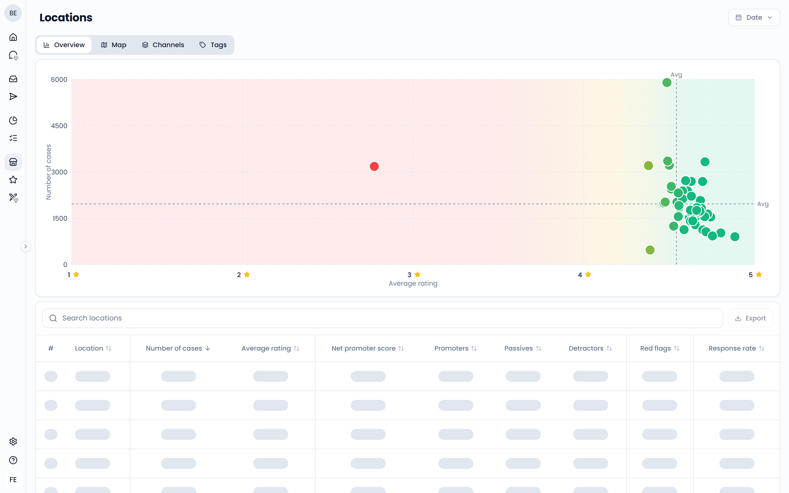
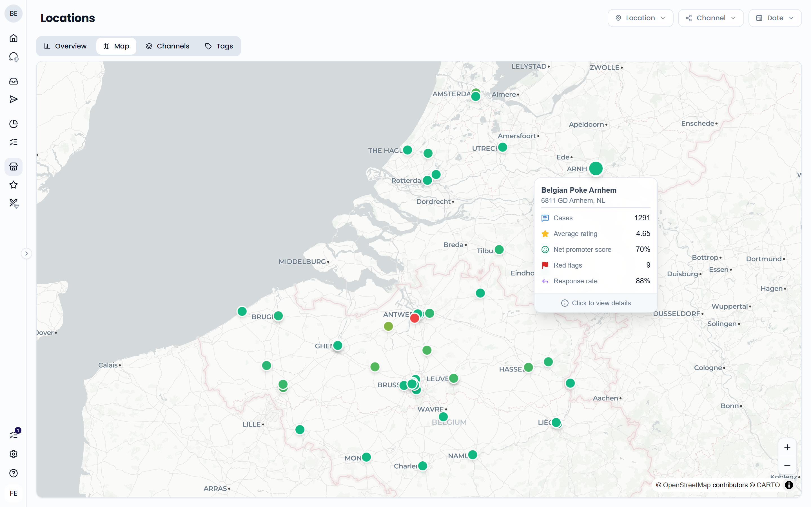
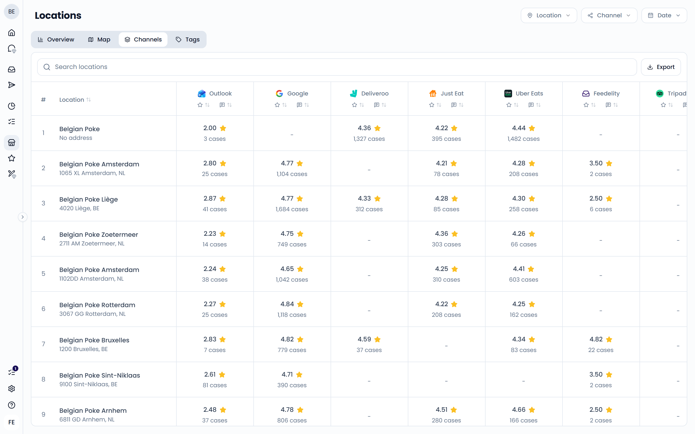
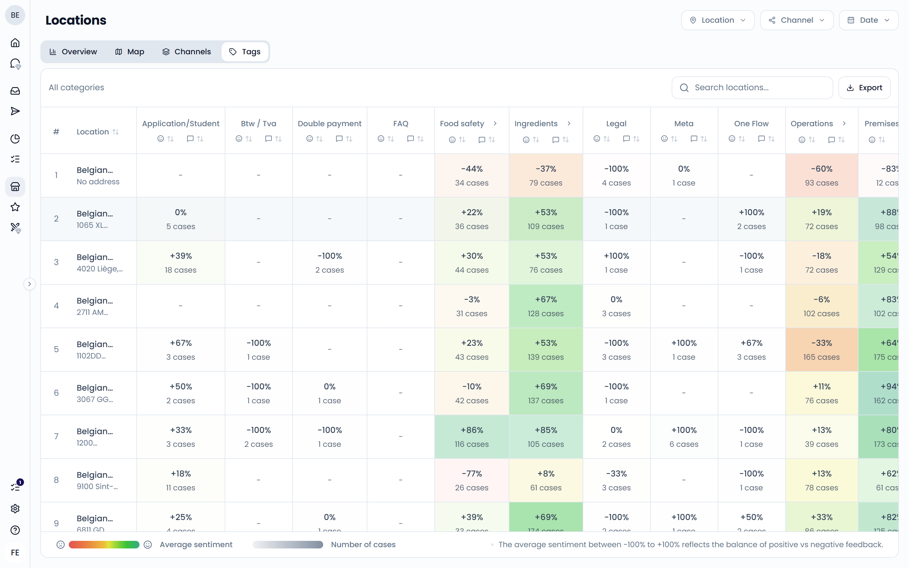

The **Locations** page compares your locations side by side. Use it to spot which restaurants do well and which need attention. Open it from **Benchmarks** > **Locations** in the sidebar.

Use the filters at the top right to choose the **Location**, **Channel**, and **Date** range. The page opens on the last 30 days by default.

The page has four tabs: **Overview**, **Map**, **Channels**, and **Tags**.

## Overview

The **Overview** tab shows a chart and a table with one row per location.

{/* SCREENSHOT: /analytics/benchmarks — Overview tab, show the scatter chart with the dashed average lines and the table below */}

The chart plots each location by its average rating (left to right) and its number of cases (bottom to top). Dashed lines mark the average across locations. This splits your locations into four groups:

- Top right: high rating and lots of feedback
- Top left: lots of feedback but a low rating. Start here.
- Bottom right: high rating but little feedback. Ask more guests for a review.
- Bottom left: low rating and little feedback

Hover over a location to see its numbers.

The table shows each location's number of cases, average rating, net promoter score, promoters, passives, detractors, red flags, and response rate. Click a column header to sort. Use **Search locations** to find a location, and **Export** to download the table.

These metrics work the same way as on the dashboard. See [Metric cards](/analytics/dashboard#metric-cards).

Click a location in the chart or the table to open the [Dashboard](/analytics/dashboard) filtered on that location.

## Map

The **Map** tab shows your locations on a map. Each dot is colored by its average rating. Hover over a dot to see the location's number of cases, average rating, net promoter score, red flags, and response rate. Click a dot to open the dashboard for that location.

Locations without a known address don't appear on the map.

{/* SCREENSHOT: /analytics/benchmarks — Map tab with a location tooltip open */}

## Channels

The **Channels** tab shows each location's average rating and number of cases per channel. Use it to see, for example, whether a location scores well on Google but poorly on Uber Eats.

Click the sort icons in a channel column to sort by average rating or by number of cases. Use **Search locations** to find a location, and **Export** to download the table.

{/* SCREENSHOT: /analytics/benchmarks — Channels tab with the location × channel table */}

## Tags

The **Tags** tab shows how each location scores on each tag. Every cell shows the average sentiment and the number of cases for that tag at that location. The average sentiment runs from -100% to +100% and reflects the balance of positive and negative mentions. See [Average sentiment](/analytics/dashboard#average-sentiment).

- Click a cell of a tag category to see the tags inside it. Use **All categories** to go back.
- Click a cell of a tag without sub-tags to open the tag details for that location only.
- Use the sort icons in a tag column to sort locations by average sentiment or by number of cases.
- Use **Search locations...** to find a location, and **Export** to download the table.

{/* SCREENSHOT: /analytics/benchmarks — Tags tab with the location × tag table and a cell hovered */}

<Tip>
  Sort a tag column to find the location with the best score on a tag. Ask that team what they do differently and share it with the other locations.
</Tip>
