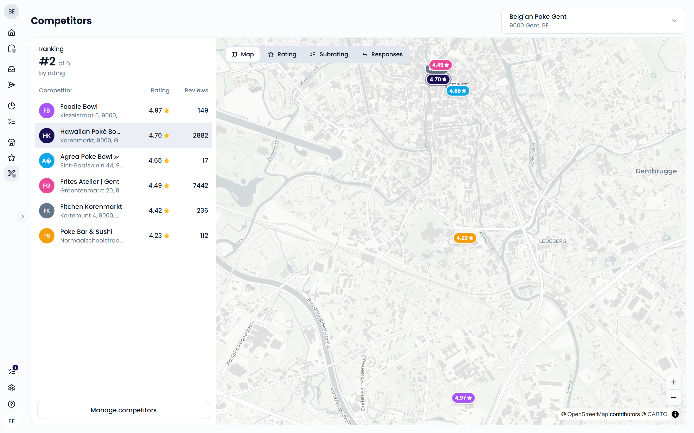
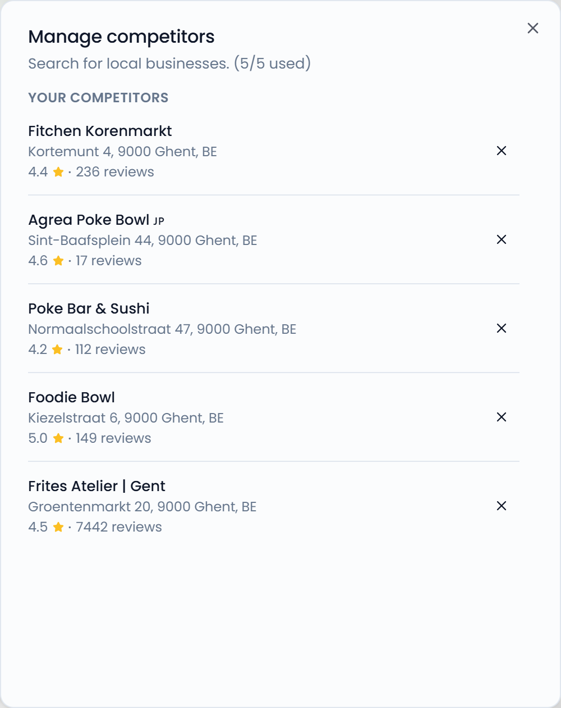
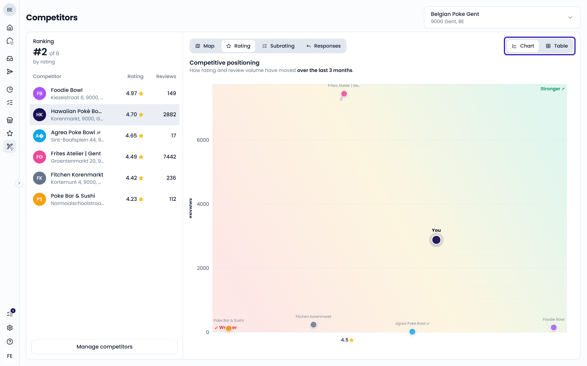
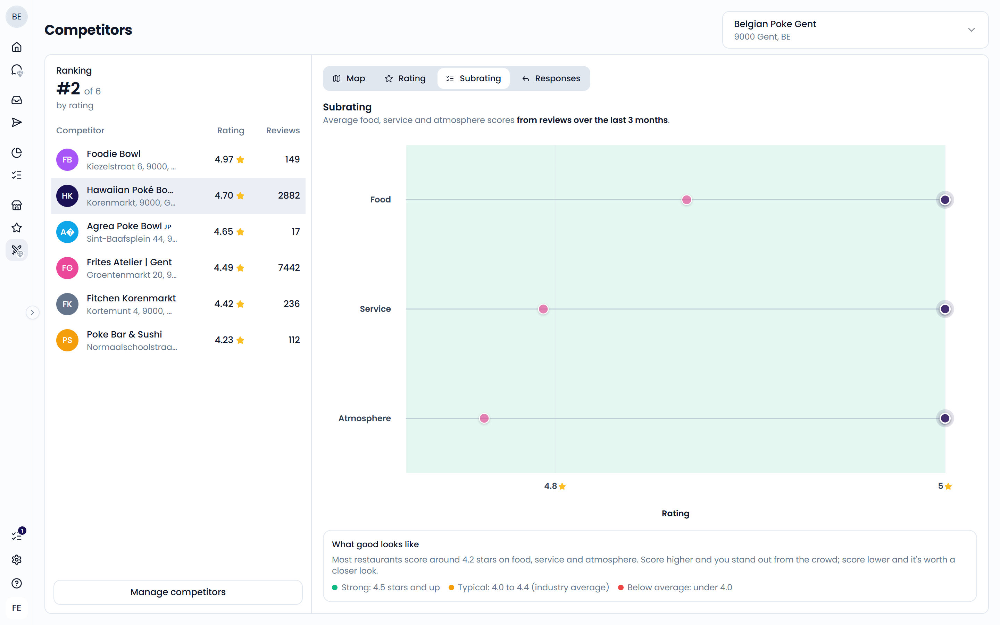
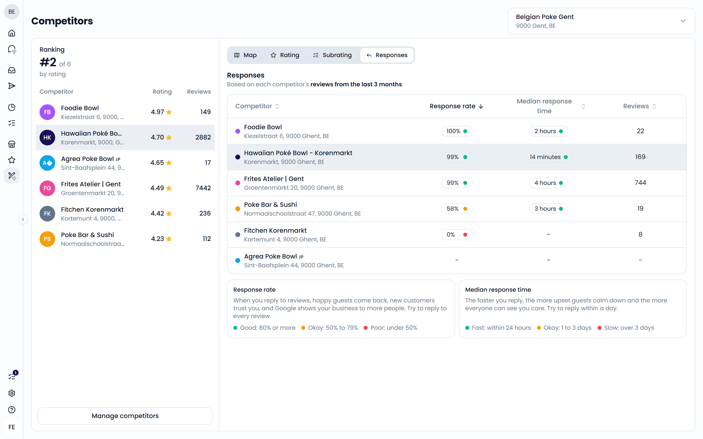

The **Competitors** page compares one of your locations with nearby businesses on Google. See how your rating, review volume, and response speed stack up against the restaurants around you. Open it from **Benchmarks** > **Competitors** in the sidebar.

<Note>
  **Competitors** is an add-on. If your plan doesn't include it, you see a lock next to **Competitors** in the sidebar, and the page isn't available. Hover over the item to learn more.

  Some existing customers get access to try it out. They see a gem icon next to **Competitors**, which marks it as part of **Feedelity Pro**.
</Note>

{/* TODO: confirm how customers add the Competitors add-on (contact sales, Settings > Billing?) and link to it here. */}

{/* SCREENSHOT: /analytics/competitors — full page with the Ranking list on the left and the Map tab on the right */}

## Before you start

Competitor benchmarking uses Google data. Your location must be connected to Google first. If it isn't, the page tells you so. An admin can connect it under **Settings** > **Integrations**. See [Google](/integrations/google).

## Pick a location

Use the location selector at the top right to choose which location to compare. You compare one location at a time.

## Add competitors

You can add up to five competitors per location.

1. Click **Add competitors** or **Manage competitors**.
2. Search for a business near your location.
3. Click a result to add it.

To remove a competitor, open **Manage competitors** again and remove it from **Your competitors**.

{/* SCREENSHOT: /analytics/competitors — Manage competitors dialog with search results and the "Your competitors" list */}
<Frame>
  
</Frame>

After you add a competitor, Feedelity collects its latest Google data. This can take a moment. Until then, you see the message "We're still gathering the latest data from some of your competitors."

## Ranking

The **Ranking** panel on the left lists your location and your competitors, sorted by Google rating. It shows your position, for example **#2 of 6**, and each business's rating and number of reviews. Your location is marked **You**. Click **Open in Google** to view a business on Google.

## Insights

The tabs on the right show four ways to compare.

### Map

**Map** shows your location and your competitors on a map.

### Rating

**Rating** shows **Competitive positioning**: how each business's rating and number of reviews changed over the last 3 months. Each line runs from 3 months ago to today. Businesses toward the top right are **Stronger**. Businesses toward the bottom left are **Weaker**.

Switch to **Table** to see the numbers: **Reviews**, **Reviews change**, **Rating**, and **Rating change**.

{/* SCREENSHOT: /analytics/competitors?tab=rating — Competitive positioning chart with the Chart/Table toggle */}

### Subrating

**Subrating** compares the average scores for **Food**, **Service**, and **Atmosphere**. They're based on Google reviews from the last 3 months. The bubble size shows the number of reviews.

As a guide, most restaurants score around 4.2 stars on each:

- **Strong**: 4.5 stars and up
- **Typical**: 4.0 to 4.4
- **Below average**: under 4.0

{/* SCREENSHOT: /analytics/competitors?tab=subrating — Subrating chart for Food, Service, and Atmosphere */}

### Responses

**Responses** shows how well each business replies to its Google reviews from the last 3 months:

- **Response rate**: the share of reviews that got a reply from the owner
- **Median response time**: the typical time between a review and the owner's reply. Half of the replies are faster, half are slower.
- **Reviews**: the number of reviews in the period

A colored dot shows how each value scores:

| | Good | Okay | Needs work |
| --- | --- | --- | --- |
| **Response rate** | 80% or more | 50% to 79% | Under 50% |
| **Median response time** | Within 24 hours | 1 to 3 days | Over 3 days |

{/* SCREENSHOT: /analytics/competitors?tab=responses — Responses table with colored dots */}

<Tip>
  Replying to reviews quickly helps unhappy guests calm down and shows new guests you care. Aim to reply to every review within a day. [AI reply agents](/automation/agents) can help you keep up.
</Tip>
