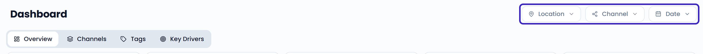
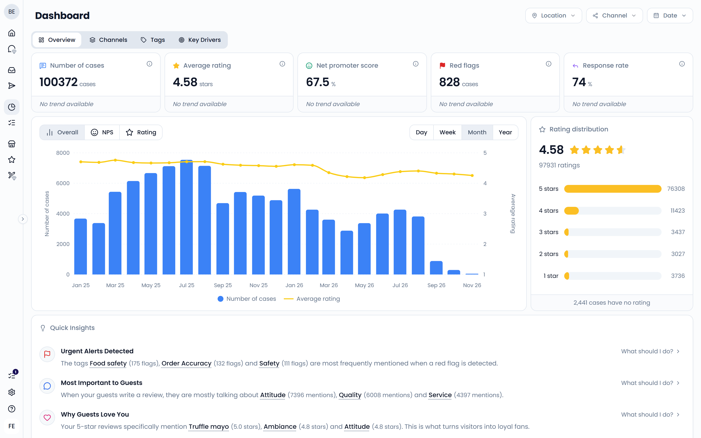
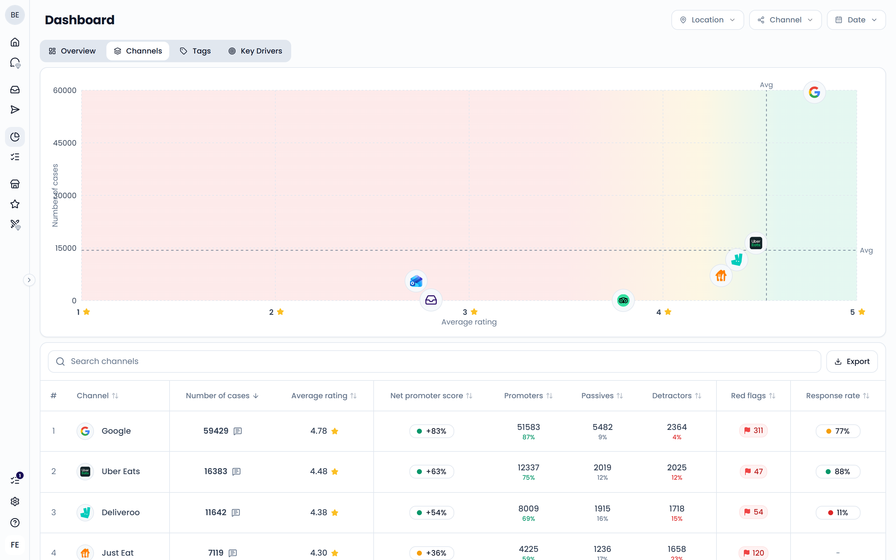
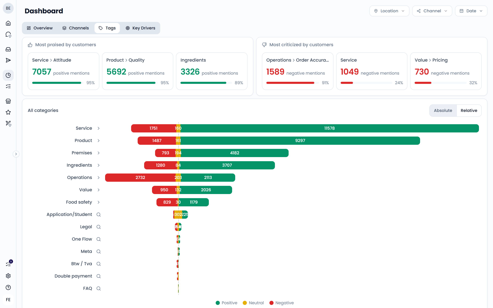
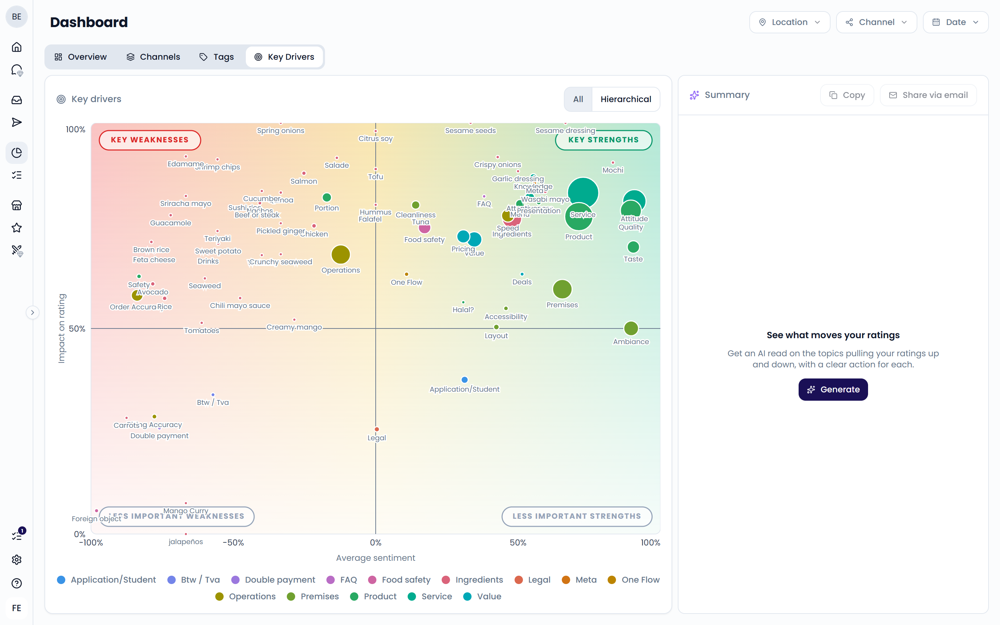
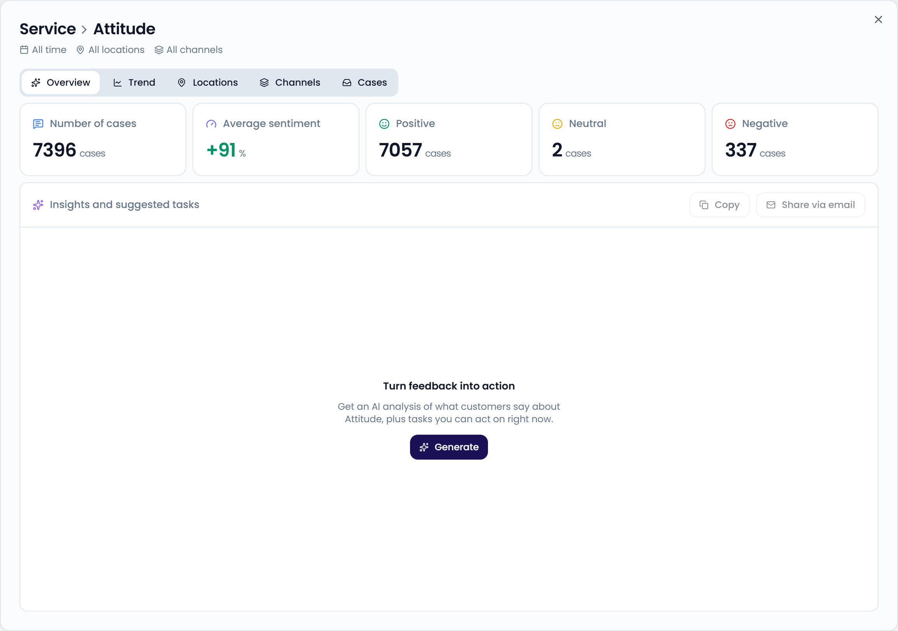

The **Dashboard** gives you a visual summary of your guest feedback. Use it to track your key metrics over time and see what guests talk about. Open it from **Reporting** > **Dashboard** in the sidebar.

{/* SCREENSHOT: /analytics/dashboard — full page on the Overview tab, highlight the location, channel, and date filters at the top right */}
<Frame>
  
</Frame>

## Filter the dashboard

Use the filters at the top right to choose which feedback the dashboard includes:

- **Location**: pick one or more locations or location groups
- **Channel**: pick one or more channels, such as Google or Uber Eats
- **Date**: pick a preset, such as **Last 30 days**, or a custom date range

The dashboard opens on the last 30 days by default. A case counts in the period when the guest's latest message falls within it. Deleted cases are never included.

The filters apply to every tab.

## Overview

The **Overview** tab shows your most important numbers at a glance.

{/* SCREENSHOT: /analytics/dashboard — Overview tab, highlight the five metric cards, the trend chart, Rating distribution, and Quick Insights */}

### Metric cards

| Card | What it shows |
| --- | --- |
| **Number of cases** | How many cases came in during the period. |
| **Average rating** | The average star rating. Only cases with a star rating count. |
| **Net promoter score** | How many guests loved their visit compared to how many had issues. See [How NPS is calculated](#how-nps-is-calculated). |
| **Red flags** | How many cases were flagged as urgent. Click the card to open these cases in the **Inbox**. |
| **Response rate** | The share of cases your team replied to, out of the cases you can reply to. |

Below each number, you see the value for the previous period of the same length. An arrow shows whether the number went up or down. For example, if you select the last 30 days, the card compares with the 30 days before that.

#### How NPS is calculated

Feedelity groups each rated case by its star rating:

- **Promoters**: 5 stars
- **Passives**: 4 stars
- **Detractors**: 1 to 3 stars

The net promoter score is the percentage of promoters minus the percentage of detractors. It ranges from -100% to +100%.

For example, take 100 rated cases: 60 with 5 stars, 25 with 4 stars, and 15 with 1 to 3 stars. Your NPS is 60% − 15% = 45%.

#### How the response rate is calculated

The response rate is the number of cases with a reply divided by the number of cases you can reply to. Cases from channels that don't support replies don't count. This excludes all Just Eat cases and Deliveroo ratings without a written comment.

### Trend chart

The trend chart shows how your feedback evolves over the selected period. Switch between three views:

- **Overall**: the number of cases and the average rating
- **NPS**: promoters, passives, and detractors, plus the net promoter score
- **Rating**: the number of cases per star rating. Choose **Absolute** for counts or **Relative** for the share of cases.

Use the interval picker to group the data by **Day**, **Week**, **Month**, or **Year**.

### Rating distribution

**Rating distribution** shows how many cases received 1, 2, 3, 4, or 5 stars. It also tells you how many cases have no rating.

### Quick Insights

**Quick Insights** turns your tags into plain-language findings, such as:

- **Urgent Alerts Detected**: the tags that appear most often on red-flagged cases. This only shows when there are red flags.
- **Most Important to Guests**: the tags mentioned most often
- **Why Guests Love You**: the tags with the highest average rating (4 stars or more), and the tags with the most positive mentions
- **Biggest Reasons for Churn**: the tags with the lowest average rating (below 3 stars), and the tags with the most negative mentions

Each insight shows up to three tags. Click **What should I do?** for a suggested next step. Click a tag to open its [details](#tag-details).

## Channels

The **Channels** tab compares the channels your guests use to leave feedback.

{/* SCREENSHOT: /analytics/dashboard — Channels tab, show the scatter chart and the table below it */}

- The chart plots each channel by its average rating and its number of cases. Dashed lines show the average across channels.
- The table lists each channel with its number of cases, average rating, net promoter score, promoters, passives, detractors, red flags, and response rate.

Click a column header to sort the table. Click **Export** to download it.

## Tags

The **Tags** tab shows the topics guests mention and how they feel about them. Each mention of a tag on a case is positive, neutral, or negative. To learn how tags work, see [Tags, sentiment, and priority](/inbox/tags-sentiment-priority).

{/* SCREENSHOT: /analytics/dashboard — Tags tab, show "Most praised by customers", "Most criticized by customers", and "Sentiment by topic" */}

The tab contains:

- **Most praised by customers** and **Most criticized by customers**: the three tags with the most positive and the most negative mentions
- **Sentiment by topic**: a bar per tag, split into negative, neutral, and positive mentions. Choose **Absolute** for counts or **Relative** for percentages.
- A table with the number of cases, the average sentiment, and the positive, neutral, and negative mentions per tag. Choose **All** for a flat list or **Hierarchical** to group tags by category. Click **Export** to download it.

In **Sentiment by topic**, click a category to see the tags inside it. Use the breadcrumbs at the top to go back. Click a tag without sub-tags to open its details.

### Average sentiment

The average sentiment summarizes how positive the mentions of a tag are. It ranges from -100% to +100%:

- +100% means every mention is positive
- 0% means positive and negative mentions balance out, or all mentions are neutral
- -100% means every mention is negative

Feedelity scores each positive mention as +1, each neutral mention as 0, and each negative mention as -1. The average of those scores is the average sentiment.

## Key Drivers

The **Key Drivers** tab shows which tags have the biggest effect on your star rating. It helps you decide what to fix first and what to keep doing.

{/* SCREENSHOT: /analytics/dashboard — Key Drivers tab, show the chart with its four quadrants and the Summary panel on the right after clicking Generate */}

Each bubble is a tag. Its position shows its average sentiment and its impact on rating. Its size shows how many cases mention it. To learn how to read the chart and how impact is calculated, see [Impact on rating](/analytics/impact-on-rating).

In the **Summary** panel, click **Generate** to get an AI read on the tags that pull your rating up and down, with an action for each. Use **Copy** or **Share via email** to pass it on.

## Tag details

Click a tag anywhere on the dashboard to open its details. The top shows the number of cases, the average sentiment, and the number of positive, neutral, and negative mentions. The details window has five tabs:

- **Overview**: click **Generate** to get an AI analysis of what guests say about the tag, plus suggested tasks
- **Trend**: the tag's sentiment over time
- **Locations**: the tag's sentiment per location
- **Channels**: the tag's sentiment per channel
- **Cases**: the cases that mention the tag

{/* SCREENSHOT: /analytics/dashboard — tag details window opened from a tag, Overview tab with a generated AI analysis */}
<Frame>
  
</Frame>

## Next steps

<CardGroup cols={2}>
  <Card title="Impact on rating" icon="target" href="/analytics/impact-on-rating">See which topics raise or lower your rating.</Card>
  <Card title="Benchmarks" icon="store" href="/analytics/benchmarks">Compare your locations.</Card>
</CardGroup>
