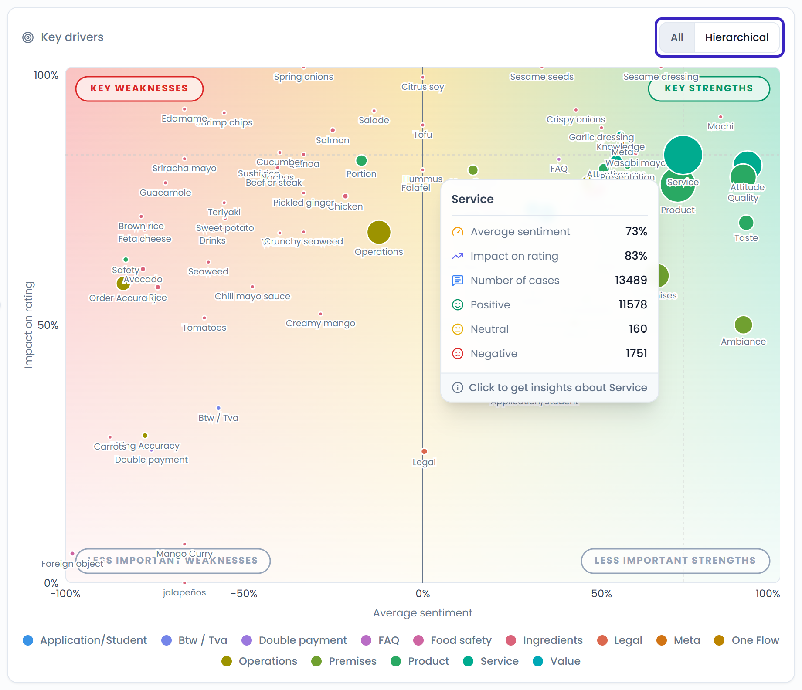
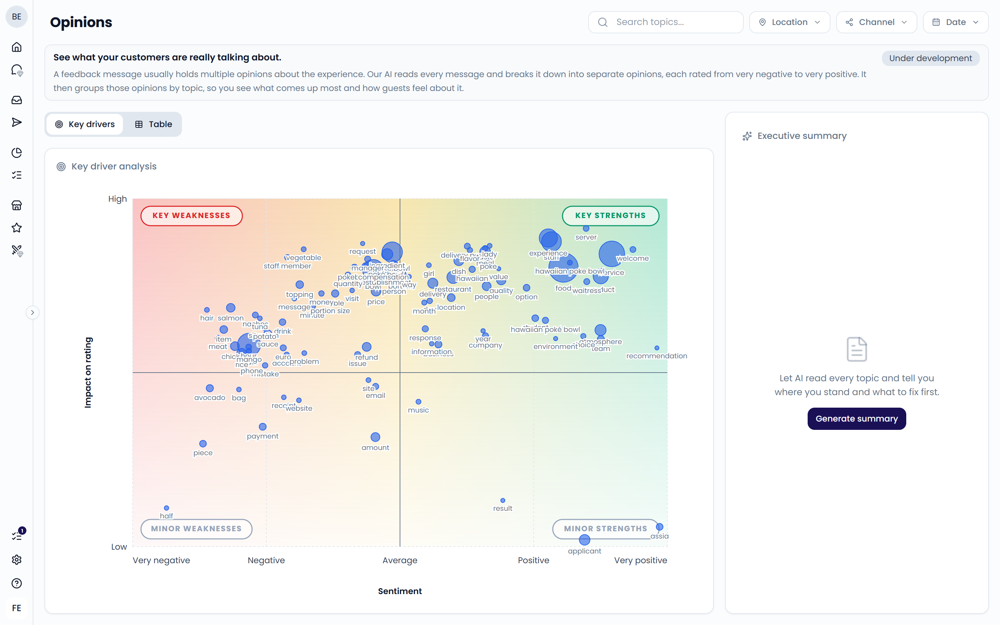

Some topics matter more to your star rating than others. A slow delivery might pull ratings down a lot, while a comment about the music barely moves them. **Impact on rating** shows you which topics drive your ratings, so you know what to fix first.

You find impact on rating in two places:

- The **Key Drivers** tab of the [Dashboard](/analytics/dashboard#key-drivers), based on your tags
- The **Key drivers** tab of [Opinions](/analytics/opinions), based on the topics guests mention

{/* TODO: Opinions is no longer in the sidebar on main. If it stays hidden, drop the "In Opinions" section below. */}

## How impact is calculated

Impact measures how closely the sentiment about a topic moves together with the star rating. Feedelity calculates the correlation between the two:

1. For every mention of the topic, Feedelity takes its sentiment and the star rating of the feedback.
2. It checks how strongly those two values move together across all mentions in your filters.
3. It shows the strength of that link as a percentage from 0% to 100%.

A high impact means that when guests are positive about the topic, they give high ratings. When they are negative, they give low ratings. A low impact means the rating doesn't depend much on how guests feel about that topic.

Only feedback with a star rating counts toward impact. Feedback without a rating, such as most emails, still counts toward sentiment and volume.

<Note>
  Impact shows a link, not proof of cause. A topic with few mentions can show a high or low impact by chance. Look at the bubble size before you act on it.
</Note>

## Read the chart

Each bubble is a topic.

- **Left to right**: the average sentiment, from negative to positive
- **Bottom to top**: the impact on rating, from low to high
- **Bubble size**: how often guests mention the topic

The chart has four areas:

| Area | Meaning | What to do |
| --- | --- | --- |
| **Key weaknesses** (top left) | Guests are negative, and it strongly affects the rating | Fix these first |
| **Key strengths** (top right) | Guests are positive, and it strongly affects the rating | Protect and repeat these |
| Minor weaknesses (bottom left) | Guests are negative, but it barely affects the rating | Improve when you have time |
| Minor strengths (bottom right) | Guests are positive, but it barely affects the rating | Nice to have |

The top and bottom areas are split at 50% impact. The left and right areas are split at neutral sentiment.

Hover over a bubble to see its numbers. Click it to open the details for that topic.

## On the dashboard

The **Key Drivers** tab on the dashboard plots your tags. Sentiment runs from -100% to +100%, and impact from 0% to 100%. The bubble size is the number of cases with the tag. The two lower areas are called **Less important weaknesses** and **Less important strengths**.

{/* SCREENSHOT: /analytics/dashboard — Key Drivers tab with the All/Hierarchical toggle highlighted and a bubble tooltip open */}
<Frame>
  
</Frame>

Choose how to show your tags:

- **All**: every tag on one chart
- **Hierarchical**: start with your tag categories. Click a category to see the tags inside it. Use **All categories** to go back.

In the hierarchical view, a category's impact is the average impact of its tags, weighted by their number of cases.

To get a written summary, click **Generate** in the **Summary** panel. AI lists the tags that pull your rating up and down, labeled **Strength** or **Weakness**, with an action for each.

## In Opinions

The **Key drivers** tab in **Opinions** plots the topics guests mention, such as "fries" or "staff". Sentiment runs from **Very negative** to **Very positive**. Impact runs from **Low** to **High**. The bubble size is the number of opinions about the topic.

{/* SCREENSHOT: /analytics/opinions — Key drivers tab with the four quadrants and the Executive summary panel on the right */}

On a large screen, the **Executive summary** panel sits next to the chart. Click **Generate summary** to let AI read every topic and tell you where you stand and what to fix first.

To learn more about opinions and topics, see [Opinions](/analytics/opinions).
