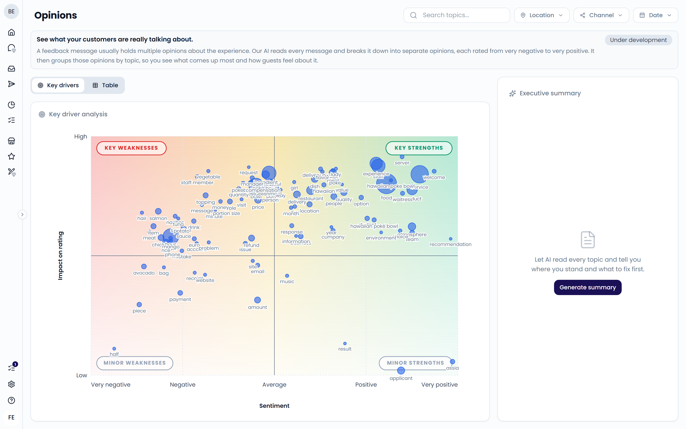
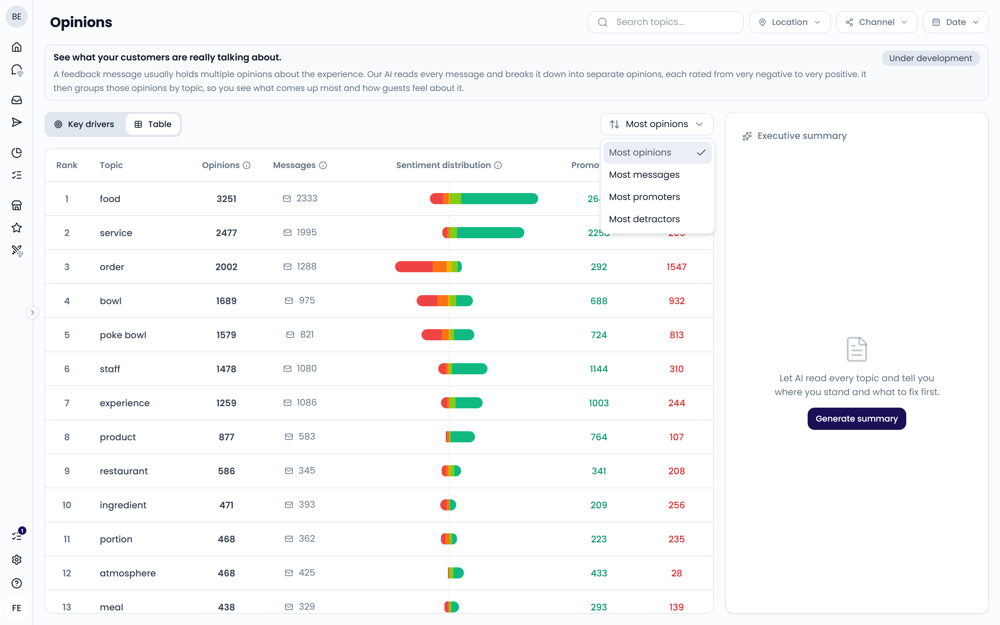
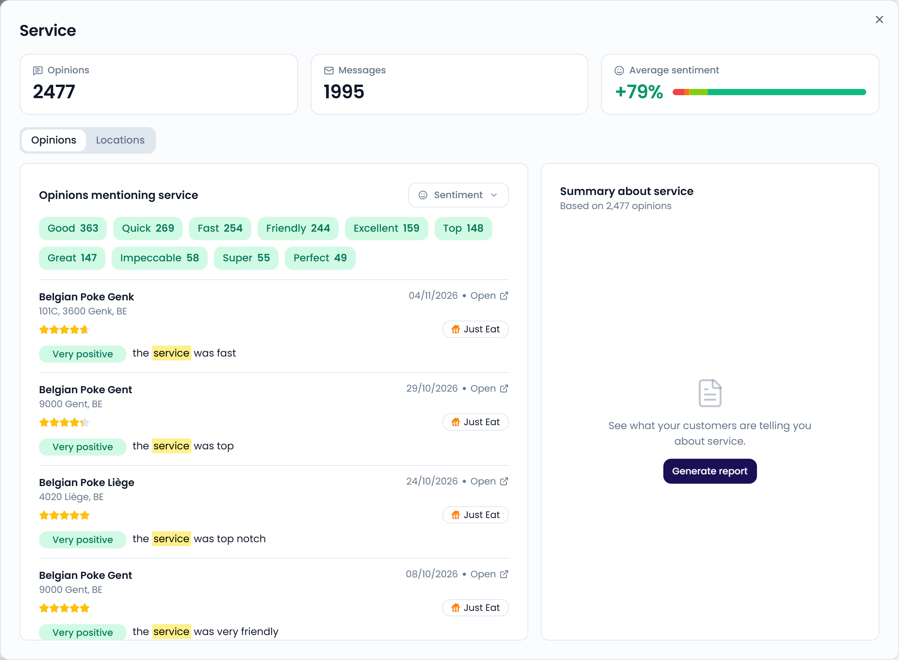

A single review often holds several opinions. "The burger was great, but the fries were cold and the staff was slow" contains three. **Opinions** splits every piece of feedback into these separate opinions and groups them by topic. You see what guests talk about most and how they feel about it.

{/* TODO: Opinions was removed from the sidebar on main; the page is only reachable at /analytics/opinions. Confirm how customers reach it, or unpublish this page. */}

<Note>
  **Opinions** is still under development. You see an **Under development** badge at the top of the page.
</Note>

{/* SCREENSHOT: /analytics/opinions — full page on the Key drivers tab, with the filters and the Executive summary panel visible */}

## How opinions work

Feedelity's AI reads every incoming guest message and:

1. Splits it into opinions. Each opinion is one short statement about one thing, such as "the fries were cold".
2. Rates each opinion on a five-point scale: very negative, negative, average, positive, or very positive.
3. Picks out the **topic** of each opinion, such as "fries" or "staff". These are the things guests talk about.
4. Picks out **what people say** about the topic, such as "cold" or "friendly". These are the descriptive words.

Questions, greetings, and plain facts without a judgment don't become opinions. Your own replies are never analyzed.

## Filter the page

Use the filters at the top right:

- **Search topics...**: find a specific topic
- **Location**: pick locations or location groups
- **Channel**: pick one or more channels
- **Date**: pick the period. The page opens on the last 30 days by default.

## Key drivers

The **Key drivers** tab plots each topic by its average sentiment and its impact on your star rating. Use it to see which topics help or hurt your rating most. To learn how to read the chart, see [Impact on rating](/analytics/impact-on-rating).

## Table

The **Table** tab lists your topics with these columns:

| Column | What it means |
| --- | --- |
| **Rank** | The topic's position in the current sort order |
| **Topic** | What guests talk about |
| **Opinions** | How many opinions mention this topic |
| **Messages** | How many guest messages mention this topic. One message can hold several opinions about the same topic, so this can be lower than **Opinions**. |
| **Sentiment distribution** | A bar that splits the opinions from negative (left) to positive (right) |
| **Promoters** | Opinions that are positive or very positive |
| **Detractors** | Opinions that are negative or very negative |

Use the sort menu to order the list by **Most opinions**, **Most messages**, **Most promoters**, or **Most detractors**. The page shows up to 100 topics.

{/* SCREENSHOT: /analytics/opinions — Table tab with the sort menu open */}

### Average sentiment

The average sentiment shows how guests feel about a topic overall, from -100% to +100%. Feedelity scores each opinion from -2 (very negative) to +2 (very positive). It takes the average and converts it to a percentage.

For example, two very positive opinions (+2) and one negative opinion (-1) average to +1. That shows as +50%.

## Executive summary

On a large screen, the **Executive summary** panel sits on the right. Click **Generate summary** to let AI read every topic in your filters. It tells you where you stand and what to fix first. Use **Send via email** to share the result.

## Topic details

Click a topic in the chart or the table to open its details. The top shows the number of **Opinions**, **Messages**, and the **Average sentiment**.

{/* SCREENSHOT: /analytics/opinions — topic details window, Opinions tab with "What people say" chips, the message list, and the summary card */}
<Frame>
  
</Frame>

### Opinions tab

- **What people say**: the words guests use about the topic, such as "crispy" or "cold". Click one to show only the messages that use it. Click **Clear** to remove it.
- **Sentiment**: show only opinions with certain sentiments, such as very negative.
- **Messages**: the guest messages behind the opinions, with their location. Click **Open** to view the case in the **Inbox**.
- **Summary about** the topic: click **Generate report** for an AI summary of what guests say. Use **Send via email** to share it.

### Locations tab

The **Locations** tab ranks your locations by their average sentiment about the topic. It shows the **Top performers** and the locations that **Need attention**. Locations with fewer than three mentions of the topic are left out, so a single opinion can't top or bottom the ranking.

Use it to find which locations do well on a topic. Then share what works with the others.

## Opinions or tags?

Both help you understand feedback, but they work differently:

- **Tags** come from your own tag list. You choose them in [Tags](/settings/tags). They power the [Dashboard](/analytics/dashboard).
- **Opinions** come straight from the guest's words. You don't need to set anything up, and you can find topics you never thought to tag.
