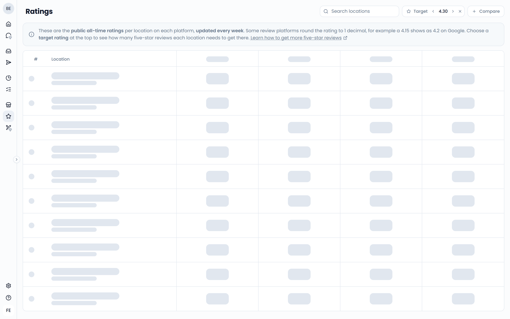
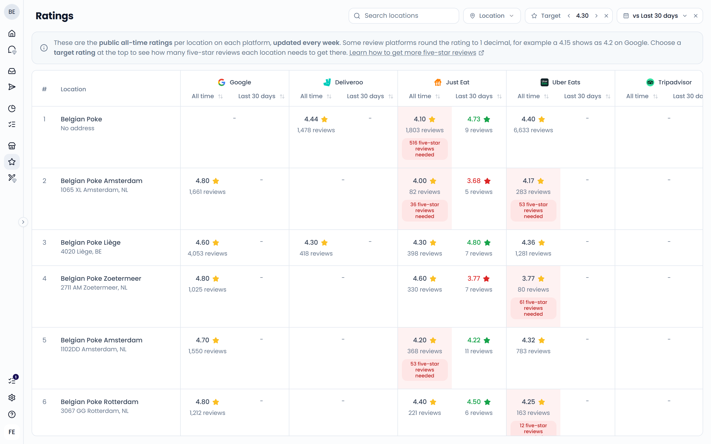

The **Ratings** page shows the public rating of every location on each review platform. These are the scores guests see online. Open it from **Benchmarks** > **Ratings** in the sidebar.

{/* SCREENSHOT: /analytics/ratings — full page with the Target control set and a few red "five-star reviews needed" badges visible */}

## What you see on this page

The page has one row per location and one column per platform, such as Google or Uber Eats. Each cell shows:

- The location's all-time rating on that platform
- The total number of reviews
- How many five-star reviews it still needs to reach your target, when it's below the target

Hover over a cell to see when the rating was last updated. Click a cell to open the location's page on that platform.

Use **Search locations** or the **Location** filter to narrow the list. Click the sort icon in a platform column to sort by rating.

## Where the ratings come from

The ratings come directly from the platforms. Feedelity doesn't calculate them. They update every week.

Some platforms round their rating to one decimal. For example, Google shows a 4.15 as 4.2. Feedelity shows the rating with two decimals, so you can see progress before the rounded public score moves. New 5-star reviews always push the average up, even when the public score hasn't changed yet.

## Set a target rating

Use **Target** at the top to set the rating you want to reach. It starts at 4.30.

- Click the arrows to change the target in steps of 0.05.
- Or type a value between 1 and 5.
- Click the **×** to hide the target. Click **Target** to show it again.

Cells below the target turn red and show how many five-star reviews the location needs.

The target only changes your own view. It resets when you reload the page.

<Tip>
  Pick a realistic target slightly above your current average, for example from 4.3 to 4.5. Targets very close to 5 need a disproportionate number of new reviews and can feel demotivating for teams.
</Tip>

### How the number of reviews needed is calculated

The number of five-star reviews needed is based on three values: the current number of reviews (n), the current rating (r), and the target rating. The formula is:

**x = n × (target − r) / (5 − target)**

Feedelity rounds the result up to a whole review.

For example, a location has 200 reviews with a 4.1 rating, and your target is 4.3. It needs 200 × 0.2 / 0.7 = 57.1, so **58** five-star reviews.

The more reviews a location already has, the more new five-star reviews it needs to move the average. A review of 4 stars or lower increases the number, because it pulls the average down.

## Compare with a period

Use **Compare** to see how a location's recent reviews score compared to its all-time rating. Pick a period, such as **Last 30 days**, or a custom date range.

Each cell then gets a second value: the average rating of the reviews Feedelity received in that period, and how many there were. The color shows the trend:

- **Green**: recent reviews score higher than the all-time rating, so the rating is going up
- **Red**: recent reviews score lower, so the rating is going down
- **Gray**: they're the same

Click the **×** next to the period to remove the comparison.

{/* SCREENSHOT: /analytics/ratings — Compare set to "Last 30 days", showing the second value per cell in green and red */}

<Tip>
  The public score can take a long time to move. Use **Compare** to show your teams the progress they make each month, even when the public score hasn't ticked up yet.
</Tip>
