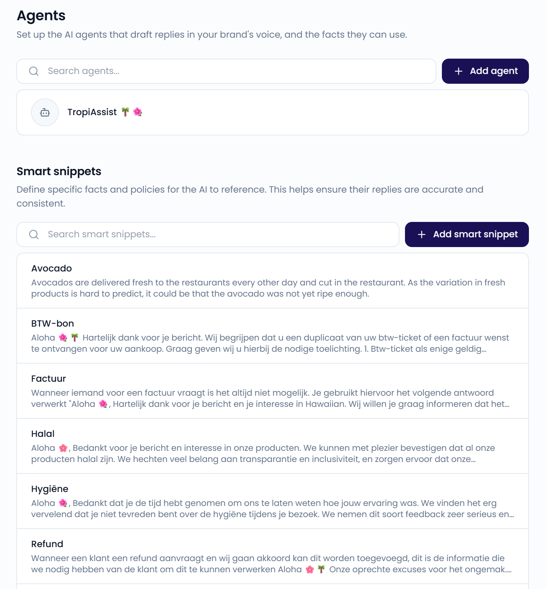
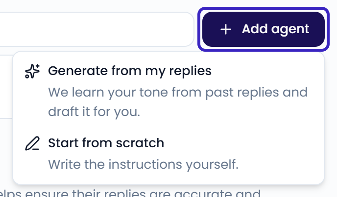
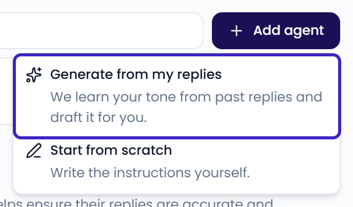
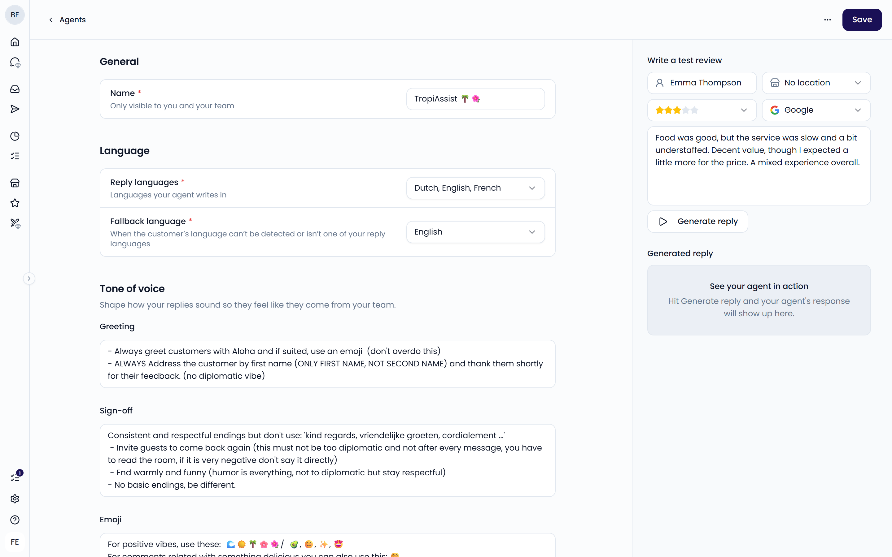
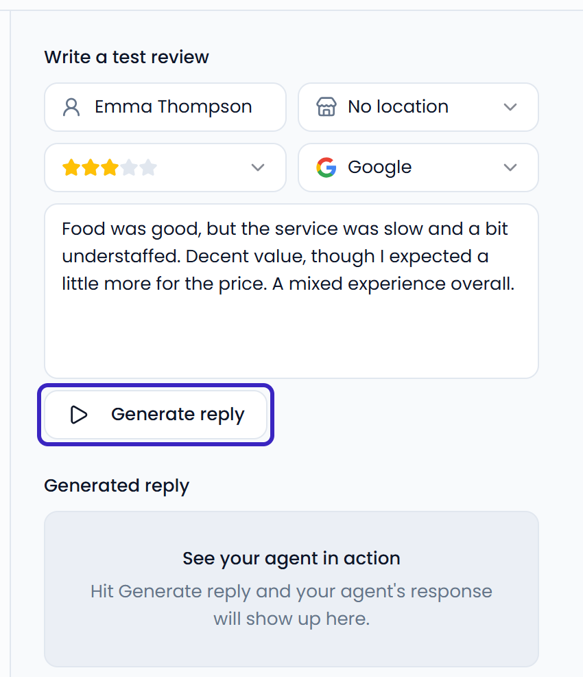
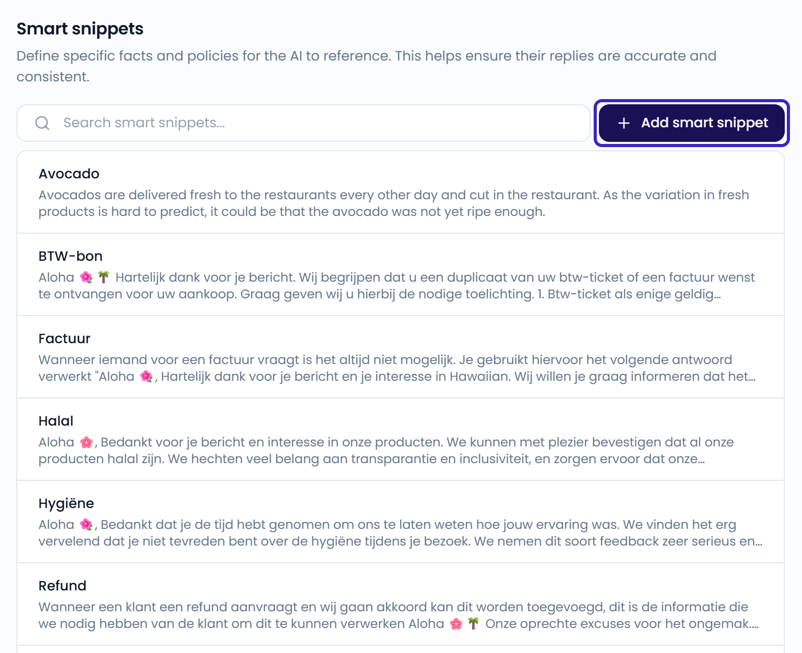
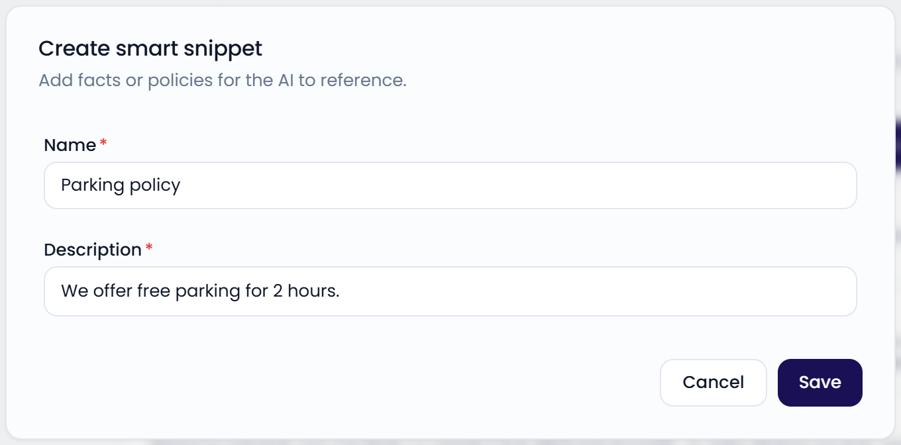

An AI reply agent drafts replies in your brand's voice. Your team reviews each draft before sending it. Go to **Settings** > **Agents** to open the page.

{/* SCREENSHOT: /settings/agents — agents list and the Smart snippets section */}
<Frame>
  
</Frame>

To use an agent, click **Generate** in the reply box of a case. See [Reply to customers](/inbox/replying).

## Create an agent

Click **Add agent** and choose how to start:

- **Generate from my replies**: Feedelity learns your tone from past replies and drafts the agent for you.
- **Start from scratch**: You write the instructions yourself.

{/* SCREENSHOT: /settings/agents — Add agent menu open with Generate from my replies and Start from scratch */}
<Frame>
  
</Frame>

### Generate from my replies

Feedelity reads up to 100 recent cases where your team replied to a guest. It uses them to fill in the agent's tone of voice settings. The new agent opens as **Untitled Agent**. Review the settings, give it a name, and click **Save**.

<Note>
  You need at least five cases with a reply from your team. If there isn't enough reply history yet, Feedelity opens an empty agent so you can set it up manually.
</Note>

<Frame>
  
</Frame>

## Agent settings

Click an agent to open its settings. Click **Save** when you're done.

{/* SCREENSHOT: /settings/agents/<agent_id> — agent editor with General, Language, Tone of voice, and Other sections, and the test panel on the right */}

### General

- **Name**: Only visible to you and your team. You pick the agent by name when you generate a reply.

### Language

- **Reply languages**: The languages your agent writes in. Choose **All languages** or select specific ones.
- **Fallback language**: The language the agent uses when it can't detect the guest's language, or when that language isn't one of your reply languages.

### Tone of voice

Shape how your replies sound, so they feel like they come from your team.

- **Greeting**: How the reply opens. For example: "Always greet the customer by their first name."
- **Sign-off**: How the reply closes. For example: "Close with 'Best regards, the team'."
- **Emoji**: Which emojis to use, and when. For example: "Use 😍 🌴 🥐 on positive reviews; none on complaints."

### Other

- **Contact**: Contact details the agent can share with guests, such as your support email address.
- **Custom instructions**: Extra guidelines the agent always follows. For example: "Never promise refunds; keep replies under 3 sentences."

### Instructions with conditions

Some agents show an **Instructions** section instead of **Tone of voice** and **Other**. Each instruction has a **Name** and an **Instruction** that tells the agent what to do.

Click **Add condition** to use an instruction only for some replies. You can filter on:

- **Channel**
- **Rating**
- **Location**
- **Language**
- **Message**: whether the review has text or not

All conditions must match. An instruction without conditions applies to every reply.

Open **What your agent knows about each message** to see what the agent receives with every message. This includes the guest's name, the location name, email, and phone number, the channel, the message text, and the rating. You can refer to these in your instructions, for example "share the location phone number for complaints".

{/* TODO: confirm how a customer gets the Instructions section. The editor only shows it for agents that already have instructions; there's no button to switch an agent over. */}
{/* SCREENSHOT: /settings/agents/<agent_id> — Instructions section with one instruction and a Rating condition */}

### Delete an agent

Open the agent, click the **...** menu, and select **Delete agent**. Replies it already drafted aren't affected.

## Test an agent

The panel on the right of the agent settings lets you try the agent before you use it on real guests.

<Steps>
  <Step title="Write a test review">
    Under **Write a test review**, fill in a customer name, location, rating, channel, and a sample customer message.
  </Step>
  <Step title="Generate a reply">
    Click **Generate reply**. The draft appears under **Generated reply**.
  </Step>
</Steps>

The test uses your current settings, including changes you haven't saved yet.

<Frame>
  
</Frame>

## Smart snippets

Smart snippets are facts and policies your AI reply agents can use when they draft replies. The agent only includes a snippet when it's relevant to the guest's feedback. Snippets keep replies accurate and consistent.

For example, you don't take reservations, and a guest complains they couldn't book a table. A smart snippet provides the correct information. The reply might say: *"We don't take reservations. We work on a first-come, first-served basis."*

<Frame>
  
</Frame>

To create a smart snippet:

1. On the **Agents** page, click **Add smart snippet**.
2. Enter a **Name**, for example "Parking policy".
3. Under **Description**, write the facts, for example "We offer free parking for 2 hours".
4. Click **Save**.

To edit or delete a snippet, click it. In the dialog, click **Save** or **Delete**.

<Frame>
  
</Frame>

You can also add a snippet to a draft yourself. In the reply box, click **Improve** and choose **Use Smart Snippet**.
