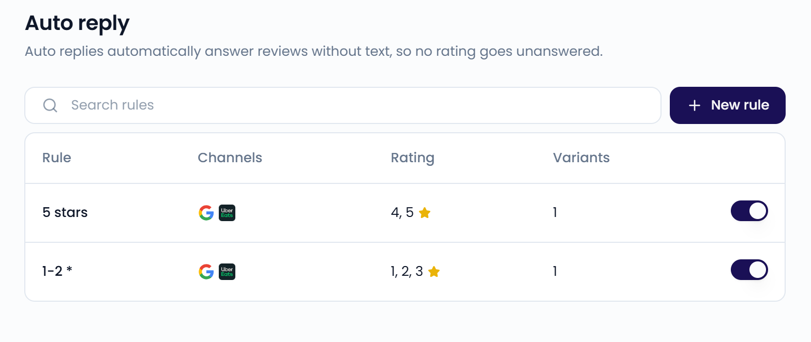
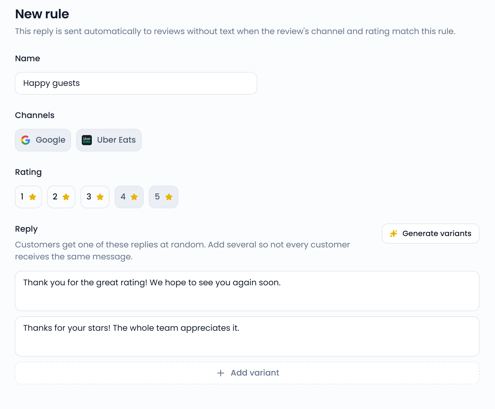
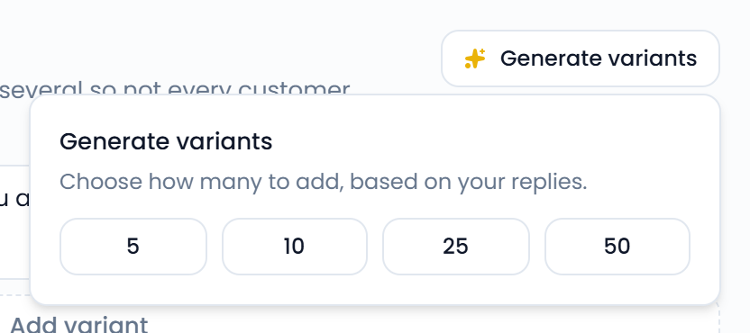

Auto reply answers reviews without text, so no star rating goes unanswered. You set up **rules**. Each rule decides which reviews get an automatic reply and what that reply says.

Go to **Settings** > **Auto reply** to open the page.

{/* SCREENSHOT: /settings/autoreply — rules table with Rule, Channels, Rating, and Variants columns and the toggles on the right */}
<Frame>
  
</Frame>

<Note>
  Auto reply only answers reviews without text (a star rating only). To reply to reviews with a written comment, use the [inbox](/inbox/replying).
</Note>

## Create a rule

<Steps>
  <Step title="Start a new rule">
    Go to **Settings** > **Auto reply** and click **New rule**.
  </Step>
  <Step title="Name the rule">
    Enter a **Name**, for example "Happy guests".
  </Step>
  <Step title="Choose the channels">
    Under **Channels**, select **Google**, **Uber Eats**, or both.
  </Step>
  <Step title="Choose the ratings">
    Under **Rating**, select the star ratings (1 to 5) the rule applies to.
  </Step>
  <Step title="Write the replies">
    Under **Reply**, write your reply. Click **Add variant** to add more replies.
  </Step>
  <Step title="Save the rule">
    Click **Save**. Check the summary in the **Start replying automatically?** dialog and click **Confirm**.
  </Step>
</Steps>

{/* SCREENSHOT: /settings/autoreply/new — rule form with Name, Channels, Rating, and Reply variants filled in */}
<Frame>
  
</Frame>

A review gets an automatic reply when its channel and rating match the rule.

## Add reply variants

Each matching review gets one of your replies, picked at random. Add several variants so not every guest receives the same message.

To let AI write variants for you:

1. Select at least one channel and one rating, and write at least one reply.
2. Click **Generate variants**.
3. Choose how many to add: **5**, **10**, **25**, or **50**.

The new variants are based on your replies. Review them before you click **Save**.

{/* SCREENSHOT: /settings/autoreply/new — Generate variants popover with the 5, 10, 25, 50 options */}
<Frame>
  
</Frame>

## What to know before you turn on a rule

When you save an active rule or switch one on, Feedelity asks you to confirm. Keep these points in mind:

- Only new reviews get a reply. Reviews already in your inbox are left alone.
- The reply is posted publicly right away, without anyone checking it first.

## Manage rules

- To edit a rule, click it in the list. Make your changes and click **Save**.
- To pause or restart a rule, use the toggle on the right of the list.
- To delete a rule, open it, click the **...** menu, and select **Delete rule**. Reviews that match it no longer get an automatic reply.
