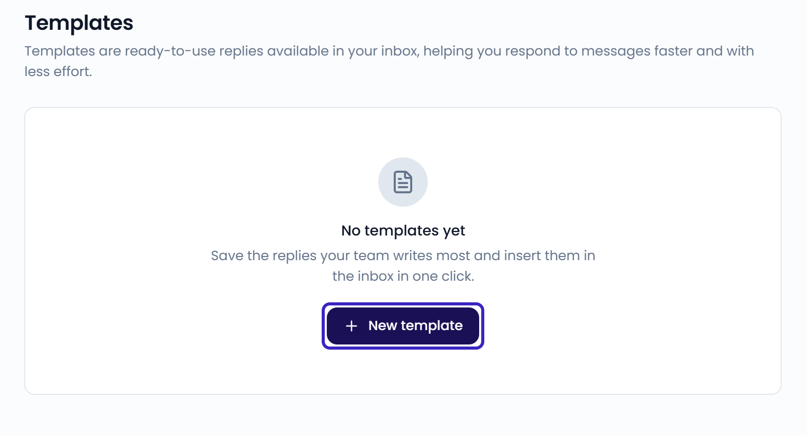
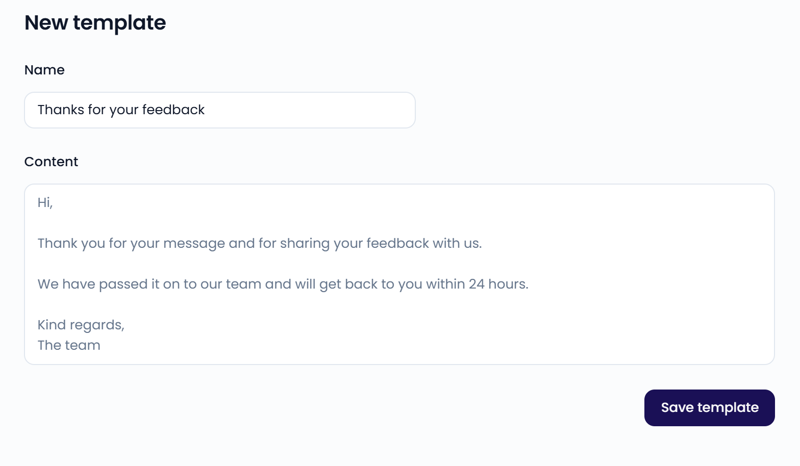

**Templates** are ready-to-use replies. Save the replies your team writes most, then insert them in the inbox in one click. Go to **Settings** > **Templates** to open the page.

{/* SCREENSHOT: /settings/templates — template list with search and the New template button */}
<Frame>
  
</Frame>

<Tip>
  To reply automatically to reviews without text, use [auto reply](/automation/auto-reply) instead.
</Tip>

## Create a template

<Steps>
  <Step title="Start a new template">
    Go to **Settings** > **Templates** and click **New template**.
  </Step>
  <Step title="Name the template">
    Enter a **Name** your team recognizes, for example "Thanks for your feedback".
  </Step>
  <Step title="Write the content">
    Under **Content**, write the reply text.
  </Step>
  <Step title="Save">
    Click **Save template**.
  </Step>
</Steps>

{/* SCREENSHOT: /settings/templates/new — template form with Name and Content filled in */}
<Frame>
  
</Frame>

## Use a template in the inbox

Open a case and click **Templates** in the reply toolbar. Choose a template to insert its text into the reply box. You can edit the text before you send it. See [Reply to customers](/inbox/replying).

## Manage templates

- To find a template, search by name or content.
- To edit a template, click it. Make your changes and click **Save template**.
- To delete a template, open it, click the **...** menu, and select **Delete template**. It's no longer available in the inbox.
