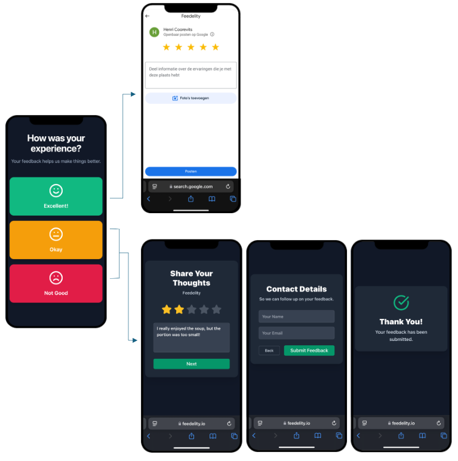
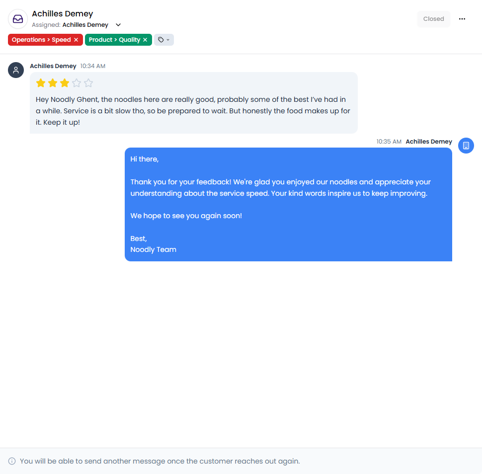
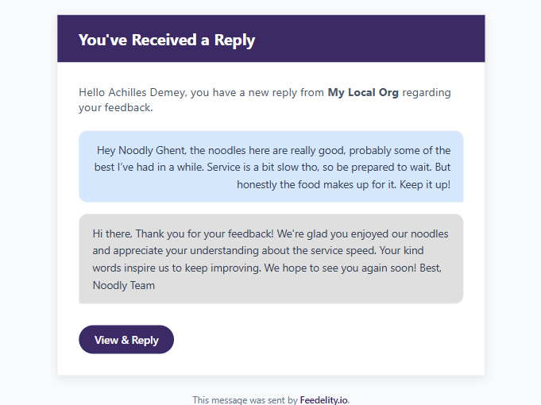
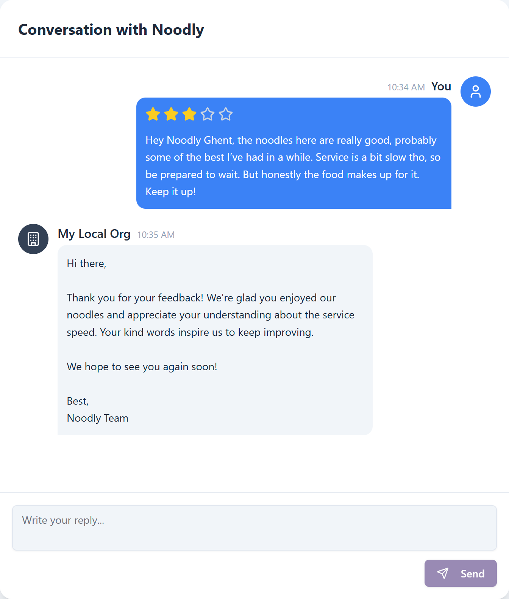
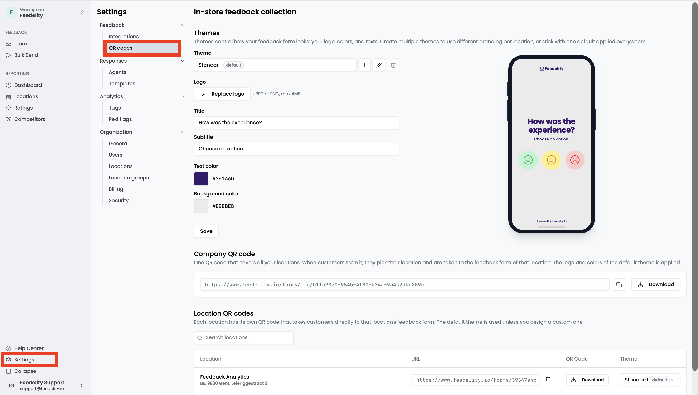
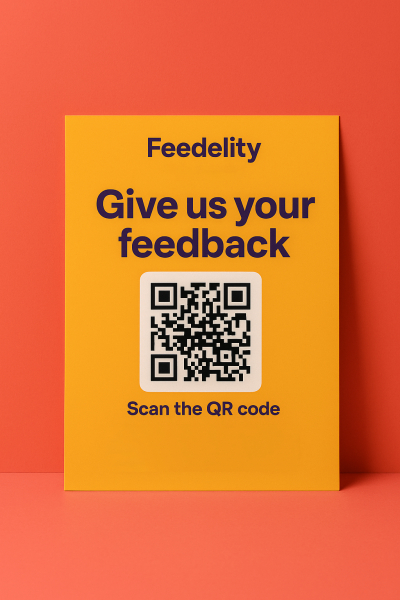

Your Google review score is one of the most important factors for driving sales. Businesses with high ratings look more trustworthy, so people are more likely to visit. Studies show that improving your Google rating by one star can increase your revenue by up to 9%.

Feedelity helps you **proactively gather five-star reviews while handling negative feedback internally**. This protects your online reputation and improves customer satisfaction.

## How smart review collection works

Feedelity uses a smart feedback loop. Satisfied customers go to your public Google page. Customers with a negative experience get a direct, private channel to resolve the issue.

<Steps>
  <Step title="The customer scans the QR code">
    A customer scans a unique QR code, or clicks a dedicated URL. You display it at your property or send it digitally.
  </Step>
  <Step title="Initial sentiment check">
    The customer is asked about their experience and chooses **Excellent**, **Okay**, or **Not Good**.
  </Step>
  <Step title="Positive route (Excellent)">
    - The customer is redirected to your property's Google review page.
    - They leave their positive review directly on Google.
    - The review is publicly visible and boosts your online rating.
    - If you respond, they receive your response on Google.
  </Step>
  <Step title="Negative route (Okay or Not Good)">
    - The customer is directed to an internal Feedelity form.
    - They write their detailed feedback privately and enter their name and email address.
  </Step>
</Steps>

### Handle negative feedback

Private feedback gives you a chance to solve the problem directly and restore the relationship with your customer.

**View and reply in the inbox.** All negative feedback appears as a new case in your Feedelity **Inbox**. Read the issue and send your reply directly from the thread.

**Email notification.** When you reply, the customer receives an email notification with a secure link to the conversation.

**Continuous dialogue.** The customer can click the link and send more messages. If the customer replies, the case reopens automatically in your **Inbox**. You can continue the conversation until the issue is fully resolved.

## Get started

### Download your QR code

Feedelity automatically creates a QR code and unique URL for each of your locations.

<Steps>
  <Step title="Open the QR code settings">
    Log in to Feedelity as an administrator. Go to **Settings** > **QR codes**.
  </Step>
  <Step title="Customize and share">
    Here, you can:

    - Customize the layout of the page guests see after they scan the QR code.
    - Click **Download** to save the QR code image to print and display.
    - Click **Copy Link** to copy the URL and share it digitally, for example in emails.
  </Step>
</Steps>

You can also create multiple themes. Use themes to design templates with different logos, which is useful if you manage multiple brands. You can also adjust elements like the title language for locations in different regions. Assign a theme to each location in the table below.

You can choose between two types of QR codes:

- **Location QR codes** take guests directly to the initial sentiment check for that location.
- **Company QR codes** first ask guests to choose a location. The list is sorted by distance, so the closest locations appear at the top.

Company QR codes are ideal for marketing materials produced in bulk, such as delivery boxes or bags. You can use the same QR code for all locations.

### Place and share your QR code strategically

Where and how you display your QR code or URL makes a big difference in the number of reviews you receive. Follow these best practices:

| Placement | Best practices |
| --- | --- |
| **QR code** | Place codes in high-traffic areas: on dining tables, on counters, in rooms, at the reception desk, or on check-out materials. Add a clear call to action, such as "Scan here to share your experience!" or "Give us your feedback". |
| **URL** | Include the URL in emails, satisfaction surveys, or on digital receipts. This captures feedback after the customer has left the property. |

<Tip>
  Combine onsite and digital placements to maximize feedback and capture more reviews.
</Tip>

## Connect to Google

To post positive reviews publicly, you must connect your location to Google.

<Warning>
  If your location isn't linked to Google, all feedback stays private in Feedelity, even **Excellent** reviews.
</Warning>

To let customers with a positive experience post reviews on Google:

<Steps>
  <Step title="Log in as an admin">
    Log in to Feedelity with an admin account.
  </Step>
  <Step title="Open integrations">
    Go to **Settings** > **Integrations**.
  </Step>
  <Step title="Link your Google Business Profile">
    Connect your Feedelity location to its Google Business Profile page. See [Google integration](/integrations/google).
  </Step>
</Steps>
