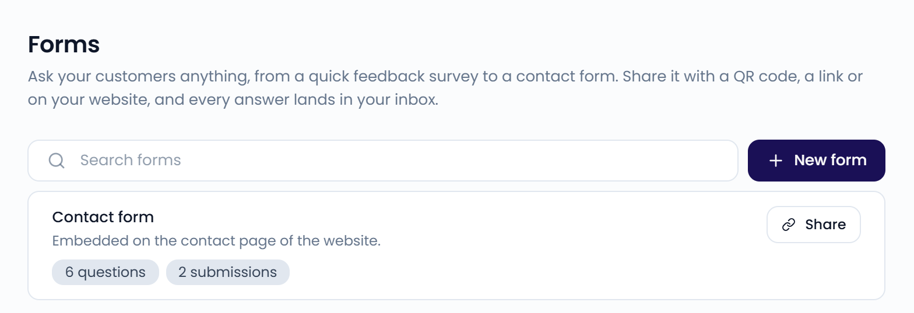
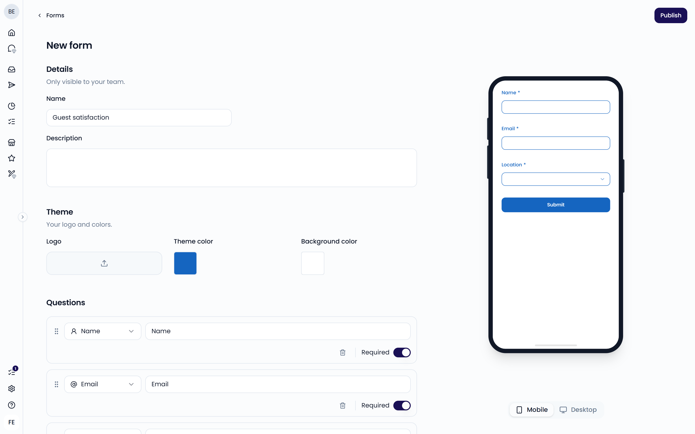
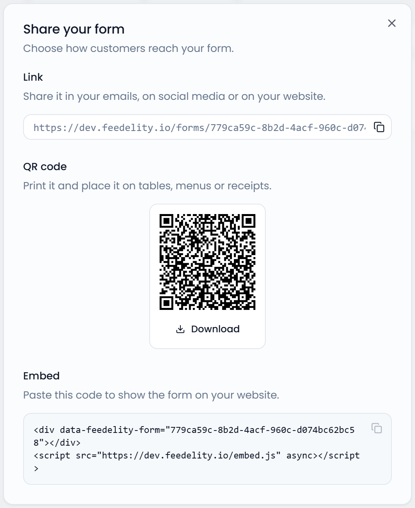
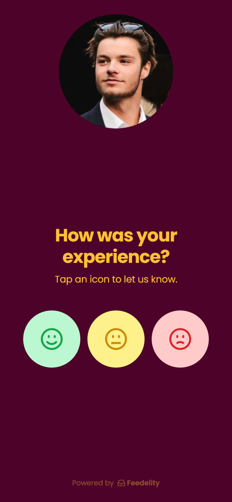
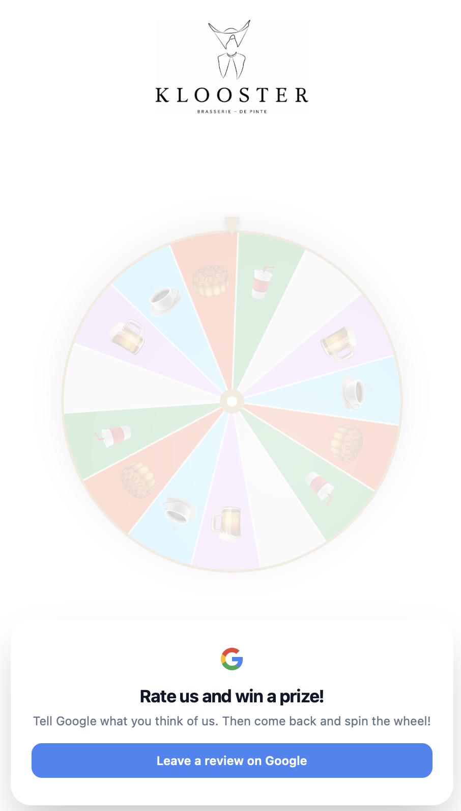
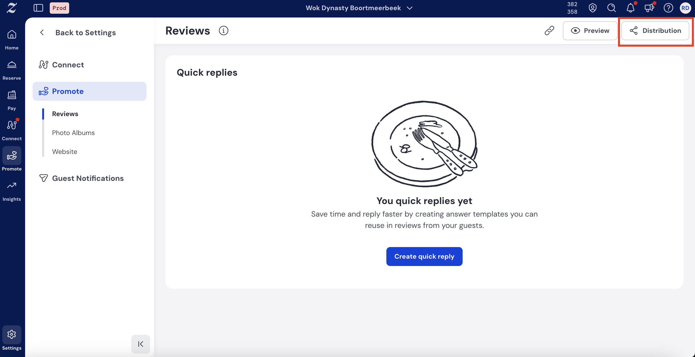
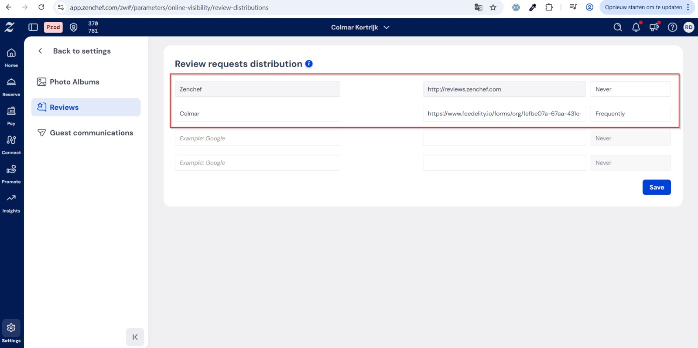
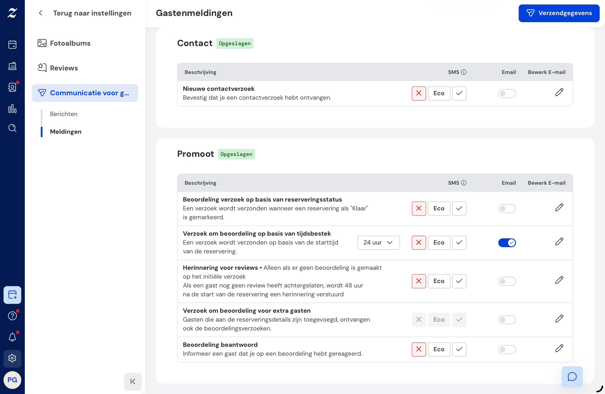

Forms let you ask your guests anything, from a quick feedback survey to a contact form. Share a form with a link, a QR code, or on your website. Every answer lands in your inbox as a case.

Go to **Settings** > **Forms** to open the page. You need an admin account to open **Settings**.

<Note>
  Forms are included in the Standard plan and the free trial. On an Enterprise plan, forms are an add-on: contact your account manager to turn them on. Until then, they show as locked in the **Settings** menu.
</Note>

{/* SCREENSHOT: /settings/forms — forms list with question and submission counts and the Share button */}
<Frame>
  
</Frame>

## Create a form

<Steps>
  <Step title="Start a new form">
    Go to **Settings** > **Forms** and click **New form**.
  </Step>
  <Step title="Add the details">
    Under **Details**, enter a **Name** and an optional **Description**. Only your team sees these.
  </Step>
  <Step title="Set the theme">
    Under **Theme**, upload a **Logo** and choose a **Theme color** and **Background color**.
  </Step>
  <Step title="Add your questions">
    Under **Questions**, edit the default questions. Click **Add question** and choose a question type to add more. See [Questions](#questions).
  </Step>
  <Step title="Customize the ending">
    Set the **Button text** of the submit button. Under **Thank-you page**, set the **Title** and **Description** guests see after they submit.
  </Step>
  <Step title="Publish">
    Click **Publish**. The share options open right away.
  </Step>
</Steps>

The preview shows the form as guests see it while you edit. On smaller screens, click **Preview** to see it.

{/* SCREENSHOT: /settings/forms/new — form editor with Details, Theme, and Questions sections and the live preview */}

## Questions

A new form starts with **Name**, **Email**, and **Location** questions. To add a question, click **Add question** and choose its type. For each question, you can:

- Choose the question type.
- Edit the question title.
- Turn **Required** on or off.
- Drag it to change the order.
- Duplicate or remove it.

You can use these question types:

| Type | What guests do |
| --- | --- |
| **Name**, **First name**, **Last name** | Enter their name. |
| **Email** | Enter their email address. |
| **Phone number** | Enter their phone number. |
| **Location** | Pick the restaurant they visited. They can search, and the nearest locations appear first. |
| **Star rating** | Give a rating from 1 to 5 stars. |
| **Single select** | Choose one option from your list. Add at least two options, each with a unique label. |
| **Long text** | Write an answer in their own words. |

Each contact question (name, email, phone number, and location) can appear only once per form. You can't duplicate them, and they're greyed out under **Add question** once the form has them.

<Tip>
  Make the **Email** question required. You can only reply to a guest who left an email address.
</Tip>

## Share a form

Click **Share** next to a form in the list. Choose how guests reach it:

- **Link**: Click **Copy link** and share it in emails, on social media, or on your website.
- **QR code**: Click **Download** and print the code on tables, menus, or receipts.
- **Embed**: Click **Copy code** and paste the code into your website. The form appears right on your page.

{/* SCREENSHOT: /settings/forms — Share your form dialog with Link, QR code, and Embed */}
<Frame>
  
</Frame>

## Edit or delete a form

- To edit a form, click it in the list. Make your changes and click **Publish**.
- To delete a form, open it, click the **...** menu, and select **Delete form**.

<Warning>
  Deleting a form also deletes all its questions and every response linked to it. You can't undo this.
</Warning>

To see the answers guests send, see [View submissions](/collecting-feedback/submissions).

## Reservation system follow-up emails

If you take bookings through a reservation platform such as **Zenchef** or **Guestplan**, you already have a strong way to collect reviews. Most reservation systems send guests a follow-up email after their visit. That's the ideal moment to ask for a review, while the experience is still fresh.

Add a Feedelity link to that email. Every booking then becomes a chance to grow your public Google rating, while negative feedback stays private.

### Why not use your reservation system's own reviews?

Most reservation platforms collect reviews in their own dashboard. Those reviews are useful for internal insight, but they usually **don't appear on Google**. They don't help the star rating new guests see before they book.

Feedelity sends happy guests straight to your Google listing, where everyone can see their review.

<Warning>
  To avoid sending guests two review requests, turn off your reservation system's own review request once you add your Feedelity link.
</Warning>

### Choose the link to paste

**Option 1: Your location's QR code link (recommended).** Go to **Settings** > **QR codes**. In the **Location QR codes** table, click the copy button next to the location's **URL**. This link runs the same sentiment check as your QR codes: happy guests go to Google, and unhappy guests give feedback privately. See [QR codes](/collecting-feedback/qr-codes).

<Frame>
  
</Frame>

**Option 2: Your spin the wheel link.** Guests leave a Google review, then spin a wheel for a reward. A voucher lands in their inbox and brings them back. See [Games](/loyalty/games).

**Option 3: A form link.** Share one of your forms to ask guests specific questions after their visit. See [Share a form](#share-a-form).

### Example setup: Zenchef

When a guest books through Zenchef, they receive a follow-up email after their visit. This is where your Feedelity link goes.

<Steps>
  <Step title="Copy your Feedelity link">
    In Feedelity, go to **Settings** > **QR codes** and copy the location's **URL**.
  </Step>
  <Step title="Open review distribution in Zenchef">
    In Zenchef, go to **Settings** > **Reviews** > **Review Distribution**.
  </Step>
  <Step title="Paste your Feedelity link">
    Paste the link into the review link field.
  </Step>
  <Step title="Turn off Zenchef's own review request">
    Turn off Zenchef's follow-up review request, so guests aren't asked twice.
  </Step>
  <Step title="Save">
    Click **Save**.
  </Step>
</Steps>

The same principle works for every reservation platform: replace its built-in review link with your Feedelity link.
