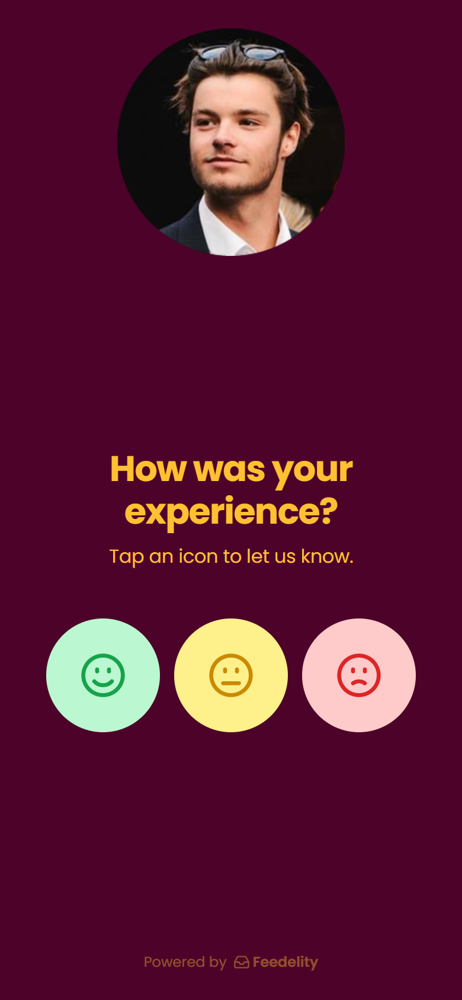
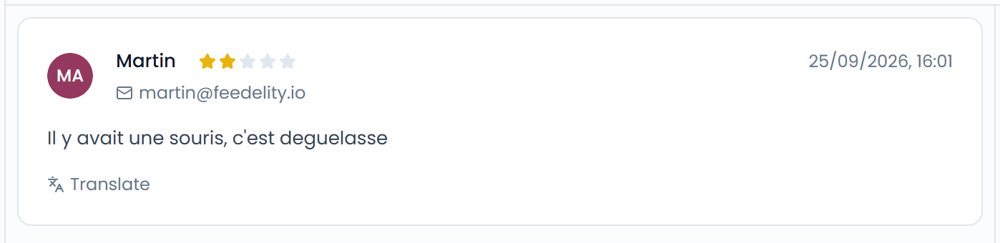
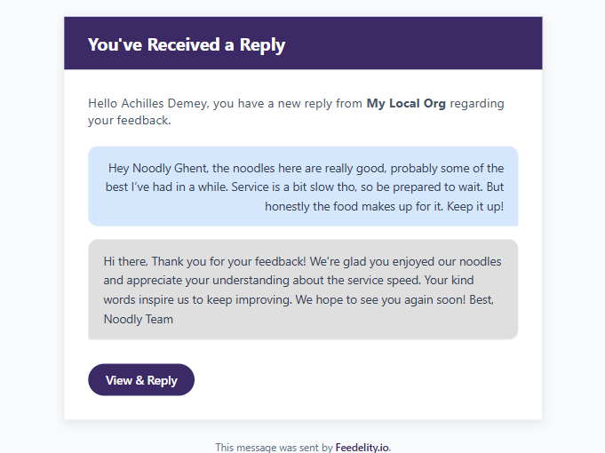
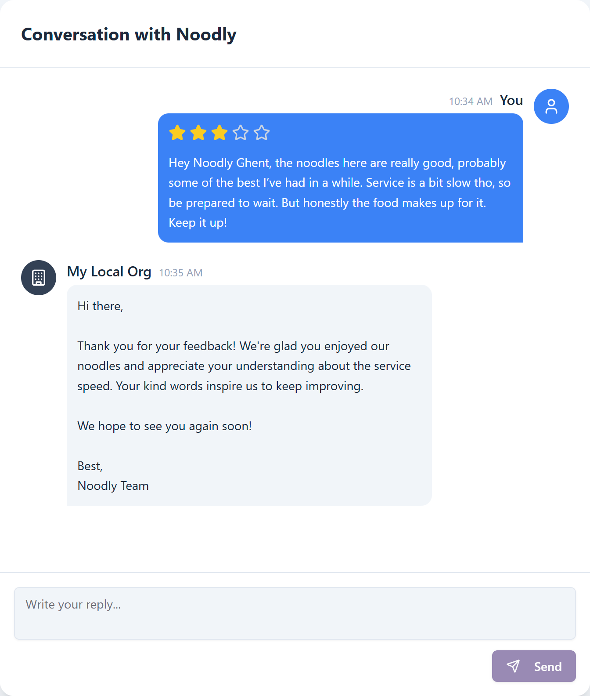
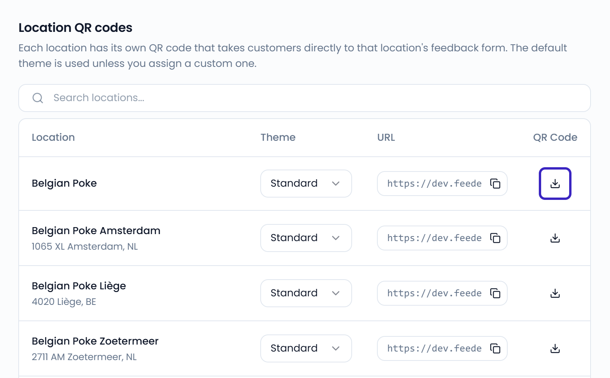
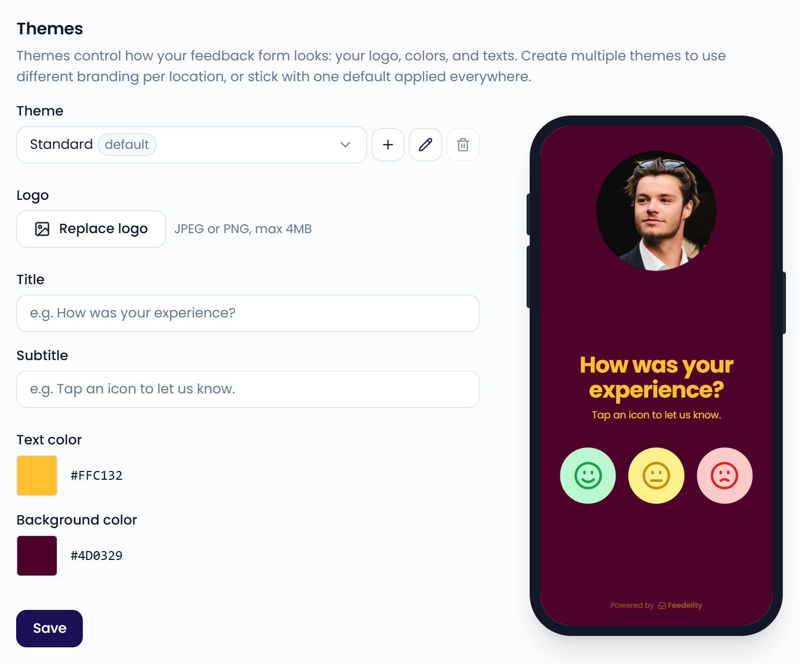
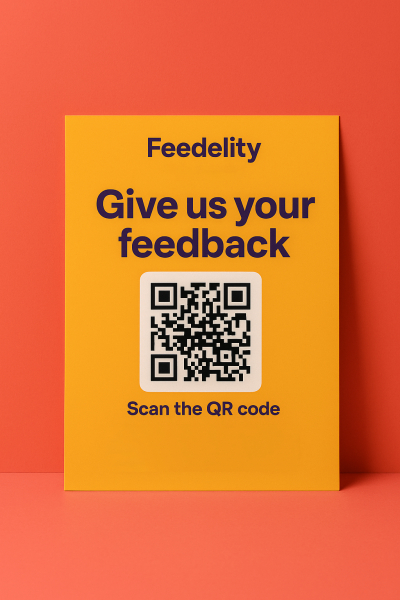

Your Google rating is one of the biggest factors in whether new guests choose you. Feedelity's QR codes help you **collect more five-star reviews while you handle negative feedback privately**.

Go to **Settings** > **QR codes** to open the **In-store feedback collection** page.

<Note>
  Smart QR codes are included in the Standard plan and the free trial. On an Enterprise plan, smart QR codes are an add-on: contact your account manager to turn them on. Until then, they show as locked in the **Settings** menu.
</Note>

## How it works

Each QR code opens a short feedback page. Happy guests go to your public Google page. Guests with a bad experience get a private way to tell you what went wrong.

<Steps>
  <Step title="The guest scans the QR code">
    A guest scans your QR code, or opens its link. You display the code in your restaurant or share the link digitally.
  </Step>
  <Step title="Sentiment check">
    The guest sees "How was your experience?" and taps a happy, neutral, or unhappy face.
  </Step>
  <Step title="Happy guests go to Google">
    The guest goes straight to your location's Google review page. Their review is public and boosts your rating.
  </Step>
  <Step title="Other guests give private feedback">
    The guest gives a star rating, writes a comment, and enters their name and email address. The feedback comes in as a case in your **Inbox**.
  </Step>
</Steps>

{/* SCREENSHOT: /forms/<location uuid> on a phone — sentiment check with the three faces, next to the private feedback form */}
<Frame>
  
</Frame>

<Warning>
  Happy guests only go to Google when the location is linked to Google. Otherwise, all feedback stays private in Feedelity. See [Connect to Google](#connect-to-google).
</Warning>

### Handle private feedback

Private feedback gives you a chance to fix the problem and win the guest back.

**Reply from the inbox.** Each piece of private feedback appears as a new case in your **Inbox**. Read it and reply from the case.

<Frame>
  
</Frame>

**The guest gets an email.** When you reply, the guest receives an email with a link to the conversation.

**Keep the conversation going.** The guest can open the link and reply to you. Their reply shows up in the same case, so you can continue until the issue is resolved.

## Get your QR codes

You need an admin account to open **Settings**.

{/* SCREENSHOT: /settings/instore — Location QR codes table with Theme, URL, and download button */}
<Frame>
  
</Frame>

### Location QR codes

Each location has its own QR code. It takes guests directly to that location's feedback page. In the **Location QR codes** table, you can:

- Click the download button to save the QR code as an image to print.
- Click the copy button next to the **URL** to share the link digitally, for example in emails.
- Choose a **Theme** for the location.

### Company QR code

The **Company QR code** covers all your locations. Guests who scan it first pick their location, then see that location's feedback page. Locations are sorted by distance, so the closest one appears at the top.

Click **Download** to save the image, or copy the link next to it. The company QR code uses your default theme.

<Tip>
  Use the company QR code on materials you print in bulk, such as delivery bags or boxes. One code works for every location.
</Tip>

## Customize the look with themes

Themes control how your feedback page looks. Use one default theme everywhere, or create several, for example one per brand.

{/* SCREENSHOT: /settings/instore — Themes section with the theme selector, logo, title, subtitle, colors, and the live preview */}
<Frame>
  
</Frame>

To edit a theme:

1. Under **Themes**, select the theme.
2. Change any of these settings:
   - **Logo**: JPEG or PNG, up to 4 MB.
   - **Title**: For example, "How was your experience?"
   - **Subtitle**: For example, "Tap an icon to let us know."
   - **Text color** and **Background color**.
3. Click **Save**.

To add a theme, click the plus button next to the theme selector and enter a name. You can also rename or delete a theme. Locations that use a deleted theme switch back to the default theme.

Assign a theme to each location in the **Location QR codes** table. Locations without a custom theme use the default one.

## Place your QR codes

Where you show your QR code or link makes a big difference in how many reviews you get.

| Placement | Best practices |
| --- | --- |
| **QR code** | Place codes where guests have a moment: on tables, menus, counters, or receipts. Add a clear call to action, such as "Scan here to share your experience!" |
| **Link** | Add the link to emails, surveys, or digital receipts. This reaches guests after they leave. To add it to your booking follow-up email, see [Reservation system follow-up emails](/collecting-feedback/forms#reservation-system-follow-up-emails). |

<Tip>
  Combine in-store and digital placements to collect the most reviews.
</Tip>

## Connect to Google

To send happy guests to Google, link each location to its Google Business Profile.

<Steps>
  <Step title="Open integrations">
    Go to **Settings** > **Integrations**.
  </Step>
  <Step title="Link your Google Business Profile">
    Connect each Feedelity location to its Google Business Profile. See [Google](/integrations/google).
  </Step>
</Steps>
