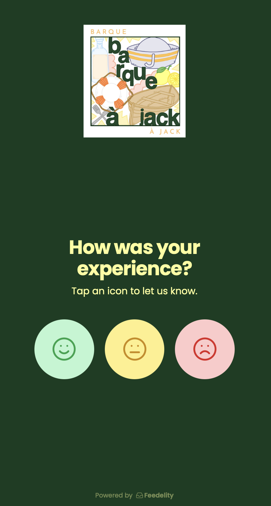
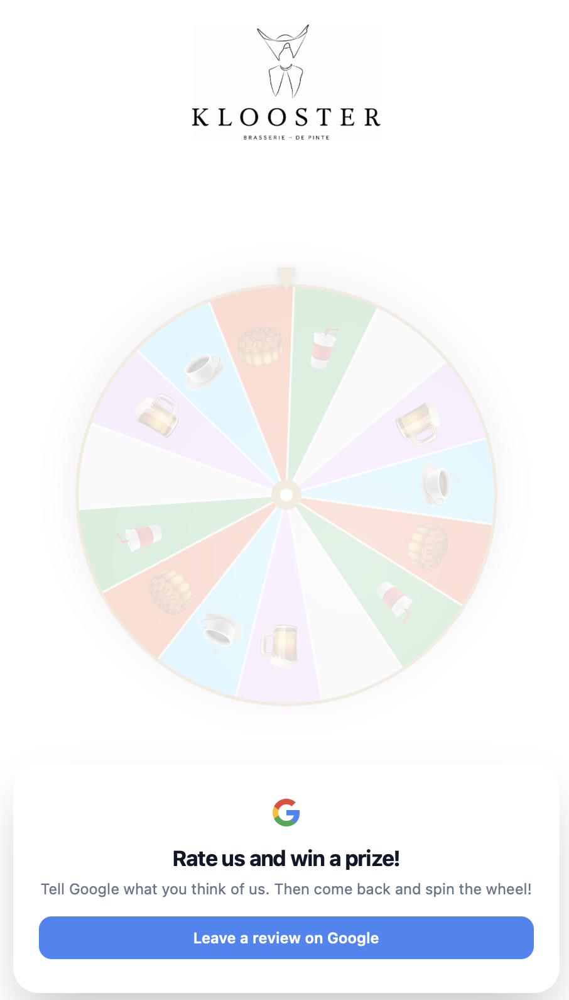
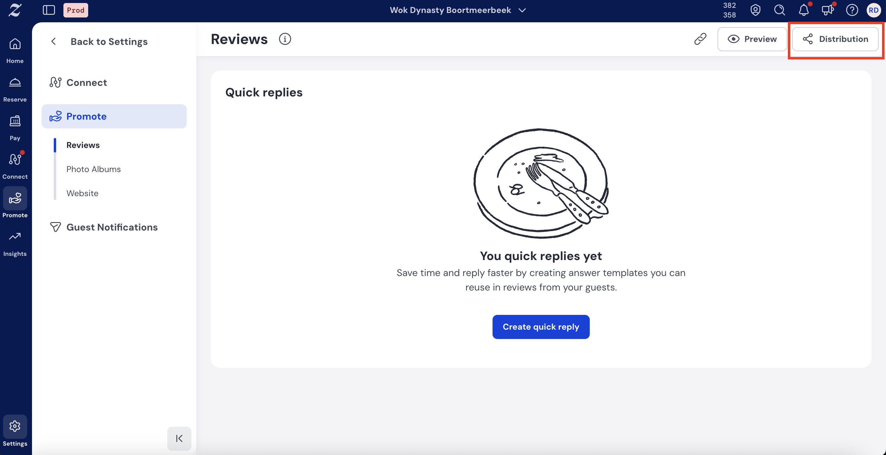
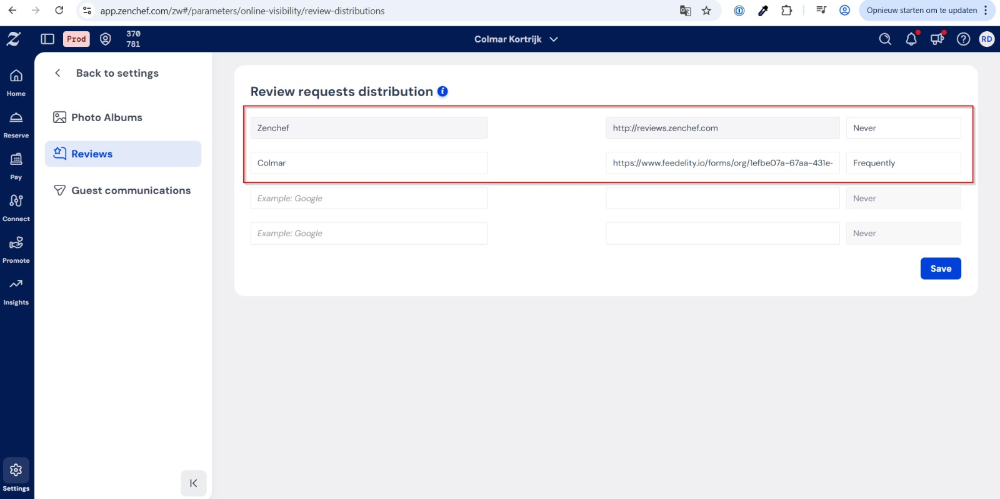
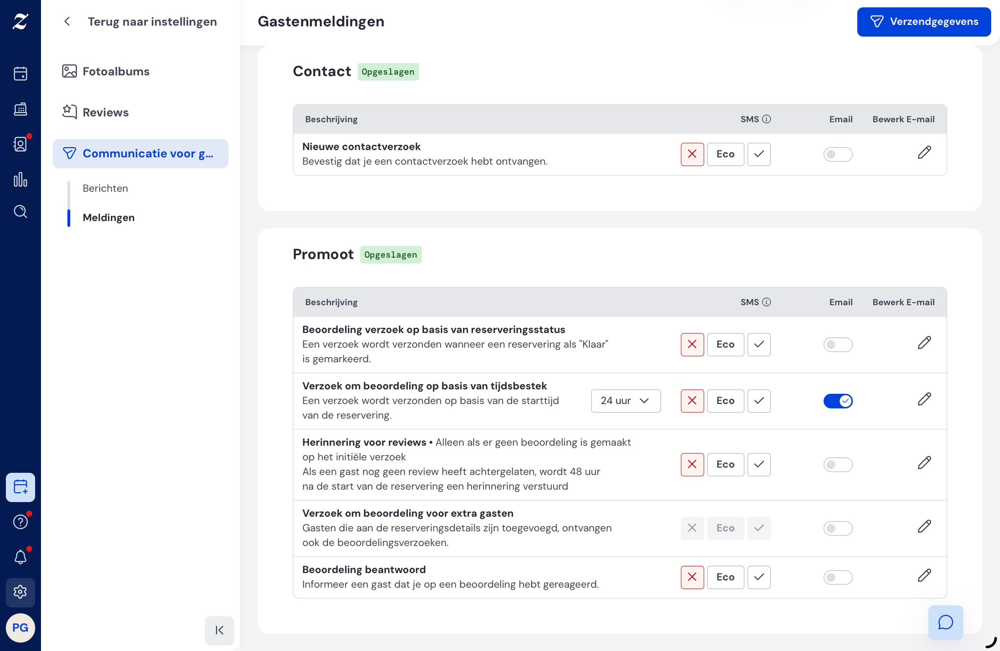

If you take bookings through a reservation platform like **Zenchef**, **Guestplan**, or similar, you already have a powerful review-collection channel. Most restaurants never switch it on properly.

Almost every reservation system automatically sends guests a **follow-up email after their visit**. That moment, when the experience is still fresh, is the ideal time to ask for a review. Add a **Feedelity smart link** to that email. Every booking then becomes a chance to grow your public Google rating, while negative feedback stays private.

This is one of the fastest, highest-volume ways to collect positive reviews. Setup takes about five minutes.

## Why not use your reservation system's own reviews?

Most reservation platforms can collect reviews inside their own dashboard. Those reviews are useful for internal insight, but they usually **don't appear on Google**. They do nothing for the online star rating that new customers see *before* they book or walk in.

You may already collect lots of five-star reviews in your reservation system without realizing none of them help your public reputation. Feedelity fixes this by sending happy guests straight to your Google listing, where everyone can see their review.

<Warning>
  To avoid sending guests two competing review requests, turn **off** or replace your reservation system's own review-request email once you add your Feedelity link. Guests should receive the Feedelity flow, not two separate requests.
</Warning>

## Choose the link to paste

### Option 1: Your smart QR code URL (recommended)

Use your **Feedelity smart QR code URL**. To find it:

<Steps>
  <Step title="Log in as an administrator">
    Log in to Feedelity with an administrator account.
  </Step>
  <Step title="Open the QR code settings">
    Go to **Settings** > **QR codes**.
  </Step>
  <Step title="Copy the link">
    Click **Copy Link**.
  </Step>
</Steps>

The link looks something like this:

This is the same smart link behind your QR codes. It runs the sentiment check, sends happy guests to Google, and routes unhappy guests privately to Feedelity.

### Option 2: The spin the wheel URL

Guests are asked to leave a Google review, then **spin a wheel for a reward**. A voucher lands in their inbox. This gives the silent majority of happy guests a fun reason to leave that review, and the voucher brings them back. For the full setup, see [Wheel of fortune](/collecting-feedback/wheel-of-fortune).

### Option 3: Your reservation system's normal review flow

Keep the reservation system's normal review flow. The feedback enters Feedelity, where you can reply to the guest directly.

## Example setup: Zenchef

When a guest books through Zenchef, they automatically receive a follow-up email after their visit. This is where your Feedelity link goes.

<Steps>
  <Step title="Copy your Feedelity link">
    In Feedelity, go to **Settings** > **QR codes** and click **Copy Link**.
  </Step>
  <Step title="Open review distribution in Zenchef">
    In Zenchef, go to **Settings** > **Reviews** > **Review Distribution**.
  </Step>
  <Step title="Paste your Feedelity URL">
    Paste your Feedelity URL into the review link field.
  </Step>
  <Step title="Turn off Zenchef's own review request">
    Turn off Zenchef's own follow-up review request, so guests only receive the Feedelity flow and aren't asked twice.
  </Step>
  <Step title="Save">
    Click **Save**.
  </Step>
</Steps>

From now on, every guest who books through Zenchef goes through your chosen Feedelity flow after their visit.

The principle is the same for every platform: replace the platform's built-in review link with your Feedelity smart link.
