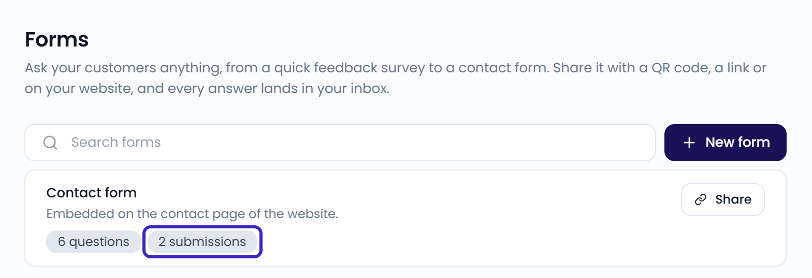

Every time a guest submits one of your [forms](/collecting-feedback/forms), a new case appears in your **Inbox**. You read and reply to it like any other feedback.

## Find a submission in the inbox

Each submission becomes its own case:

- The case title is the name of the form.
- The message lists every question with the guest's answer. Star ratings show as stars.
- The guest's name, email address, and phone number appear as the sender, if the form asked for them.
- If the form has a **Location** question, the case belongs to the location the guest picked.
- If the form has **Star rating** questions, the case gets a rating: the average of all star ratings in the submission.

{/* SCREENSHOT: /inbox — a form submission case showing the form name as title and the answers with star ratings */}

{/* TODO: confirm form submission cases get AI tags and sentiment like other cases, then link /inbox/tags-sentiment-priority */}

## Reply to a submission

Reply from the case as usual. See [Reply to customers](/inbox/replying).

The guest receives your reply by email, with a link to the conversation. They can open the link and reply to you. Their reply shows up in the same case.

<Note>
  You can only reply when the guest left an email address. Make the **Email** question required in your form to reply to every submission.
</Note>

## Count submissions per form

Go to **Settings** > **Forms**. Each form in the list shows its number of questions and submissions.

{/* SCREENSHOT: /settings/forms — forms list with the submission count badge highlighted */}
<Frame>
  
</Frame>
