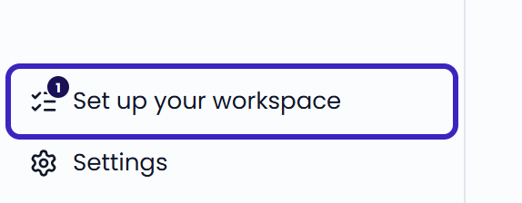
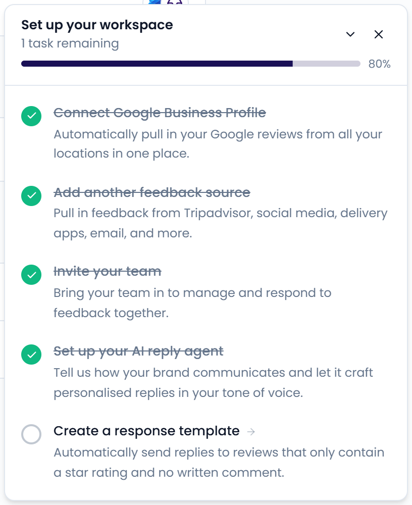

The **Set up your workspace** checklist tracks the steps that get the most out of Feedelity. Feedelity ticks off each step automatically when you complete it.

<Note>
  Only administrators see the checklist. It's not available on mobile.
</Note>

## Open the checklist

Click **Set up your workspace** in the sidebar. The badge on the icon shows how many tasks are left.

<Frame>
  
</Frame>

The checklist opens in the bottom-right corner. It shows your progress and the remaining tasks. Click a task to go to the right page in Settings.

Use the arrow to collapse the checklist, or the **X** to close it. When you complete every step, the checklist disappears from the sidebar.

{/* SCREENSHOT: /home — the "Set up your workspace" checklist panel open in the bottom-right, with the progress bar and a mix of completed (struck through) and pending tasks; highlight the sidebar item with its badge */}

<Frame>
  
</Frame>

## The steps

<Steps>
  <Step title="Connect Google Business Profile">
    Bring in your Google reviews from all your locations. See [Google](/integrations/google).

    This step is done when you've connected at least one Google location.
  </Step>
  <Step title="Add another feedback source">
    Add Tripadvisor, social media, delivery apps, email, and more under **Settings** > **Integrations**. See [Manage integrations](/integrations/how-integrations-work).

    This step is done when you've connected at least one channel other than Google.
  </Step>
  <Step title="Invite your team">
    Invite colleagues under **Settings** > **Users** to handle feedback together. See [Users](/settings/users).

    This step is done when your organization has a second user or a pending invitation.
  </Step>
  <Step title="Set up your AI reply agent">
    Describe how your brand communicates under **Settings** > **Agents**. Your AI reply agent then drafts replies in your tone of voice. See [AI reply agents](/automation/agents).

    This step is done when you've created at least one agent.
  </Step>
  <Step title="Create a response template">
    Create a template under **Settings** > **Templates** to answer reviews that only have a star rating and no comment. See [Response templates](/automation/templates).

    This step is done when you've created at least one template.
  </Step>
  <Step title="Set up billing">
    Add a payment method under **Settings** > **Billing** to keep access after your trial. See [Billing and license](/settings/billing).

    This step only appears during your free trial.
  </Step>
</Steps>

## Learn the inbox

Ready to reply? Open **Inbox** and click a case. See [Inbox](/inbox/overview) and [Reply to customers](/inbox/replying).

The first time you open the **Inbox**, a short tour shows you around. To see it again, hover over the help icon next to the page title and click **Show me how**.
