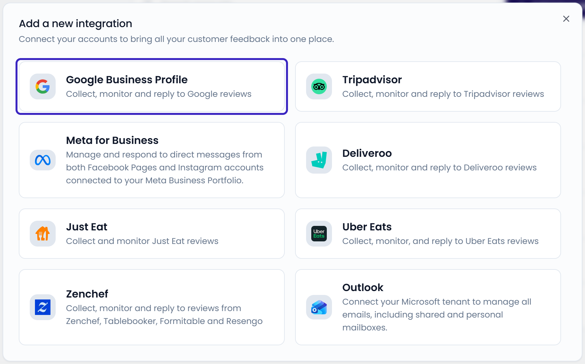

A channel is a source of feedback, such as a Google location or a Tripadvisor page. You connect channels through integrations. Once connected, new reviews and messages arrive in your **Inbox** as cases.

Most restaurants start with Google, because that's where most reviews are.

## Connect Google Business Profile

You can start from three places:

- The last screen when you [create your organization](/getting-started/create-organization)
- **Connect Google Business Profile** in the [get-started checklist](/getting-started/checklist)
- **Settings** > **Integrations** > **Add integration** > **Google Business Profile**

<Steps>
  <Step title="Continue to Google">
    Click **Connect Google Business Profile**, then **Continue to Google**.
  </Step>
  <Step title="Sign in and give access">
    Sign in with the Google account that manages your Google Business Profile. On Google's consent screen, tick the box that gives Feedelity access to your data.
  </Step>
  <Step title="Select your listings">
    The **Select your listings on Google** screen lists the business locations in your Google account. All listings are selected. Clear the ones you don't want to manage in Feedelity, then click **Continue**.

    Keep the page open while Feedelity connects your listings.
  </Step>
  <Step title="Link your locations">
    Feedelity links each Google listing to a matching location, or creates a new location for it. If every listing is linked, you're done.

    Otherwise, the **Link your locations** screen opens. Pick a Feedelity location for each listing, or click **Create new location**. Click **Finish**.
  </Step>
</Steps>

{/* SCREENSHOT: /integrations/accounts/{id}/channels/new — the "Select your listings on Google" screen with listings ticked, the "Select all" checkbox, and the "x of y" counter */}

Feedelity then imports your recent reviews. It includes reviews from the 30 days before you created your organization.

<Tip>
  Leave a channel without a location only when it receives feedback for several locations at once, such as a shared mailbox. Feedback from an unlinked channel doesn't show up when you filter dashboards by location. If you click **Finish** with unlinked channels, Feedelity asks you to confirm.
</Tip>

For more details, see [Google](/integrations/google).

## Connect another channel

Every integration follows the same pattern. Go to **Settings** > **Integrations**, click **Add integration**, and choose a platform. Then follow the on-screen steps. See [How integrations work](/integrations/how-integrations-work).

<Frame>
  
</Frame>

The setup differs per platform:

| Platform | How you connect |
| --- | --- |
| [Facebook](/integrations/facebook) | Sign in with Facebook, then select your Facebook pages |
| [Instagram](/integrations/instagram) | Sign in with Facebook, then select your Instagram accounts |
| [Tripadvisor](/integrations/tripadvisor) | Paste the link to your Tripadvisor page |
| [Just Eat Takeaway](/integrations/just-eat) | Paste the link to your restaurant or brand page |
| [Deliveroo](/integrations/deliveroo) | Log in with your Deliveroo Partner Hub email and password |
| [Uber Eats](/integrations/uber-eats) | Email support, then invite the Feedelity email address to your Uber Eats stores |
| [Zenchef](/integrations/zenchef) | Enter your Zenchef API token |
| [Outlook](/integrations/outlook) | Sign in with Microsoft, then add your mailbox |

## Next steps

<CardGroup cols={2}>
  <Card title="Reply to customers" icon="reply" href="/inbox/replying">
    Reply to your first case with your AI reply agent.
  </Card>
  <Card title="Keep integrations connected" icon="plug" href="/integrations/manage">
    Reconnect an integration when it needs attention.
  </Card>
</CardGroup>
