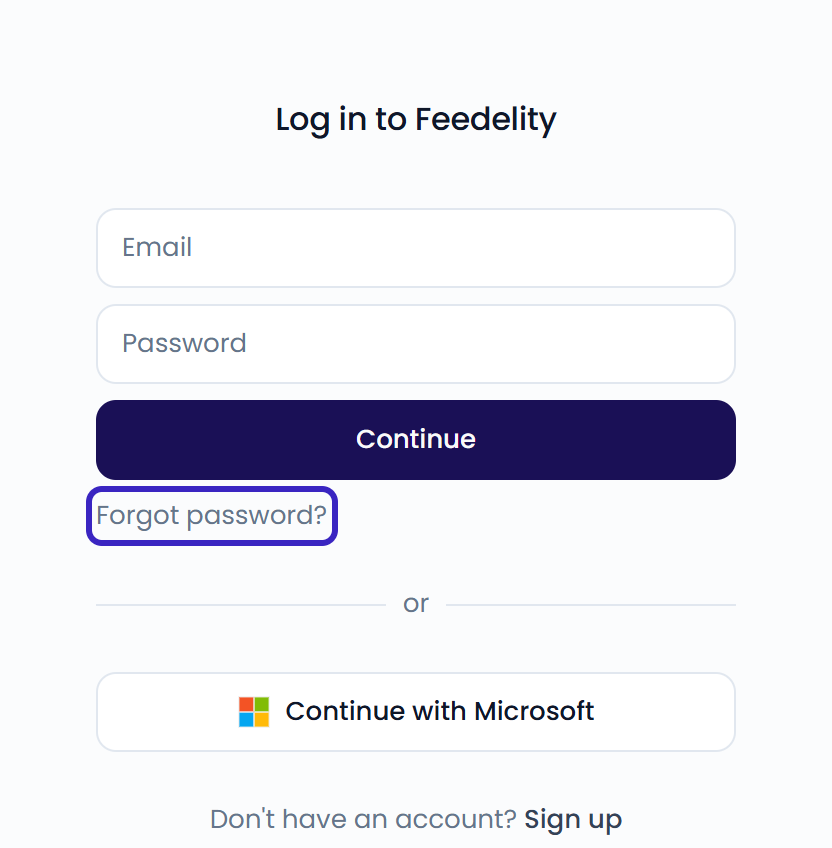
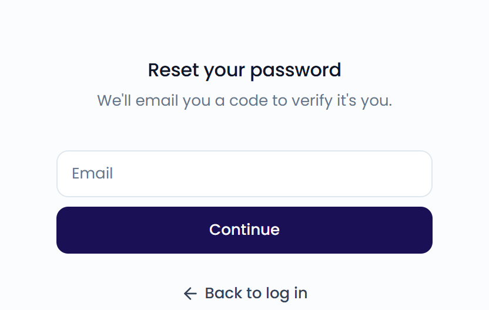

You can sign up with your email address or with your Microsoft account. Feedelity is available in English, Dutch, French, and German.

## Sign up

{/* SCREENSHOT: /signup — the "Create your account" screen with the Email field, Continue button, and Continue with Microsoft button */}

<Frame>
  
</Frame>

<Tabs>
  <Tab title="Email">
    <Steps>
      <Step title="Enter your email">
        Go to [app.feedelity.io/signup](https://app.feedelity.io/signup). Enter your email and click **Continue**.
      </Step>
      <Step title="Verify your email">
        We send a 6-digit code to your inbox. Enter it and click **Verify**.

        The code expires after 10 minutes. Didn't get it? Wait 60 seconds and click **Resend code**. Typed the wrong address? Click **Use a different email**.
      </Step>
      <Step title="Finish setting up">
        Enter your first and last name. Choose a password with at least 12 characters. Click **Create account**.
      </Step>
    </Steps>
  </Tab>
  <Tab title="Microsoft">
    Go to [app.feedelity.io/signup](https://app.feedelity.io/signup) and click **Continue with Microsoft**. Sign in with your Microsoft account.

    Your Feedelity account is created the first time you sign in. You don't need a separate password.
  </Tab>
</Tabs>

<Note>
  Already have an account with this email? We don't send a code. Instead, you get an email that tells you you already have a Feedelity account. [Log in](#log-in) or [reset your password](#reset-your-password) instead.
</Note>

## What happens next

After you sign up, Feedelity checks whether you can join an existing organization:

- **You have an invitation**: Click **Accept** to join the organization, or **Reject** to decline.
- **Your colleagues already use Feedelity**: If your organization registered your email domain, you can ask to join. Add an optional message and click **Request access**. An administrator approves your request, and we email you once you have access.
- **Neither**: You create a new organization. See [Create your organization](/getting-started/create-organization).

## Log in

Go to [app.feedelity.io/login](https://app.feedelity.io/login).

- **With email**: Enter your email and password, then click **Continue**.
- **With Microsoft**: Click **Continue with Microsoft**.

<Frame>
  
</Frame>

If you belong to several organizations, use the organization switcher in the sidebar to switch between them.

## Reset your password

<Steps>
  <Step title="Open the reset page">
    On the login page, click **Forgot password?**.

    <Frame>
      
    </Frame>
  </Step>
  <Step title="Enter your email">
    Enter the email you signed up with and click **Continue**.
  </Step>
  <Step title="Verify your email">
    Enter the 6-digit code from your inbox and click **Verify**.
  </Step>
  <Step title="Set a new password">
    Choose a new password with at least 12 characters. Click **Reset password**.
  </Step>
</Steps>

You're logged in right away. For your security, Feedelity logs you out on all your other devices.

<Tip>
  Signed up with Microsoft? You don't have a Feedelity password, so you won't receive a reset code. Click **Continue with Microsoft** to log in. To also log in with a password, [sign up with email](#sign-up) using the same address.
</Tip>
