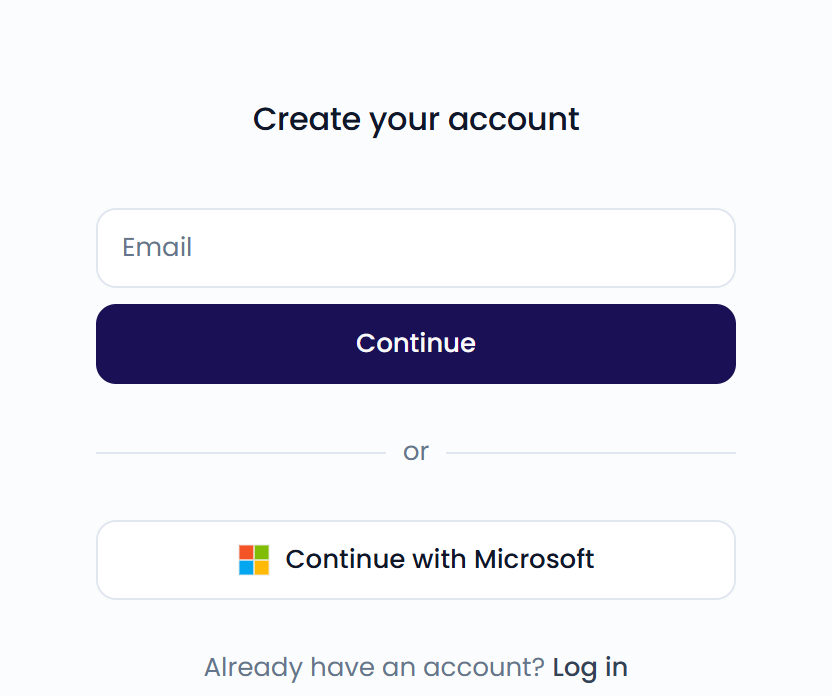

You can sign up with your email address or with your Microsoft account. Feedelity is available in English, Dutch, French, and German.

## Sign up

{/* SCREENSHOT: /signup — the "Create your account" screen with the Email field, Continue button, and Continue with Microsoft button */}

<Frame>
  
</Frame>

<Tabs>
  <Tab title="Email">
    <Steps>
      <Step title="Enter your email">
        Go to [app.feedelity.io/signup](https://app.feedelity.io/signup). Enter your email and click **Continue**.
      </Step>
      <Step title="Verify your email">
        We send a 6-digit code to your inbox. Enter it and click **Verify**.

        The code expires after 10 minutes. Didn't get it? Wait 60 seconds and click **Resend code**. Typed the wrong address? Click **Use a different email**.
      </Step>
      <Step title="Finish setting up">
        Enter your first and last name. Choose a password with at least 12 characters. Click **Create account**.
      </Step>
    </Steps>
  </Tab>
  <Tab title="Microsoft">
    Go to [app.feedelity.io/signup](https://app.feedelity.io/signup) and click **Continue with Microsoft**. Sign in with your Microsoft account.

    Your Feedelity account is created the first time you sign in. You don't need a separate password.
  </Tab>
</Tabs>

<Note>
  Already have an account with this email? We don't send a code. Instead, you get an email that tells you you already have a Feedelity account. [Log in](/getting-started/log-in) or [reset your password](/getting-started/log-in#reset-your-password) instead.
</Note>

## What happens next

After you sign up, Feedelity checks whether you can join an existing organization:

- **You have an invitation**: Click **Accept** to join the organization, or **Reject** to decline. See [Accept an invitation](/getting-started/users-and-organizations#accept-an-invitation).
- **Your colleagues already use Feedelity**: If your organization registered your email domain, you can ask to join. Add an optional message and click **Request access**. An administrator approves your request, and we email you once you have access. See [Request access](/getting-started/users-and-organizations#request-access).
- **Neither**: You create a new organization. See [Create your organization](/getting-started/create-organization).

One account works for every organization you join. To learn how accounts, organizations, and roles fit together, see [How users and organizations work](/getting-started/users-and-organizations).

Already have an account? See [Log in and reset your password](/getting-started/log-in).
