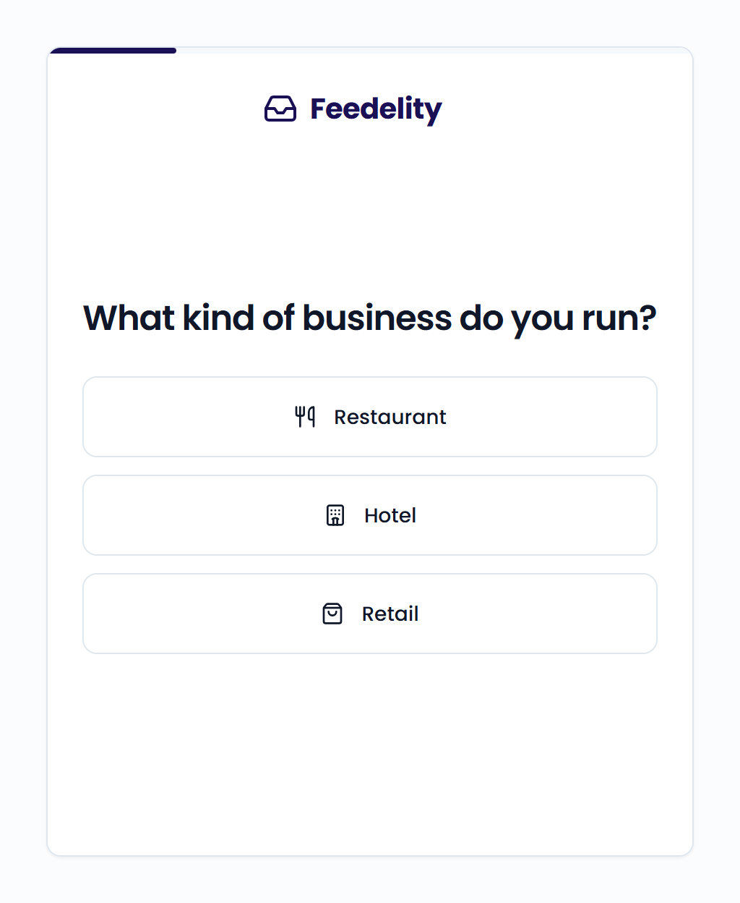
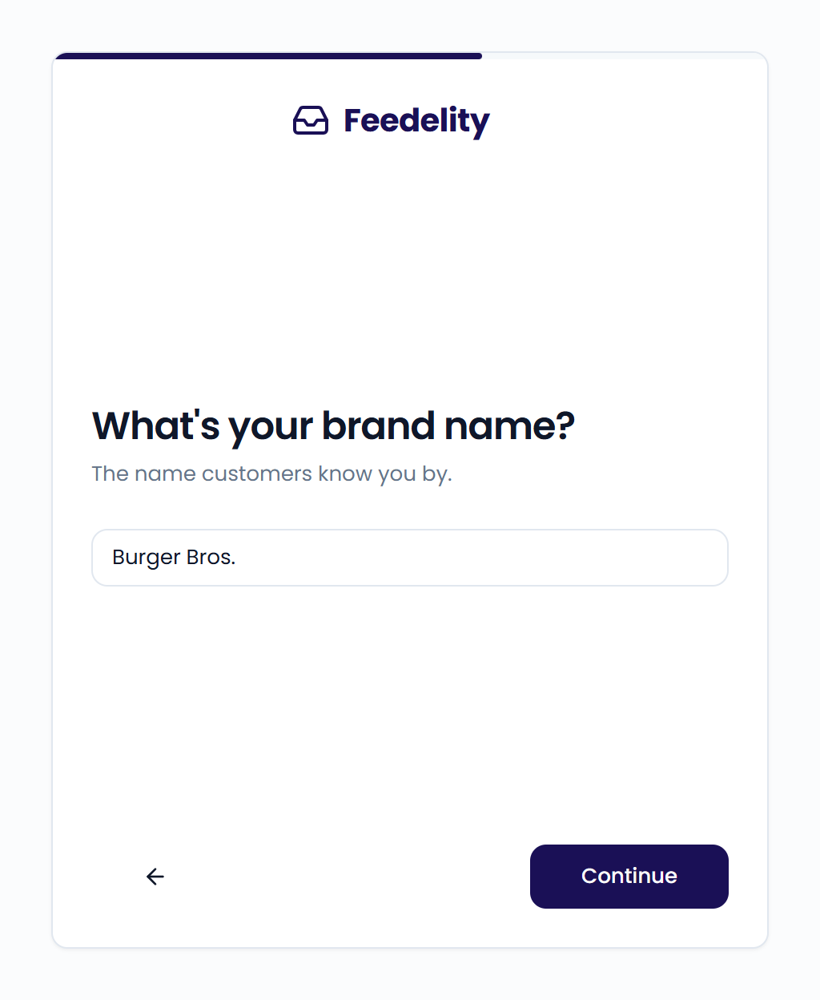

An organization is your company account in Feedelity, usually one restaurant brand. It holds your locations, channels, cases, and team.

After you [create your account](/getting-started/create-account), Feedelity asks you to create an organization. This only happens when you don't have an invitation or a pending request to join an existing organization.

{/* SCREENSHOT: /organizations/new — the first wizard screen "What kind of business do you run?" with the progress bar at the top */}

<Frame>
  
</Frame>

## Answer a few questions

<Steps>
  <Step title="What kind of business do you run?">
    Choose **Restaurant**, **Hotel**, or **Retail**.
  </Step>
  <Step title="How many locations do you operate?">
    Choose **1**, **2-5**, **6-20**, or **20+**.
  </Step>
  <Step title="What's your brand name?">
    Enter the name customers know you by. Click **Continue**.

    <Frame>
      
    </Frame>
  </Step>
  <Step title="What's your phone number?">
    Select your country and enter your phone number. Click **Continue**.

    Feedelity creates your organization.
  </Step>
</Steps>

Click the back arrow to change an earlier answer before you enter your phone number.

## Bring in your Google reviews

The last screen asks you to connect Google Business Profile. Click **Connect Google Business Profile** and follow the steps. See [Connect your first channel](/getting-started/connect-first-channel).

Not ready yet? Click **Not now, connect later in Settings**. You go straight to Feedelity, and you can connect Google anytime.

## What you get

- **A 14-day free trial.** You don't need a credit card. To keep access after the trial, add a payment method under **Settings** > **Billing**.
- **The administrator role.** As the creator, you can manage all settings, users, and locations.
- **The get-started checklist.** It guides you through the rest of your setup. See [Get-started checklist](/getting-started/checklist).

<Note>
  If you signed up with a company email address, Feedelity links your email domain to the organization. Colleagues who sign up with the same domain can then request access. Review their requests on your **Home** page or under **Settings** > **Users**.
</Note>
