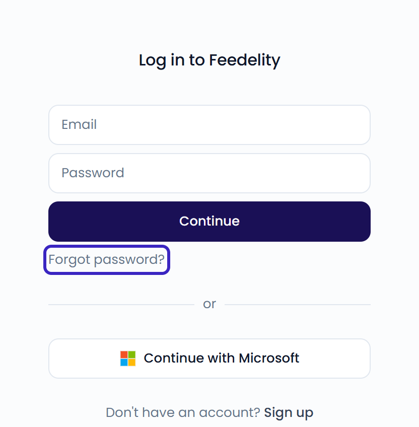
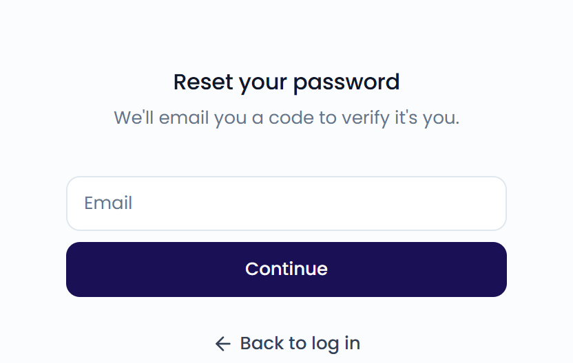

You log in with the same account for every organization you belong to. Don't have an account yet? See [Create your account](/getting-started/create-account).

## Log in

Go to [app.feedelity.io/login](https://app.feedelity.io/login).

<Tabs>
  <Tab title="Email">
    Enter your **Email** and **Password**, then click **Continue**.
  </Tab>
  <Tab title="Microsoft">
    Click **Continue with Microsoft** and sign in with your Microsoft account.

    If you already have a Feedelity account with the same email address, Microsoft is linked to it automatically. Otherwise, we create your account the first time you sign in.
  </Tab>
</Tabs>

<Frame>
  
</Frame>

After you log in, Feedelity opens your organization. If you belong to several, see [Switch organization](/getting-started/users-and-organizations#switch-organization).

## Log out

Click your name at the bottom of the sidebar, then click **Log out**.

## Reset your password

<Steps>
  <Step title="Open the reset page">
    On the login page, click **Forgot password?**.

    <Frame>
      
    </Frame>
  </Step>
  <Step title="Enter your email">
    Enter the email you signed up with and click **Continue**.
  </Step>
  <Step title="Verify your email">
    Enter the 6-digit code from your inbox and click **Verify**.
  </Step>
  <Step title="Set a new password">
    Choose a new password with at least 12 characters. Click **Reset password**.
  </Step>
</Steps>

You're logged in right away. For your security, Feedelity logs you out on all your other devices.

To change a password you still know, log out and follow the same steps.

## Add a password to a Microsoft account

Signed up with Microsoft? Then you don't have a Feedelity password, so you won't receive a reset code. Click **Continue with Microsoft** to log in.

To also log in with a password, [sign up with email](/getting-started/create-account#sign-up) using the same address. The password is added to your existing account, and you keep access to all your organizations.

## Troubleshooting

<AccordionGroup>
  <Accordion title="I didn't get a code">
    Check your spam folder. The email's subject starts with your code, for example "123456 is your password reset code".

    Still nothing after 60 seconds? Click **Resend code**. Typed the wrong address? Click **Use a different email**.

    For a password reset, we only send a code if the email address has a Feedelity password. If you always log in with Microsoft, see [Add a password to a Microsoft account](#add-a-password-to-a-microsoft-account).
  </Accordion>
  <Accordion title="This code is incorrect or has expired">
    A code expires after 10 minutes and works only once. When you request a new code, the previous one stops working. Click **Resend code** and enter the newest code.
  </Accordion>
  <Accordion title="Invalid email or password">
    Check that you use the email address your account was created with. If you're not sure of your password, [reset it](#reset-your-password).

    If you signed up with Microsoft, click **Continue with Microsoft** instead.
  </Accordion>
  <Accordion title="Failed to authorize with Microsoft">
    Try again, or log in with your email and password. If your company manages your Microsoft account, your IT team may need to allow Feedelity.
  </Accordion>
</AccordionGroup>

Still stuck? [Contact support](/faq/contact-support).
