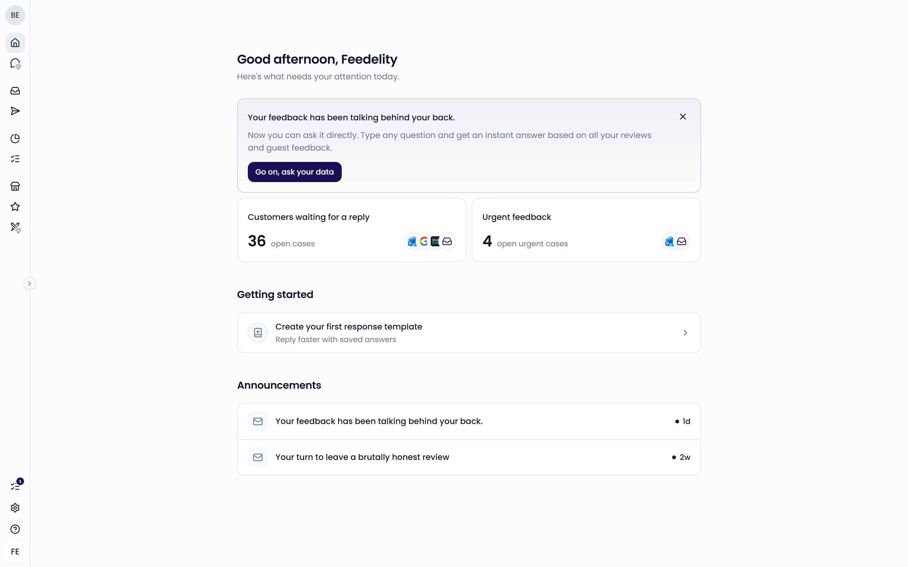
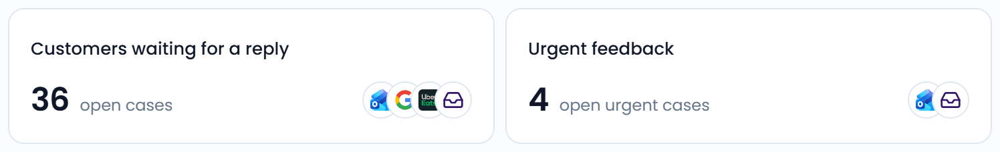

**Home** is the first page you see when you open Feedelity. It shows what needs your attention today. Open it from the top of the sidebar.

{/* SCREENSHOT: /home — the full Home page with the greeting, the two cards, and Announcements */}

At the top, Feedelity greets you by name. If something needs your attention, you see "Here's what needs your attention today." When everything is handled, you see "Great work! You are on top of your feedback."

New Feedelity announcements can also appear as a banner at the top. Click **Dismiss** to hide one.

## Customers waiting for a reply

The **Customers waiting for a reply** card shows how many open cases are waiting for a reply. The icons show which channels those cases come from.

Click the card to open your open cases in the [Inbox](/inbox/overview). When every case has a reply, the card shows a green checkmark.

## Urgent feedback

The **Urgent feedback** card shows how many open cases have a [red flag](/settings/flags). Click the card to open those cases in the inbox.

{/* SCREENSHOT: /home — the Customers waiting for a reply and Urgent feedback cards */}
<Frame>
  
</Frame>

## Action items

Below the cards, Feedelity lists other things that need fixing. You only see the items that apply to you:

- **Your … integration is disconnected**: a connected account stopped working. Admins click the item to reconnect it. Other users see a prompt to ask an admin.
- **Review join requests**: people asked to join your organization. Admins only.

## Unread notifications

If you have unread notifications, **Home** shows up to five of them under **Unread notifications**.

## Getting started

Admins see a **Getting started** list until the setup is complete. Each step disappears once you've done it:

- **Connect your Google listing**
- **Connect another channel**
- **Invite a teammate**
- **Create your first AI reply agent**
- **Create your first response template**
- **Set up billing**: only shown during your trial

Click a step to go straight to the right page. For a full walkthrough, see the [Quickstart](/getting-started/checklist).

## Loyalty

If your organization uses offers, admins see a **Loyalty** section when an offer is running low on codes or has none left. Click **Refill codes for "…"** to add codes. Customers can't receive the offer until you do.

## Announcements

**Announcements** lists recent Feedelity news and product updates. Click an announcement to read it.
