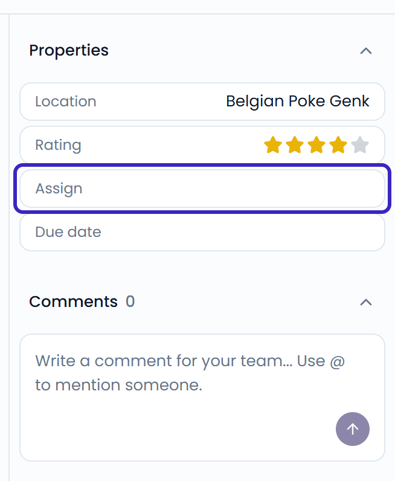

Use assignments, comments, and due dates to share the work on a case. You find them in the case details on the right of an open case. If the details are hidden, click the panel button in the top-right corner of the case.

{/* SCREENSHOT: /inbox?case_id=<id> — the case details with Properties (Assign, Due date) and Comments sections highlighted */}
<Frame>
  
</Frame>

## Assign a case

Assign a case to the teammate who is responsible for handling it.

<Steps>
  <Step title="Open the assignee list">
    Under **Properties**, click **Assign**. Or press <kbd>A</kbd>.
  </Step>
  <Step title="Choose a teammate">
    Search for a teammate and select them. You appear at the top of the list.
  </Step>
</Steps>

The teammate gets a notification that a case was assigned to them. To remove the assignment, choose **No assignee**.

When you reply to a case that has no assignee, it's assigned to you automatically.

The assignee's avatar shows on the case in the list. To see all cases assigned to someone, use the **Assigned to** filter. See [Filter and search](/inbox/filtering-and-searching).

## Set a due date

Under **Properties**, click **Due date** and pick a date. To remove it, choose **No due date**.

## Comment on a case

Comments are notes for your team. Customers never see them.

Type your comment in the box under **Comments**. Click the arrow button or press <kbd>Ctrl</kbd> + <kbd>Enter</kbd> (<kbd>⌘</kbd> + <kbd>Enter</kbd> on Mac) to post it.

When someone comments, the assignee and everyone who commented on the case before get a notification.

### Mention a teammate

Type `@` followed by a name to mention a teammate. Choose them from the list with the arrow keys and press <kbd>Enter</kbd>, or click their name.

The teammate gets a notification that you mentioned them.

{/* SCREENSHOT: /inbox?case_id=<id> — the comment box with the @mention suggestions open */}

{/* TODO: confirm whether assignment, comment, and mention notifications are always also sent by email (no per-type setting found in Profile) */}

<Note>
  Users with the **Viewer** role can't assign cases or change due dates.
</Note>
