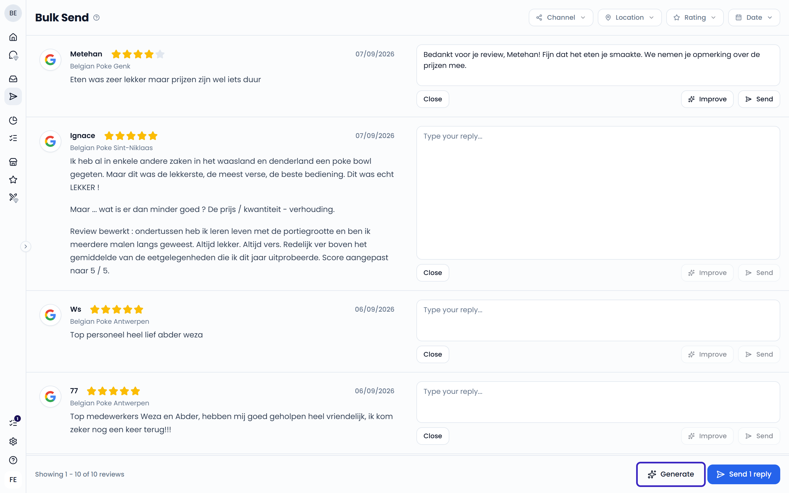

**Bulk Send** lets you draft and send replies to many reviews at once. Use it to work through a backlog of reviews quickly. Open it from **Bulk Send** in the sidebar.

Bulk Send shows open reviews from Google, Deliveroo, Uber Eats, and Zenchef that you can still reply to. It shows 20 reviews at a time. When you've handled all of them, the next 20 load automatically.

Use the filters at the top to narrow the list by **Channel**, **Location**, **Rating**, and **Date**.

<Steps>
  <Step title="Generate replies">
    Click **Generate** at the bottom of the page. If you have more than one [AI reply agent](/automation/agents), choose which one to use. The agent drafts a reply for each review that doesn't have one yet.
  </Step>
  <Step title="Review the drafts">
    Edit any reply yourself, or click **Improve** to adjust it. See [Improve a reply](/inbox/replying#improve-a-reply).
  </Step>
  <Step title="Send">
    Click **Send** next to a single review, or click **Send _n_ replies** at the bottom to send all drafted replies at once. Each case moves to **Closed** once its reply is sent.
  </Step>
</Steps>

{/* SCREENSHOT: /bulk — reviews with drafted replies, and the Generate and Send buttons at the bottom */}

## Skip a review

Click **Close** on a review to leave it out of the bulk send without replying. This also closes the case in your **Inbox**.

If a reply can't be sent, the review shows an error. Click **Close** to remove it from the bulk send.

<Note>
  Bulk Send only handles reviews. Messages and emails are excluded because they can be ongoing conversations. A review is a single message that holds all the context a reply needs.
</Note>

<Note>
  Bulk Send is an add-on. If your plan doesn't include it, **Bulk Send** in the sidebar shows an **Add-on** label when you hover over it. To add it, [contact support](/faq/contact-support). Users with the **Viewer** role don't have access to Bulk Send.
</Note>

## Bulk actions in the inbox

The inbox doesn't support selecting several cases at once. To close or delete cases quickly, hover over a case in the list and click the checkmark or the trash bin. You can also use keyboard shortcuts to move through cases. See [Keyboard shortcuts](/inbox/overview#keyboard-shortcuts).
