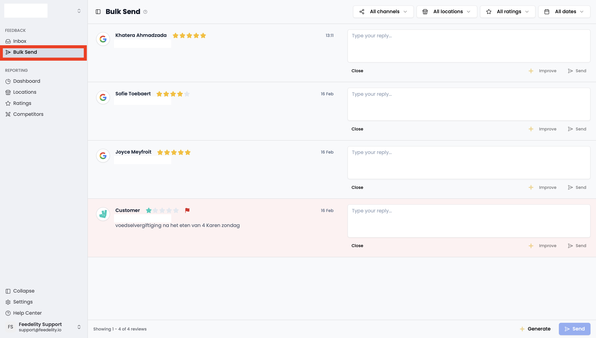

**Bulk Send** is a streamlined version of the **Inbox**. It lets you generate and send replies to many cases at once, so you can handle large volumes of feedback with little effort.

Use the filters at the top to narrow the list by channel, location, rating, and period.

<Steps>
  <Step title="Generate replies">
    Click **Generate** and select one of your AI reply agents. A reply is drafted for each review in the list.
  </Step>
  <Step title="Review the drafts">
    Edit any reply you want to change.
  </Step>
  <Step title="Send">
    Send replies one by one, or send them all at once with the blue send button in the bottom-right corner. You can send up to 20 replies at once.
  </Step>
</Steps>

<Note>
  Bulk Send only handles reviews. Channels like Instagram or email are excluded, because they can involve ongoing conversations (threads). A review is a single incoming message that contains all the context needed for a reply.
</Note>
