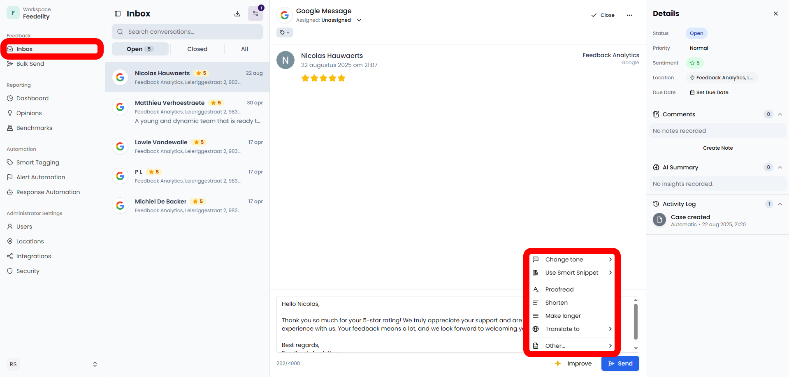

For reviews from Deliveroo and Uber Eats, you can add credit to your reply. The customer gets it on their next order. Use it to win back a guest who reports a missing item or a wrong order. Check what they ordered first in the [order details](/inbox/order-details).

<Steps>
  <Step title="Open the credit menu">
    Click **Add voucher** in the reply toolbar.
  </Step>
  <Step title="Choose an amount">
    Choose one of the amounts. The options depend on the platform and the currency of the order.
  </Step>
  <Step title="Send the reply">
    Send your reply. The credit goes out with it.
  </Step>
</Steps>

{/* SCREENSHOT: /inbox?case_id=<id of an Uber Eats review> — the Add voucher menu open with the available credit amounts */}

## How credit works

You cover the cost of the credit. It's applied automatically to the customer's next order on that platform. **Deliveroo credit** is valid for 60 days, and **Uber Eats credit** for 30 days. Click **View conditions** on the credit for details.

This credit is different from the [vouchers](/loyalty/vouchers) your guests win in your loyalty games. It isn't an offer, and it doesn't appear on the **Vouchers** page.

## Who can add credit

<Tip>
  Administrators can always add credit. To let another user add it, turn on **Send vouchers** for that user under **Settings** > **Users**.
</Tip>

<Note>
  Credit is an add-on. If your plan doesn't include it, the button shows an **Add-on** label when you hover over it. To add it, [contact support](/faq/contact-support).
</Note>
