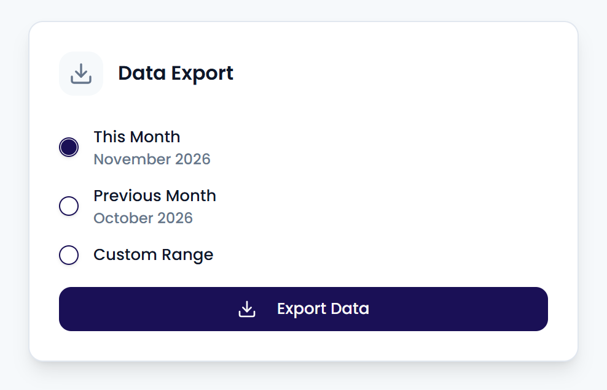

Export your feedback as a CSV file to analyze it in a spreadsheet or share it.

<Steps>
  <Step title="Open the export page">
    In the **Inbox**, click **Export** in the top-right corner.
  </Step>
  <Step title="Choose a period">
    Choose **This Month**, **Previous Month**, or **Custom Range**. For a custom range, pick a **From** and **To** date.
  </Step>
  <Step title="Export">
    Click **Export Data**. The file downloads to your computer.
  </Step>
</Steps>

{/* SCREENSHOT: /inbox/export — the Data Export page with the period options and Export Data button */}
<Frame>
  
</Frame>

## What the export contains

The export holds one row per case, with the customer's first message. A case is included when that first message arrived in the period you chose. Your inbox filters don't apply to the export.

Each row has these columns:

| Column | Contents |
| --- | --- |
| `case_id` | The case's ID |
| `date`, `time` | When the customer's first message arrived |
| `customer` | The customer's name |
| `message` | The customer's first message |
| `message_cleaned` | A cleaned-up version of the message |
| `rating` | The star rating |
| `flagged` | Whether the case is urgent |
| `source` | The channel |
| `location_name`, `location_external_id`, `location_street`, `location_post_code`, `location_city`, `location_country` | The location's details |
| `tags` | The tags and their sentiment |

You only get cases from the locations you have access to.

<Note>
  An export holds at most 10,000 cases. For a longer period, export one month at a time.
</Note>

<Tip>
  To pull your feedback into another tool automatically, use the [Data Export API](/api/endpoints).
</Tip>
