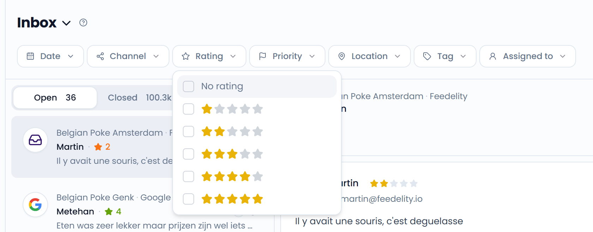

## Filter cases

Click **Filters** to show the filter bar. You can filter the list by:

- **Date**: Pick a preset such as **Last 7 days** or **This month**, or choose your own date range.
- **Channel**: Google, Uber Eats, and your other connected channels.
- **Rating**: One or more star ratings, or **No rating**.
- **Priority**: **Urgent** or **No priority**.
- **Location**: One or more locations or location groups, or **No location**.
- **Tag**: One or more tags.
- **Assigned to**: One or more teammates, or **No assignee**.
- **Folder**: One or more folders, or **No folder**. This filter only shows when your organization has [folders](/inbox/folders).

The **Filters** button shows how many filters are active. Click **Clear filters** to remove all filters at once.

Your filters are saved in the page address. Bookmark the page or share the link to come back to the same view.

{/* SCREENSHOT: /inbox?is_open=true — the filter bar below the inbox header, with a filter open */}
<Frame>
  
</Frame>

## Search

Type in **Search...** at the top of the inbox to find a specific case. Search matches:

- The text and title of any message in the case
- The customer's name

Search combines with your filters and with the **Open**, **Closed**, and **All** tabs. Press <kbd>Ctrl</kbd> + <kbd>F</kbd> (<kbd>⌘</kbd> + <kbd>F</kbd> on Mac) to jump to the search box.
