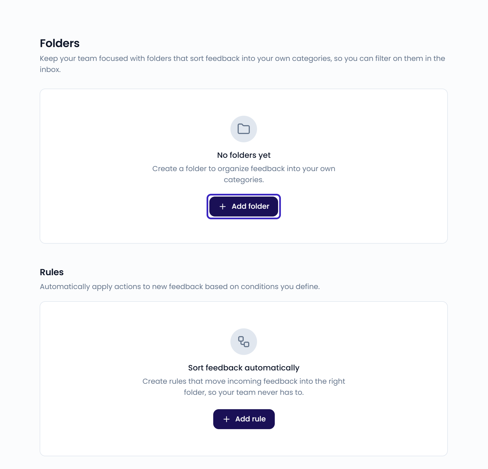
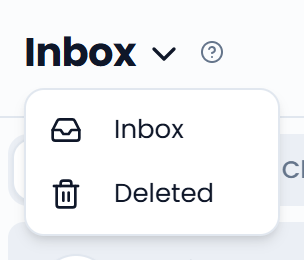

Folders sort feedback into your own categories, such as complaints or catering requests. Each case can be in one folder.

## Create folders

Administrators manage folders under **Settings** > **Folders**.

<Steps>
  <Step title="Add a folder">
    Click **Add folder**.
  </Step>
  <Step title="Name it">
    Enter a **Name**, for example "Complaints", and click **Save**.
  </Step>
</Steps>

To rename or delete a folder, click it in the list. When you delete a folder, its cases are kept. They just aren't in a folder anymore.

{/* SCREENSHOT: /settings/folders — the folder list with the Add folder button, and the Rules section below */}
<Frame>
  
</Frame>

## Move a case to a folder

Open a case. Under **Properties**, click **Folder** and choose a folder, or press <kbd>F</kbd>. To take the case out of its folder, choose **No folder**.

The **Folder** property and filter only show once your organization has at least one folder.

## View a folder

Click **Filters** and use the **Folder** filter to see the cases in one or more folders. Choose **No folder** to see the cases that aren't in a folder. See [Filter and search](/inbox/filtering-and-searching).

## Sort feedback automatically with rules

Rules move or delete new feedback based on the sender's email address. Administrators manage them under **Settings** > **Folders** > **Rules**.

<Steps>
  <Step title="Add a rule">
    Click **Add rule** and give the rule a **Name**.
  </Step>
  <Step title="Set the condition">
    Under **If**, choose whether the **Sender email** equals an address or ends with a domain, such as `@example.com`.
  </Step>
  <Step title="Set the action">
    Under **Then**, choose **Move to** a folder, or **Delete**.
  </Step>
  <Step title="Save">
    Turn on **Run this rule on all existing messages** to also apply the rule to feedback you already have. Click **Save**.
  </Step>
</Steps>

<Tip>
  To create a rule from an email in the inbox, click **⋯** next to the sender and choose **Create rule**. The sender's address is filled in for you.
</Tip>

## Deleted

Click the **Inbox** title and select **Deleted** to see the cases you deleted. Deleted cases don't count in your dashboards.

Open a case and click **Restore** to put it back in your inbox and dashboards.

{/* SCREENSHOT: /inbox?is_open=true — the Inbox title menu open with Inbox and Deleted */}
<Frame>
  
</Frame>
