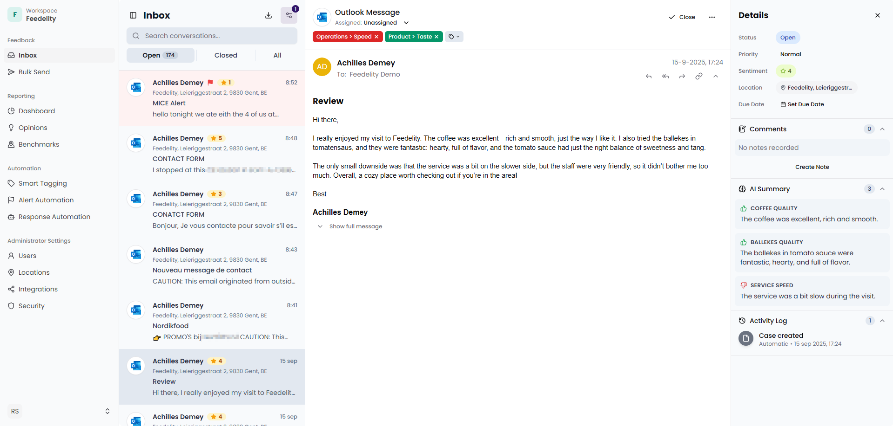
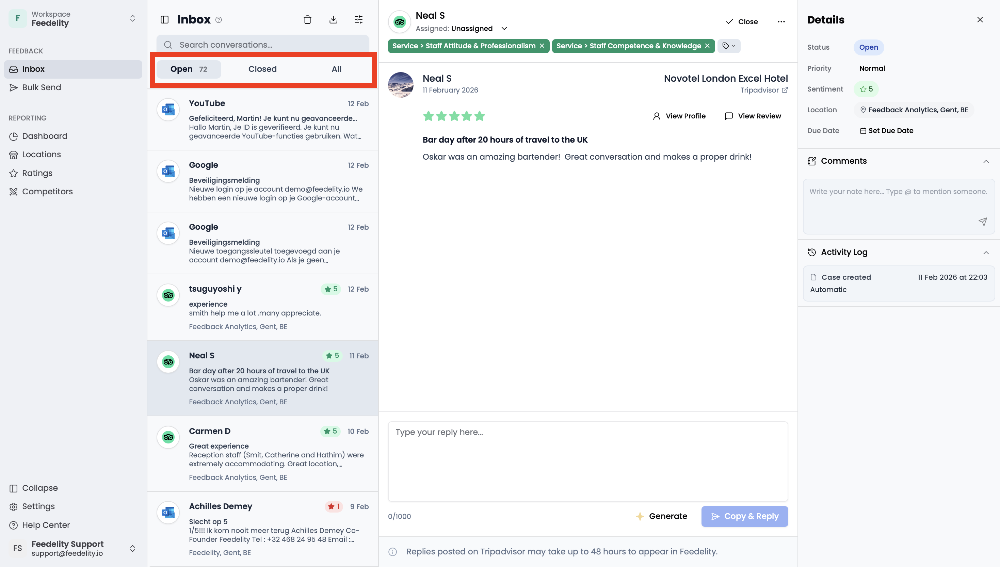
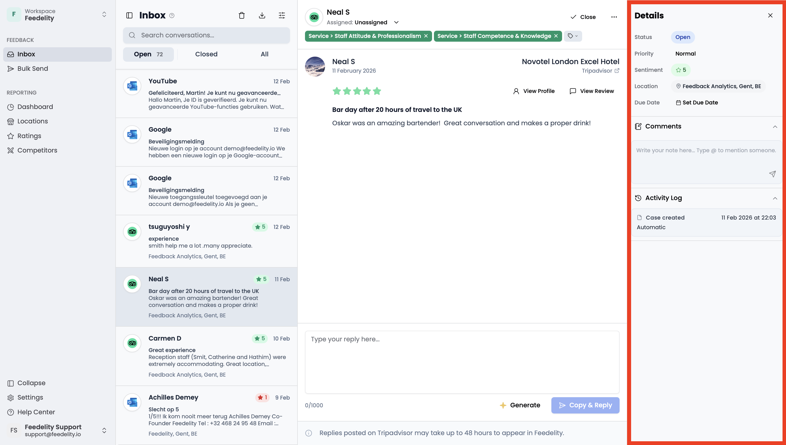
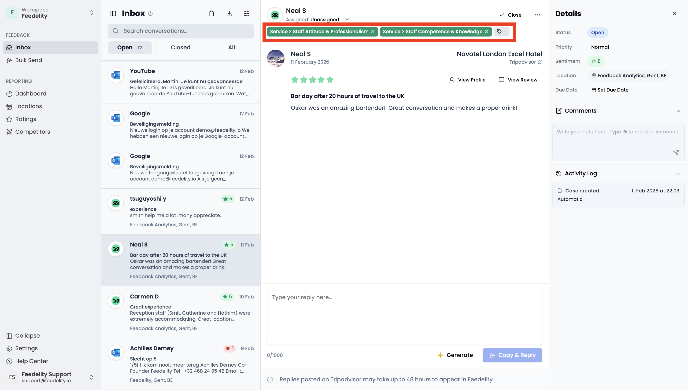
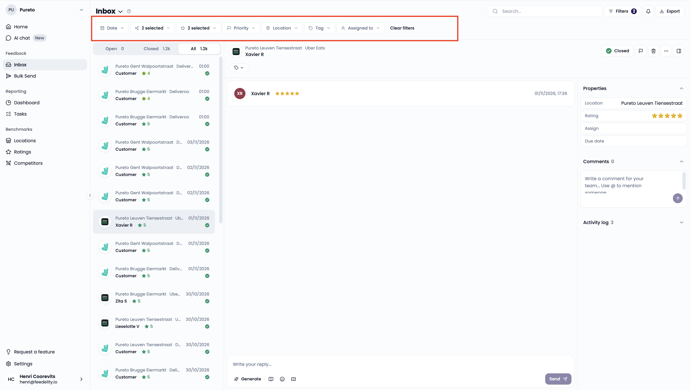
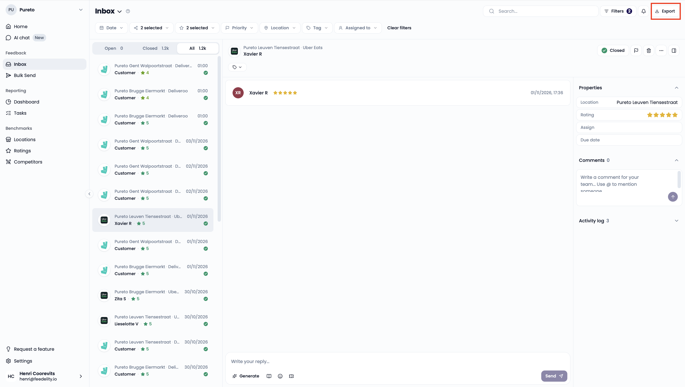
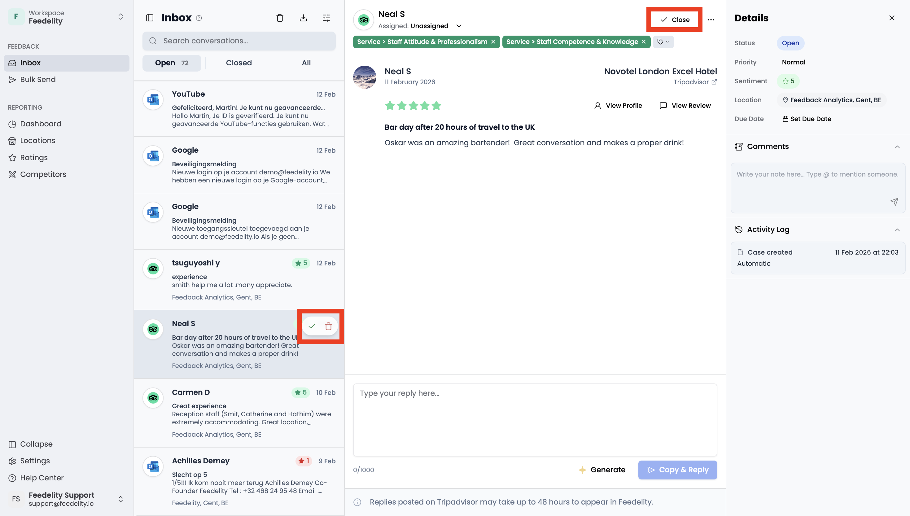
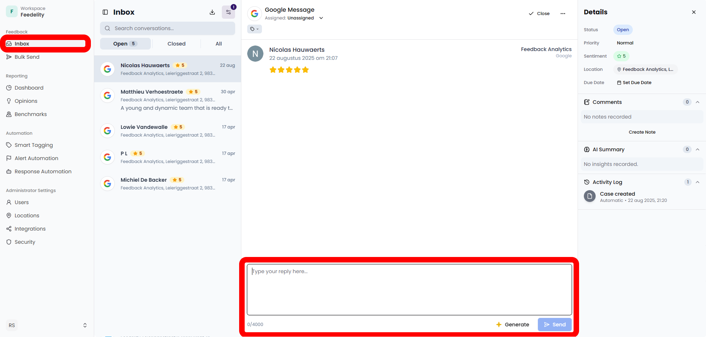
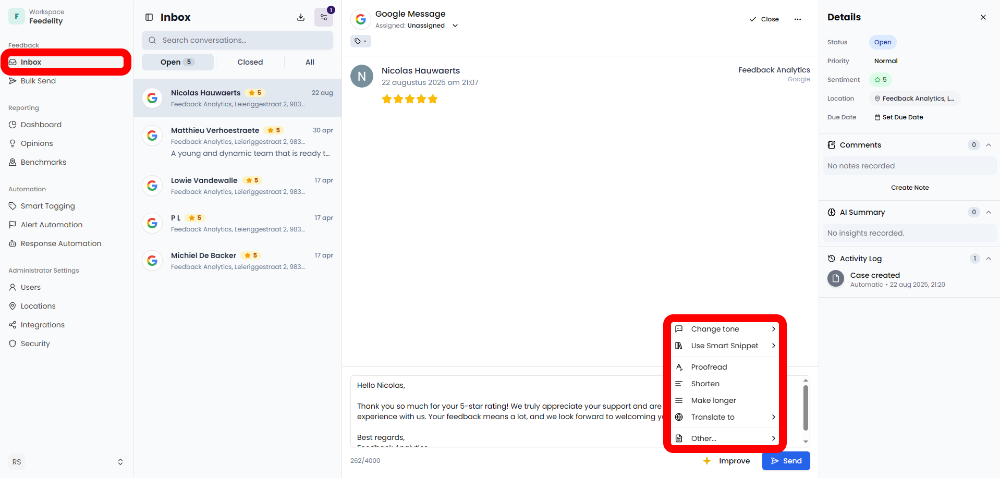
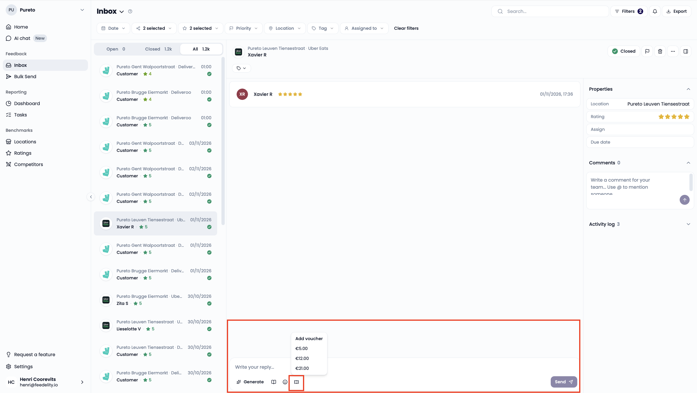

The **Inbox** is the central place to view and manage all your customer feedback. From here, you can:

- See every incoming message in one feed
- Open cases to view details
- Reply directly to customers
- Close cases when they're resolved

## Use the inbox efficiently

All new feedback appears in the **Open** folder. Once a case is handled, move it to the **Closed** folder to keep your inbox organized.

### Open vs. closed feedback

- **Open** → Feedback that still needs attention or isn't resolved yet.
- **Closed** → Feedback that's fully handled and marked as complete.

Switch between the **Open** and **Closed** views with the filter at the top of the feed. When you reply to a case, it closes automatically.

### Case details

Click a case in the feed to see it in more detail:

1. Full feedback message (thread)
2. Current status (**Open** or **Closed**)
3. Priority (red flagged or not)
4. Sentiment score
5. Associated location
6. Due date (if you set one)
7. Internal comments (for team communication)
8. Activity log (history of changes and actions)

### Tags

Each case gets tags automatically, each with a sentiment. You see them above the customer feedback. Admins manage tags on the **Settings** page, and the tags feed your dashboards.

You can always correct, add, or remove tags manually. Your corrections teach the tagging algorithm to make better predictions in the future.

### Inbox filters

You can filter by:

- Date range
- Channel
- Sentiment score
- Urgency
- Location
- Tags

### Export customer feedback

Export customer feedback to a CSV file with one click. Select the period you want to export.

<Note>
  Exports are limited to 10,000 cases.
</Note>

## Handle customer feedback

### Close a case

- From the case detail view: click **Close** at the top of the screen.
- From the list view: hover over the case and click the checkmark.

### Delete a case

Hover over the case and click the trash bin icon.

### Create a response

- **Manual response**: Type your reply in the text box and send it.
- **AI-powered response**: Click **Generate** to let one of your response agents draft a reply for you.

### Improve a response

Edit a drafted reply manually, or click **Improve** for options such as:

- Change tone
- Use Smart Snippet
- Proofread
- Shorten or expand
- Translate
- Add a custom instruction (**Other**)

### Send credits with a reply

For some reviews from delivery platforms like Deliveroo or Uber Eats, you can add a credit voucher to your reply. For example, use this when a guest mentions a missing item or a wrong order that needs to be reimbursed.

Configure the credit amounts and availability in the delivery platform's own hub first. After that, you can send credits straight from the Feedelity inbox.

<Tip>
  Manage who can send credit vouchers under **Settings** > **Users**.
</Tip>

