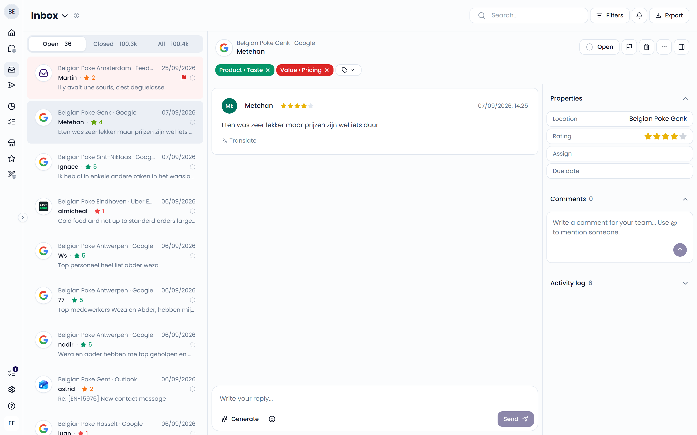
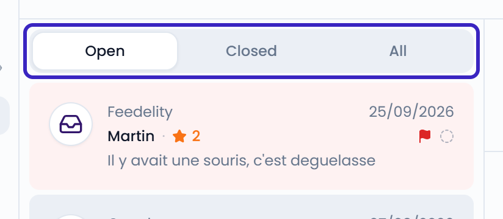
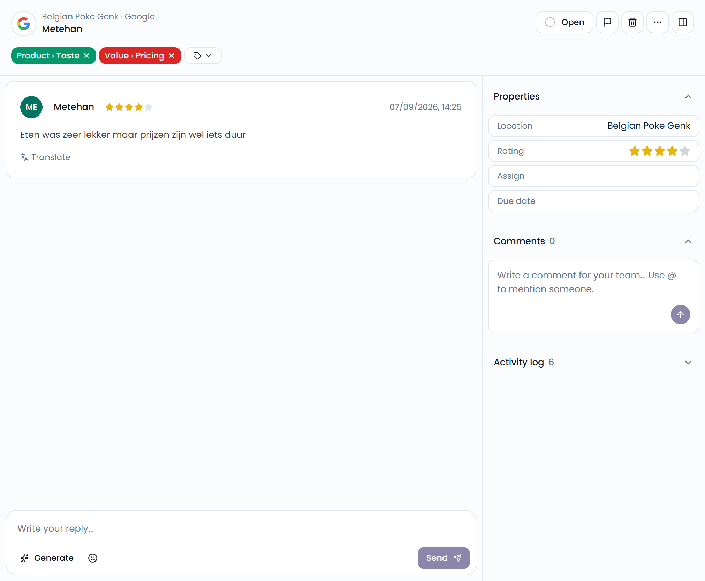
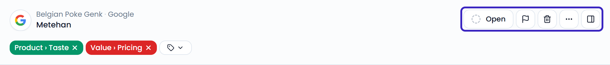

The **Inbox** collects feedback from all your connected channels in one list. Each piece of feedback is a case: a review, a message, or an email. From the inbox, you can:

- Open a case to read the full conversation and its details
- Reply to the customer
- Assign the case to a teammate
- Close the case when it's handled

{/* SCREENSHOT: /inbox?is_open=true — full inbox with the case list on the left and an open case on the right */}

<Note>
  If you haven't connected a channel yet, the inbox is empty. Click **Browse Integrations** to connect your first channel.
</Note>

## Open, Closed, and All

New feedback arrives in **Open**. When you send a reply, the case moves to **Closed** automatically. To close a case without replying, set its status to **Closed**. **All** shows both. The number on each tab shows how many cases it holds.

If the customer sends a new message on a closed case, the case reopens automatically.

Administrators can change where new messages from a connected account land. Open the account under **Settings** > **Integrations** and choose an option under **Inbox automation**:

- **Move all new messages to the Open folder**
- **Move messages without text to the Closed folder**
- **Move all new messages to the Closed folder**

{/* SCREENSHOT: /inbox?is_open=true — highlight the Open, Closed, and All tabs above the case list */}
<Frame>
  
</Frame>

## The case list

Each case in the list shows:

- The location and channel
- The customer's name and star rating
- The date of the customer's latest message, or the time if it arrived today
- A preview of the message, with a paperclip if it has attachments
- Who the case is assigned to, whether it's urgent, and whether it's open or closed

Urgent cases have a red background, so they stand out.

## Work on a case

Click a case in the list to open it. You see the conversation and the case details side by side.

When your window is too narrow to show both, for example on a phone, a case opens on the conversation. Click the panel button in the top-right corner to switch to the details, and click it again to go back to the conversation.

The details have three sections:

- **Properties**: The **Location** the case belongs to, its **Rating**, who it's assigned to, its **Folder**, and its **Due date**.
- **Comments**: Notes for your team. See [Assign, comment, and mention](/inbox/assigning-and-comments).
- **Activity log**: The history of the case, such as replies sent, tags added, and status changes.

The case's tags appear above the conversation. See [Tags, sentiment, and priority](/inbox/tags-sentiment-priority).

{/* SCREENSHOT: /inbox?case_id=<id> — an open case with tags, conversation, and the Properties, Comments, and Activity log sections */}
<Frame>
  
</Frame>

Changing the location or rating also updates your dashboards.

To read a message in another language, click **Translate** under it. Click **Show original** to switch back.

Reviews from Uber Eats and Deliveroo also show the order behind them. See [Order details](/inbox/order-details).

### Case actions

The buttons at the top of an open case let you:

- Set the status to **Open** or **Closed**
- Set the **Priority** with the flag button: **Urgent** cases show up in your team's notifications
- **Delete** the case: it's removed from your inbox and dashboards until you restore it
- Click **⋯** to **Share via email**, or to open the feedback on the original platform with **View in** _platform_

**Share via email** opens your email app with a new email. It holds the customer's name, the location, the rating, and the message.

You can also close or delete a case straight from the list. Hover over it and click the checkmark or the trash bin.

{/* SCREENSHOT: /inbox?case_id=<id> — highlight the status, priority, delete, and ⋯ buttons at the top of an open case */}
<Frame>
  
</Frame>

<Note>
  Users with the **Viewer** role can read cases but can't reply or change them. See [Users](/settings/users).
</Note>

## Keyboard shortcuts

| Key | Action |
| --- | --- |
| <kbd>↑</kbd> / <kbd>↓</kbd> | Open the previous or next case |
| <kbd>←</kbd> / <kbd>→</kbd> | Switch between **Open**, **Closed**, and **All** |
| <kbd>Ctrl</kbd> + <kbd>F</kbd> (<kbd>⌘</kbd> + <kbd>F</kbd> on Mac) | Jump to search |
| <kbd>S</kbd> | Change the status |
| <kbd>P</kbd> | Change the priority |
| <kbd>T</kbd> | Add a tag |
| <kbd>L</kbd> | Change the location |
| <kbd>R</kbd> | Change the rating |
| <kbd>A</kbd> | Assign the case |
| <kbd>F</kbd> | Move the case to a folder |
| <kbd>Backspace</kbd> | Delete the case |

## Next steps

<CardGroup cols={2}>
  <Card title="Filter and search" icon="filter" href="/inbox/filtering-and-searching">Find the cases you need.</Card>
  <Card title="Reply to customers" icon="reply" href="/inbox/replying">Reply with templates and AI.</Card>
  <Card title="Tags, sentiment, and priority" icon="tag" href="/inbox/tags-sentiment-priority">How cases are tagged.</Card>
  <Card title="Export cases" icon="download" href="/inbox/exporting">Download your feedback.</Card>
</CardGroup>
