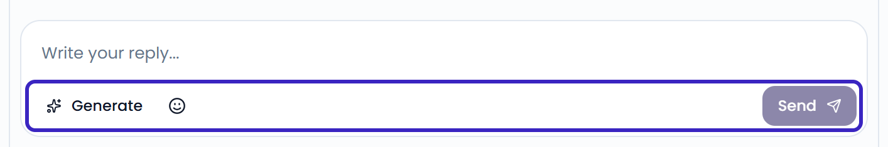
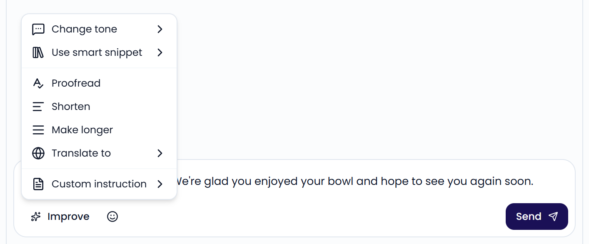
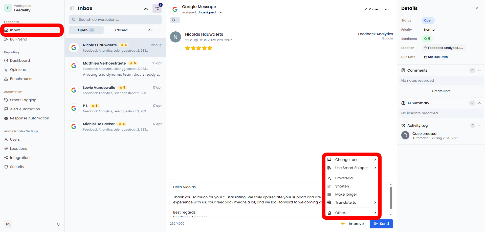

Type your reply in the box at the bottom of the case and click **Send**. Once the reply is sent, the case moves to **Closed**. If nobody was assigned to the case, it's assigned to you.

The toolbar under the box helps you write it:

- **Generate**: An [AI reply agent](/automation/agents) drafts a reply in your brand's tone of voice. If you have more than one agent, choose which one to use.
- **Use template reply** (book icon): Insert one of your [response templates](/automation/templates).
- **Add emoji**: Insert an emoji.
- **Add voucher**: Add credit to a Deliveroo or Uber Eats review. See [Add credit to a reply](#add-credit-to-a-reply).

**Generate** and the templates button show while the reply box is empty. **Generate** only shows when you have at least one AI reply agent. The templates button only shows when you have at least one template.

{/* SCREENSHOT: /inbox?case_id=<id of a Google review> — the empty reply box with Generate, the templates, emoji, and Send buttons */}
<Frame>
  
</Frame>

## Improve a reply

Edit a draft yourself, or click **Improve** to:

- **Change tone**: **More casual**, **Professional**, **Empathetic**, or **Confident**
- **Use smart snippet**: Add company knowledge from your [smart snippets](/automation/agents#smart-snippets)
- **Proofread**
- **Shorten** or **Make longer**
- **Translate to** English, French, Dutch, German, Spanish, or Italian
- Give a **Custom instruction**: Describe how to change the reply and press <kbd>Enter</kbd>

**Improve** replaces **Generate** as soon as the reply box holds text. **Use smart snippet** only shows when you have smart snippets.

{/* SCREENSHOT: /inbox?case_id=<id> — the Improve menu open on a drafted reply */}
<Frame>
  
</Frame>

## Update a reply

Some platforms, such as Google and Zenchef, let you change a reply after you post it. Click **Update** under your reply, edit it, and send it again.

If the customer edits their review after you replied, the case shows a warning. Check whether your reply still fits.

## When you can't reply

Some feedback can't be answered from Feedelity. The reply box explains why when this happens. For example:

- **Just Eat** doesn't support replies to reviews.
- **Deliveroo** only accepts replies to reviews with a written comment, within 60 days of posting.
- **Uber Eats** only accepts replies within 14 days of posting.
- A review that the customer removed can't be answered.
- Feedback from your own [QR codes](/collecting-feedback/qr-codes) and [forms](/collecting-feedback/forms) can only be answered when the customer left an email address.

Some platforms also limit the length of a reply. The reply box shows how many characters you have left when you get close to the limit.

## Reply to emails

Emails from a connected [Outlook](/integrations/outlook) mailbox show as a thread. Each email has these buttons:

- **Reply**: Reply to the sender
- **Reply All**: Reply to the sender and everyone else on the email
- **Forward**: Send the email to someone else
- **Open in Outlook**: Open the email in Outlook

The email reply form has **To**, **Cc**, **Bcc**, and **Subject** fields. Click **Cc** or **Bcc** to show those fields. If you change the subject, the email starts a new thread.

You can format the text in bold, italic, underline, or strikethrough, and add bullet or numbered lists. **Generate**, templates, **Improve**, and emoji work the same as for other replies.

To attach files, click the paperclip. Each file can be up to 3 MB, and all attachments together up to 15 MB.

Click **Discard** to delete your draft.

{/* SCREENSHOT: /inbox?case_id=<id of an Outlook email> — the email reply form with To, Cc, Subject, and the formatting toolbar */}

## Add credit to a reply

For reviews from Deliveroo and Uber Eats, you can add credit to your reply. The customer gets it on their next order. Use it to win back a guest who reports a missing item or a wrong order.

<Steps>
  <Step title="Open the credit menu">
    Click **Add voucher** in the reply toolbar.
  </Step>
  <Step title="Choose an amount">
    Choose one of the amounts. The options depend on the platform and the currency of the order.
  </Step>
  <Step title="Send the reply">
    Send your reply. The credit goes out with it.
  </Step>
</Steps>

You cover the cost of the credit. It's applied automatically to the customer's next order on that platform. **Deliveroo credit** is valid for 60 days, and **Uber Eats credit** for 30 days. Click **View conditions** on the credit for details.

<Tip>
  Administrators can always add credit. To let another user add it, turn on **Send vouchers** for that user under **Settings** > **Users**.
</Tip>

<Note>
  Credit is an add-on. If your plan doesn't include it, the button shows an **Add-on** label when you hover over it. To add it, [contact support](/faq/contact-support).
</Note>

{/* SCREENSHOT: /inbox?case_id=<id of an Uber Eats review> — the Add voucher menu open with the available credit amounts */}

