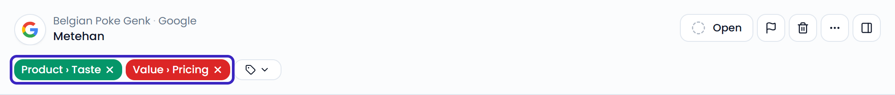
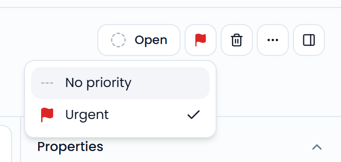

## Tags

Feedelity tags new feedback automatically. Each topic the customer mentions gets a tag, such as a dish or the service. The tags appear above the conversation and power your dashboards.

Each tag has a sentiment, shown by the colored dot:

- Green: **Positive**
- Yellow: **Neutral**
- Red: **Negative**

{/* SCREENSHOT: /inbox?case_id=<id> — the tags with their sentiment dots above a case */}
<Frame>
  
</Frame>

### Correct tags

If a tag is wrong, fix it yourself:

- **Add a tag**: Click the tag button next to the tags, or press <kbd>T</kbd>. Search for a tag, then choose **Positive**, **Neutral**, or **Negative**.
- **Remove a tag**: Click the **X** on the tag.
- **Change the sentiment**: Remove the tag and add it again with the right sentiment.

Feedelity chooses tags based on the name and description of each tag. Clear descriptions lead to better tagging. Administrators manage tags under **Settings** > **Tags**, and can also create a new tag straight from the tag search. See [Tags](/settings/tags).

## Priority

Mark a case as urgent when it needs fast attention. Click the flag button at the top of the case, or press <kbd>P</kbd>. Then choose **Urgent** or **No priority**.

Urgent cases have a red flag and a red background in the case list. Your teammates with access to the case's location get a notification.

To see only urgent cases, filter on **Priority** > **Urgent**. See [Filter and search](/inbox/filtering-and-searching).

### Red flags

Feedelity also marks cases as urgent automatically. It checks new feedback against your red flag indicators: keywords and phrases such as "food poisoning". When feedback matches, the case becomes urgent and your team gets notified.

Administrators set up red flag indicators under **Settings** > **Red flags**. See [Red flags](/settings/flags). To get an email when a red flag is detected, turn on **Red flag mail** in your [profile](/profile/profile).

If an urgent case turns out to be harmless, set its priority back to **No priority**.

{/* SCREENSHOT: /inbox?case_id=<id of an urgent case> — the priority menu open with Urgent and No priority */}
<Frame>
  
</Frame>
