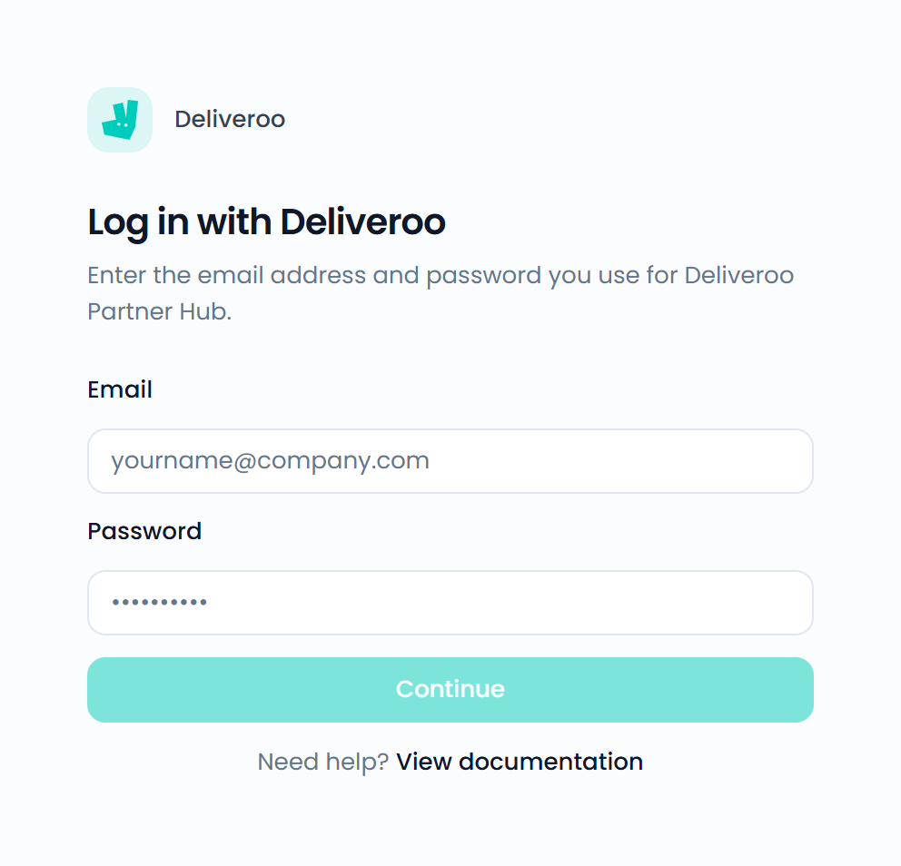

Connect Deliveroo to bring your Deliveroo reviews into the Feedelity inbox. You can reply to them from Feedelity.

## Connect Deliveroo

<Steps>
  <Step title="Choose Deliveroo">
    Go to **Settings** > **Integrations**, click **Add integration**, and choose **Deliveroo**.
  </Step>
  <Step title="Log in">
    On **Log in with Deliveroo**, enter the **Email** and **Password** you use for [Deliveroo Partner Hub](https://restaurant-hub.deliveroo.net/login?redirect=/home). Click **Continue**.
  </Step>
  <Step title="Select your restaurants">
    On **Select your restaurants**, select the restaurants you want, or click **Select all**. Click **Continue**.
  </Step>
  <Step title="Link your locations">
    If a restaurant has no location yet, pick one for each on **Link your locations** and click **Finish**.
  </Step>
</Steps>

{/* SCREENSHOT: /integrations/accounts/new/4 — the "Log in with Deliveroo" form with the Email and Password fields */}
<Frame>
  
</Frame>

{/* SCREENSHOT: /integrations/accounts/{id}/channels/new — "Select your restaurants" for Deliveroo with a few restaurants ticked */}

To add or remove restaurants later, open your Deliveroo integration under **Settings** > **Integrations**.

## Order details

Deliveroo reviews with a written comment show the order the customer placed: the order number, the total, and the items they ordered. Reviews without a written comment don't include the order. See [Order details](/inbox/order-details).

## Replying to Deliveroo reviews

- You can reply to a review within 60 days after it's posted.
- You can only reply to reviews that include a written comment.
- A reply can be up to 600 characters.
- You can't edit a reply after you send it.
- You can add credit to your reply. See [Add credit to a reply](/inbox/credit).
- You can reply to many Deliveroo reviews at once with [Bulk Send](/inbox/bulk-actions).
