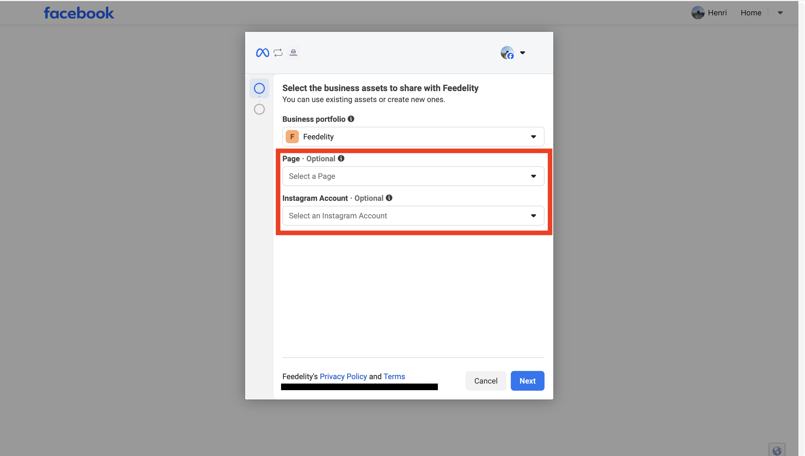
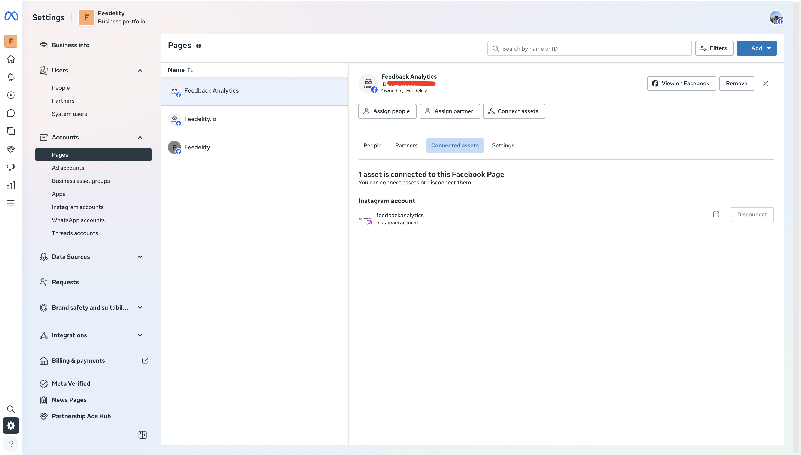

The Facebook integration brings direct messages from your Facebook pages into the Feedelity inbox. You can reply to them from Feedelity.

## Connect Facebook

<Steps>
  <Step title="Choose Meta for Business">
    Go to **Settings** > **Integrations**, click **Add integration**, and choose **Meta for Business**.
  </Step>
  <Step title="Log in with Facebook">
    Facebook opens. Log in with your Facebook account and give Feedelity access to your pages.

    
  </Step>
  <Step title="Select your pages">
    On **Select your Facebook pages and Instagram accounts**, select the Facebook pages you want, or click **Select all**. Click **Continue**.
  </Step>
  <Step title="Link your locations">
    If a page has no location yet, pick one for each on **Link your locations** and click **Finish**.
  </Step>
</Steps>

{/* SCREENSHOT: /integrations/accounts/{id}/channels/new — "Select your Facebook pages and Instagram accounts" with a Facebook page ticked */}

To add more pages later, open the Meta for Business account under **Settings** > **Integrations** and click **Add channel**.

<Tip>
  The same login also gives access to your Instagram accounts. See [Instagram](/integrations/instagram).
</Tip>

<Note>
  Make sure you have access to the relevant Meta Business Portfolios. Check this in your [Meta Business Suite](https://business.facebook.com/): go to **Pages** and check **Connected assets** to see which pages you can access and link to Feedelity.
</Note>

## What you can do

- Feedelity shows Facebook messages as a chat conversation.
- You can reply to direct messages from Feedelity.
