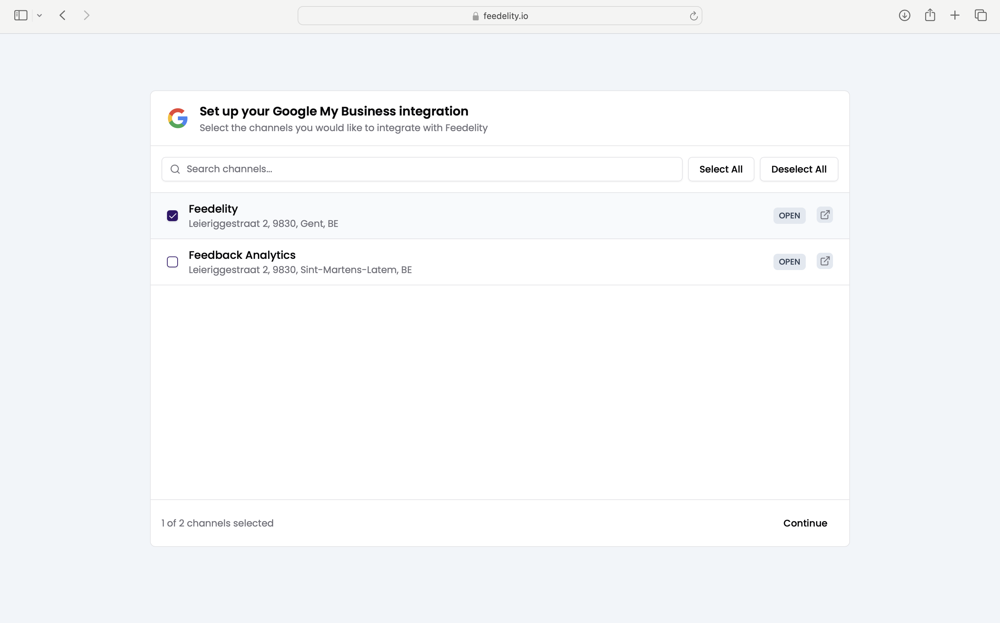
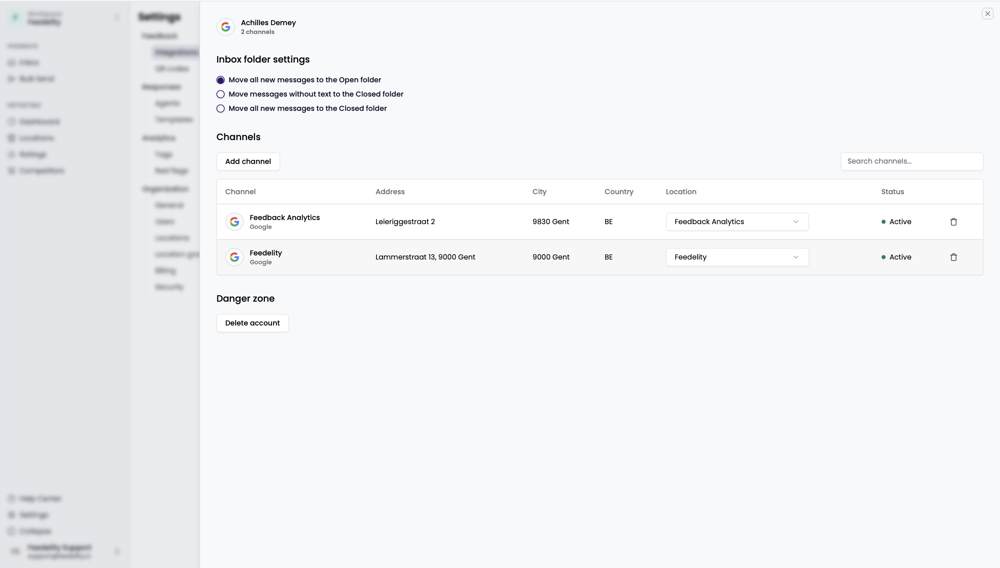

When you first log in and create your organization, Feedelity prompts you to connect your Google My Business (GMB) account. You can skip this step.

You can also add the Google integration later from **Settings** > **Integrations**. Feedelity asks you to sign in with your Google account. Make sure you have access to at least one GMB account.

After you sign in, select which locations to connect to Feedelity. You can update these settings at any time.

To link additional GMB accounts, click **Add integration**. Sign in with your other GMB account and link the locations you want. You can always manage connected Google locations in the integration settings.

