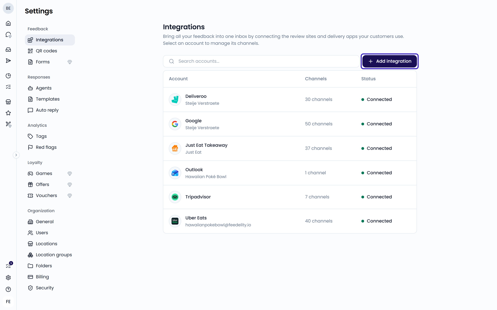
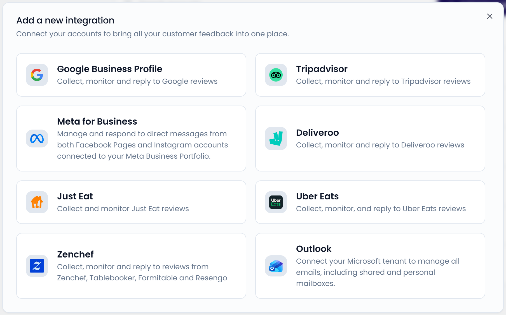
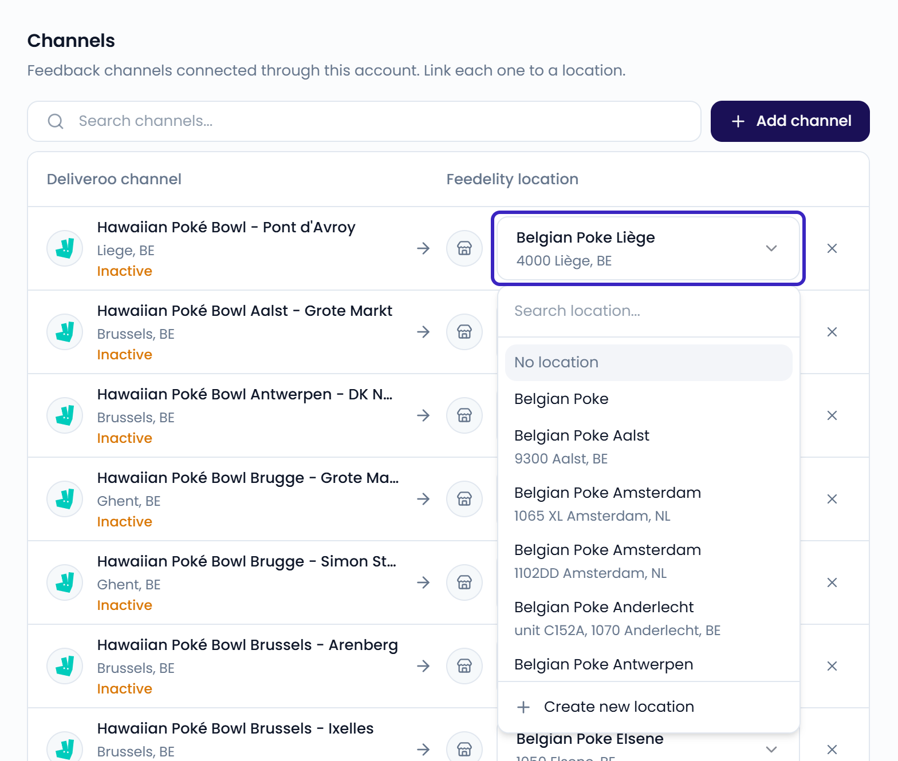
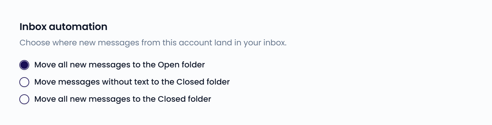

Integrations bring feedback from other platforms into Feedelity. New reviews and messages arrive in your **Inbox** as cases.

Only administrators can add and manage integrations. You find them under **Settings** > **Integrations**.

{/* SCREENSHOT: /settings/integrations — the account list and the Add integration button */}

## Accounts and channels

An integration has two levels:

- **Account**: your login or connection with a platform, such as your Google account or your Deliveroo Partner Hub login.
- **Channel**: one source of feedback inside that account, such as one Google listing, one Facebook page, or one mailbox.

One account can hold many channels. For example, one Google account can manage the listings of all your restaurants.

The **Integrations** page lists your accounts. When an account needs your attention, it shows a message:

- A message such as **2 channels are not linked to a location**: some channels have no location yet. See [Link a channel to a location](#link-a-channel-to-a-location).
- **Reauthentication required**: Feedelity lost access to the account. See [Manage integrations](/integrations/manage).

An account without a message works as it should.

## Add an integration

<Steps>
  <Step title="Open the integrations">
    Go to **Settings** > **Integrations**.
  </Step>
  <Step title="Choose a platform">
    Click **Add integration** and choose a platform. The platforms are listed alphabetically.
  </Step>
  <Step title="Connect your account">
    Follow the steps on screen. Depending on the platform, you sign in with the platform, enter your login details, or paste a link. Each platform has its own guide in this section.
  </Step>
  <Step title="Select your channels">
    Choose the channels you want in Feedelity and click **Continue**.
  </Step>
  <Step title="Link your locations">
    If a channel has no location yet, the **Link your locations** screen opens. Pick a location for each channel and click **Finish**.
  </Step>
</Steps>

{/* SCREENSHOT: /settings/integrations — the "Add a new integration" dialog with the list of platforms */}
<Frame>
  
</Frame>

You can choose from these platforms:

| Platform | How you connect | Reply from Feedelity |
| --- | --- | --- |
| [Google Business Profile](/integrations/google) | Sign in with Google | Yes |
| [Facebook](/integrations/facebook) | Sign in with Facebook | Yes, to direct messages |
| [Instagram](/integrations/instagram) | Sign in with Facebook | Yes, to direct messages |
| [Outlook](/integrations/outlook) | Sign in with Microsoft, then add mailboxes | Yes, by email |
| [Tripadvisor](/integrations/tripadvisor) | Paste the link to your page | Yes, you post the reply on Tripadvisor |
| [Uber Eats](/integrations/uber-eats) | Through our support team | Yes |
| [Deliveroo](/integrations/deliveroo) | Enter your Partner Hub login | Yes |
| [Just Eat](/integrations/just-eat) | Paste the link to your restaurant or brand page | No |
| [Zenchef](/integrations/zenchef) | Enter your Zenchef API token | Yes |

You can also connect [Leat](/loyalty/leat), a loyalty platform. Leat brings in your promotions as offers, not feedback, so it has no channels.

## Link a channel to a location

Link each channel to the location it belongs to. Its feedback is then assigned to that location, so you can filter your inbox and dashboards by location.

When you connect channels, Feedelity tries to link each one to an existing location by name and address. For Google listings without a match, Feedelity creates a new location. Mailboxes are never linked automatically.

To change a link later:

<Steps>
  <Step title="Open the account">
    Go to **Settings** > **Integrations** and click the account.
  </Step>
  <Step title="Pick a location">
    Under **Channels**, use the **Feedelity location** column next to the channel. Pick a location, choose **No location**, or click **Create new location**.
  </Step>
</Steps>

The change also applies to the channel's existing cases.

{/* SCREENSHOT: /settings/integrations/{id} — the Channels table with the location picker opened next to a channel */}
<Frame>
  
</Frame>

You can also link channels from the location itself, with **Link a channel**. See [Locations](/settings/locations).

<Tip>
  Leave a channel without a location only when it receives feedback for several locations at once, such as a shared mailbox. Feedback from an unlinked channel doesn't show up when you filter dashboards by location.
</Tip>

## Add or remove channels

To add channels to an account you already connected, open the account and click **Add channel**. You then go through the same steps as when you first connected.

To remove a channel, click the **×** next to it, then **Delete channel**. This deletes all data of that channel.

### Channel status

A channel can show a status under its name:

- **Inactive**: the location is temporarily or permanently closed on the platform. Feedelity can't fetch new data while it stays closed.
- **Deleted**: the channel was deleted from your account on the platform. Feedelity can't fetch new data for it.

## Inbox automation

Each account has an **Inbox automation** setting. It decides in which folder new messages from that account land. Open the account and choose one option:

- **Move all new messages to the Open folder**
- **Move messages without text to the Closed folder**: useful for star ratings without a comment
- **Move all new messages to the Closed folder**

{/* SCREENSHOT: /settings/integrations/{id} — the Inbox automation section with the three options */}
<Frame>
  
</Frame>

## Next steps

<CardGroup cols={2}>
  <Card title="Manage integrations" icon="plug" href="/integrations/manage">Reconnect or delete an integration.</Card>
  <Card title="Reply to customers" icon="reply" href="/inbox/replying">Reply to your cases from the inbox.</Card>
</CardGroup>
