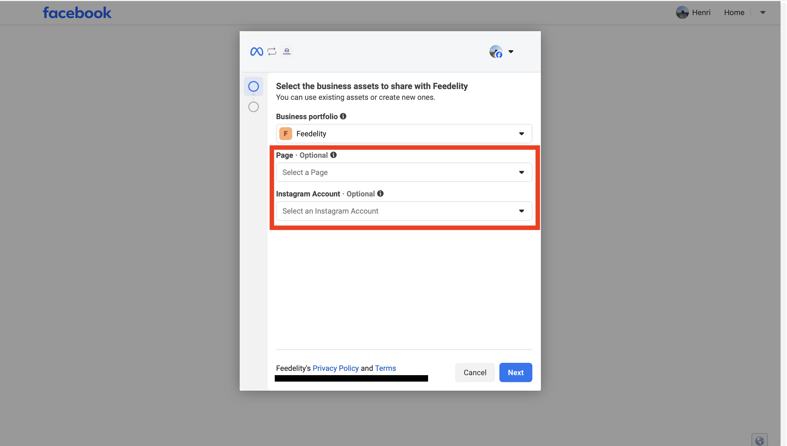
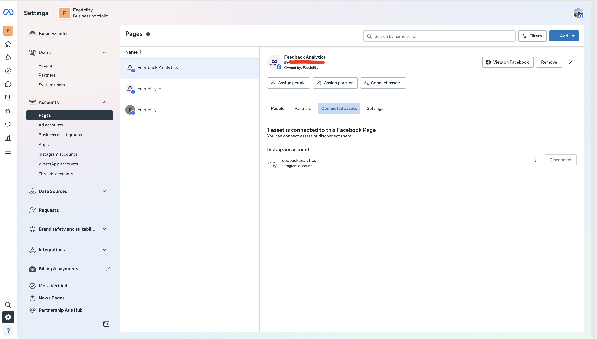

The Instagram integration brings direct messages from your Instagram accounts into the Feedelity inbox. You can reply to them from Feedelity.

## Connect Instagram

You connect Instagram through your Meta Business Portfolio, so you sign in with Facebook.

<Steps>
  <Step title="Choose Meta for Business">
    Go to **Settings** > **Integrations**, click **Add integration**, and choose **Meta for Business**.
  </Step>
  <Step title="Log in with Facebook">
    Facebook opens. Log in with your Facebook account and give Feedelity access to your accounts.

    
  </Step>
  <Step title="Select your accounts">
    On **Select your Facebook pages and Instagram accounts**, select the Instagram accounts you want, or click **Select all**. Click **Continue**.
  </Step>
  <Step title="Link your locations">
    If an account has no location yet, pick one for each on **Link your locations** and click **Finish**.
  </Step>
</Steps>

{/* SCREENSHOT: /integrations/accounts/{id}/channels/new — "Select your Facebook pages and Instagram accounts" with an Instagram account ticked */}

To add more accounts later, open the Meta for Business account under **Settings** > **Integrations** and click **Add channel**.

<Tip>
  The same login also gives access to your Facebook pages. See [Facebook](/integrations/facebook).
</Tip>

<Note>
  Make sure you have access to the relevant Meta Business Portfolios. Check this in your [Meta Business Suite](https://business.facebook.com/): check **Connected assets** to see which accounts you can access and link to Feedelity.
</Note>

## What you can do

- Feedelity shows Instagram messages as a chat conversation.
- You can reply to direct messages from Feedelity.
