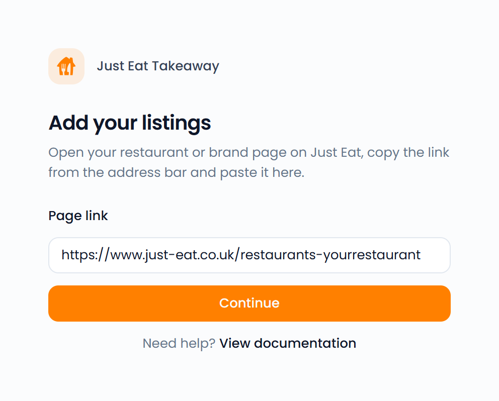

Connect your Just Eat Takeaway restaurants to Feedelity. Their reviews and ratings appear in your inbox and dashboards, next to the feedback from your other channels.

<Note>
  Just Eat Takeaway doesn't let restaurants reply to reviews. You can read Just Eat reviews in Feedelity, but you can't answer them.
</Note>

## Add your restaurants

You can add one restaurant at a time, or all the restaurants of your brand at once.

<Steps>
  <Step title="Add an integration">
    Go to **Settings** > **Integrations** and click **Add integration**.
  </Step>
  <Step title="Choose Just Eat">
    Choose **Just Eat**.
  </Step>
  <Step title="Find your page">
    Open Just Eat in your browser and find your restaurant or your brand page.
  </Step>
  <Step title="Copy the URL">
    Copy the full URL from your browser's address bar.
  </Step>
  <Step title="Paste the URL">
    On **Add your listings**, paste it into the **Page link** field and click **Continue**.
  </Step>
  <Step title="Link your locations">
    If a restaurant has no location yet, the **Link your locations** screen opens. Match each restaurant to a Feedelity location, then click **Finish**.
  </Step>
</Steps>

{/* SCREENSHOT: /integrations/accounts/{id}/channels/new — the Just Eat "Add your listings" page with a brand page link pasted into Page link */}
<Frame>
  
</Frame>

To add more restaurants later, open your Just Eat integration and click **Add channel**.

### Add one restaurant

Paste the URL of the restaurant's own page on Just Eat, the page that shows its menu. Feedelity adds that one restaurant. For example:

- Belgium: [https://www.takeaway.com/be-en/menu/burger-king-namur](https://www.takeaway.com/be-en/menu/burger-king-namur)
- Netherlands: [https://www.thuisbezorgd.nl/en/menu/gangnam-chicken-oost-1](https://www.thuisbezorgd.nl/en/menu/gangnam-chicken-oost-1)
- United Kingdom: [https://www.just-eat.co.uk/restaurants-88th-street-burger-bar---chester-rd-sunderland-south-hylton/menu](https://www.just-eat.co.uk/restaurants-88th-street-burger-bar---chester-rd-sunderland-south-hylton/menu)

### Add all restaurants of a brand

A brand page lists every restaurant of a chain. Paste its URL and Feedelity adds all of those restaurants in one go. For example:

- Belgium: [https://www.takeaway.com/be-en/takeaway/brands/burger-king](https://www.takeaway.com/be-en/takeaway/brands/burger-king)
- Netherlands: [https://www.thuisbezorgd.nl/en/takeaway/brands/burger-king](https://www.thuisbezorgd.nl/en/takeaway/brands/burger-king)
- United Kingdom: [https://www.just-eat.co.uk/takeaway/brands/88th-street-burger-bar](https://www.just-eat.co.uk/takeaway/brands/88th-street-burger-bar)

### Find your brand page

Every country has a page listing all brands on Just Eat. Open the one for your country, find your brand and click it. The page that opens is your brand page.

- Belgium: [https://www.takeaway.com/be-en/takeaway/brands](https://www.takeaway.com/be-en/takeaway/brands)
- Luxembourg: [https://www.takeaway.com/lu-en/takeaway/brands](https://www.takeaway.com/lu-en/takeaway/brands)
- Netherlands: [https://www.thuisbezorgd.nl/en/takeaway/brands](https://www.thuisbezorgd.nl/en/takeaway/brands)
- Germany: [https://www.lieferando.de/en/takeaway/brands](https://www.lieferando.de/en/takeaway/brands)
- Austria: [https://www.lieferando.at/en/takeaway/brands](https://www.lieferando.at/en/takeaway/brands)
- Switzerland: [https://www.just-eat.ch/en/takeaway/brands](https://www.just-eat.ch/en/takeaway/brands)
- Italy: [https://www.justeat.it/en/takeaway/brands](https://www.justeat.it/en/takeaway/brands)
- Spain: [https://www.just-eat.es/en/takeaway/brands](https://www.just-eat.es/en/takeaway/brands)
- Poland: [https://www.pyszne.pl/en/takeaway/brands](https://www.pyszne.pl/en/takeaway/brands)
- Slovakia: [https://www.bistro.sk/en/takeaway/brands](https://www.bistro.sk/en/takeaway/brands)
- United Kingdom: [https://www.just-eat.co.uk/takeaway/brands](https://www.just-eat.co.uk/takeaway/brands)
- Ireland: [https://www.just-eat.ie/takeaway/brands](https://www.just-eat.ie/takeaway/brands)

### Good to know

- Restaurants you already connected are updated, not added twice.
- If a restaurant on the brand page can't be read, Feedelity skips it. Add it with its restaurant URL instead.
- A brand page shows at most 1,000 restaurants. For a larger brand, add the missing restaurants one by one.

## Supported Just Eat websites

- **Belgium, Luxembourg:** [takeaway.com](https://takeaway.com)
- **Netherlands:** [thuisbezorgd.nl](https://thuisbezorgd.nl)
- **Germany:** [lieferando.de](https://lieferando.de)
- **Austria:** [lieferando.at](https://lieferando.at)
- **Switzerland:** [just-eat.ch](https://just-eat.ch)
- **Italy:** [justeat.it](https://justeat.it)
- **Spain:** [just-eat.es](https://just-eat.es)
- **Poland:** [pyszne.pl](https://pyszne.pl)
- **Slovakia:** [bistro.sk](https://bistro.sk)
- **United Kingdom:** [just-eat.co.uk](https://just-eat.co.uk)
- **Ireland:** [just-eat.ie](https://just-eat.ie)

## What Feedelity collects

For each restaurant, Feedelity collects its reviews and keeps its average rating and number of reviews up to date. New reviews appear in your inbox automatically.
