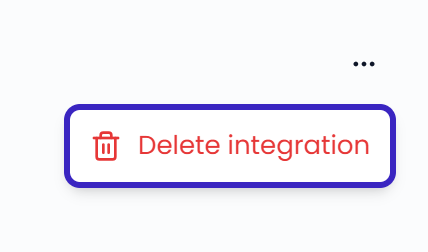

Integrations keep working on their own once they're connected. Sometimes a platform stops giving Feedelity access, for example when a password changes or access expires. Then you need to reconnect.

Only administrators can manage integrations.

## Check the status of your integrations

Go to **Settings** > **Integrations**. An account that needs your attention shows a message:

- A message such as **1 channel is not linked to a location**: the account works, but some channels have no location. See [Link a channel to a location](/integrations/how-integrations-work#link-a-channel-to-a-location).
- **Reauthentication required**: Feedelity lost access to the account. Reconnect it.

An account without a message works as it should.

{/* SCREENSHOT: /settings/integrations — the account list with one account showing "Reauthentication required" and the Reconnect button */}

## Reconnect an integration

When an account needs to be reauthenticated, new feedback from it stops arriving and replies may fail. Feedelity warns you in several places:

- A banner in the **Inbox** and on the account's page: **Your {"<platform>"} account {"<name>"} needs your attention**
- An action on the **Home** page: **Your {"<platform>"} integration is disconnected**
- **Reauthentication required** on the **Integrations** page

To reconnect:

<Steps>
  <Step title="Start reconnecting">
    Click **Reconnect now** in the banner, **Reconnect** on the **Integrations** page, or the action on the **Home** page.
  </Step>
  <Step title="Sign in again">
    Feedelity takes you through the sign-in for that platform again. Sign in with an account that still has access to your locations, pages, or mailboxes.
  </Step>
</Steps>

{/* SCREENSHOT: /inbox — the "needs your attention" banner with the Reconnect now button */}

When you sign in through Google, Meta, or Microsoft, Feedelity takes you back to the page you started from and confirms that the account is reconnected.

Only administrators see the banners and can reconnect. Other users see **Ask an admin to reconnect** on the **Home** page.

{/* TODO: confirm what reconnecting does for Deliveroo and Zenchef (form login): does it update the existing account or create a second one? */}

## Channels that stopped receiving feedback

A single channel can stop receiving feedback while the account is still connected. The channel then shows a status under its name on the account's page:

- **Inactive**: the location is temporarily or permanently closed on the platform. Feedelity can't fetch new data while it stays closed.
- **Deleted**: the channel was deleted from your account on the platform. Feedelity can't fetch new data for it.

To fix this, reopen or restore the location on the platform itself.

## Delete a channel

<Steps>
  <Step title="Open the account">
    Go to **Settings** > **Integrations** and click the account.
  </Step>
  <Step title="Delete the channel">
    Click the **×** next to the channel, then click **Delete channel** to confirm.
  </Step>
</Steps>

<Warning>
  Deleting a channel deletes all data of that channel.
</Warning>

## Delete an integration

<Steps>
  <Step title="Open the account">
    Go to **Settings** > **Integrations** and click the account.
  </Step>
  <Step title="Delete the integration">
    Click **⋯** in the top-right corner and choose **Delete integration**.
  </Step>
  <Step title="Confirm">
    Click **Delete integration** to confirm.
  </Step>
</Steps>

{/* SCREENSHOT: /settings/integrations/{id} — the ⋯ menu opened with Delete integration */}
<Frame>
  
</Frame>

<Warning>
  Deleting an integration permanently deletes the account and all its data. You can't undo this.
</Warning>
