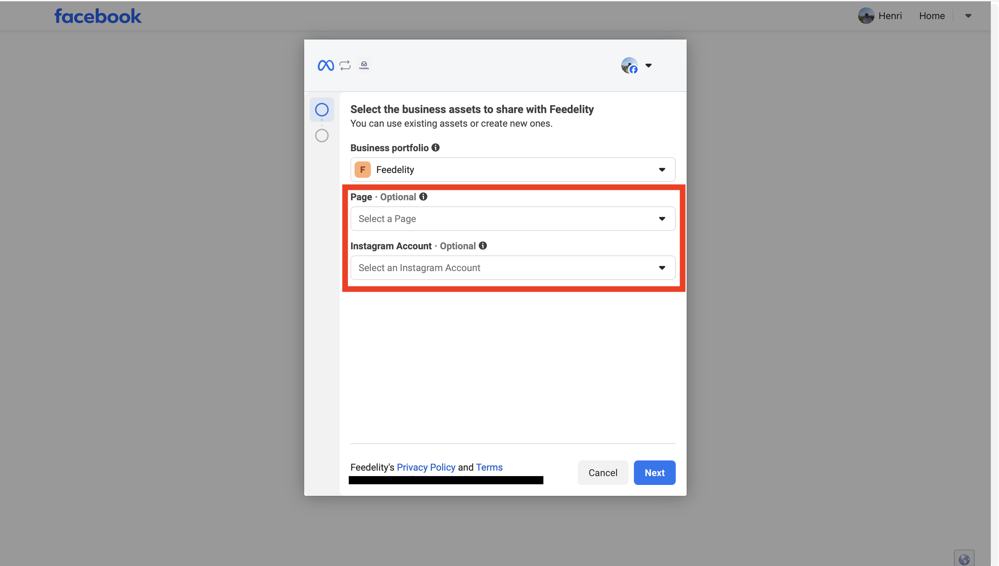
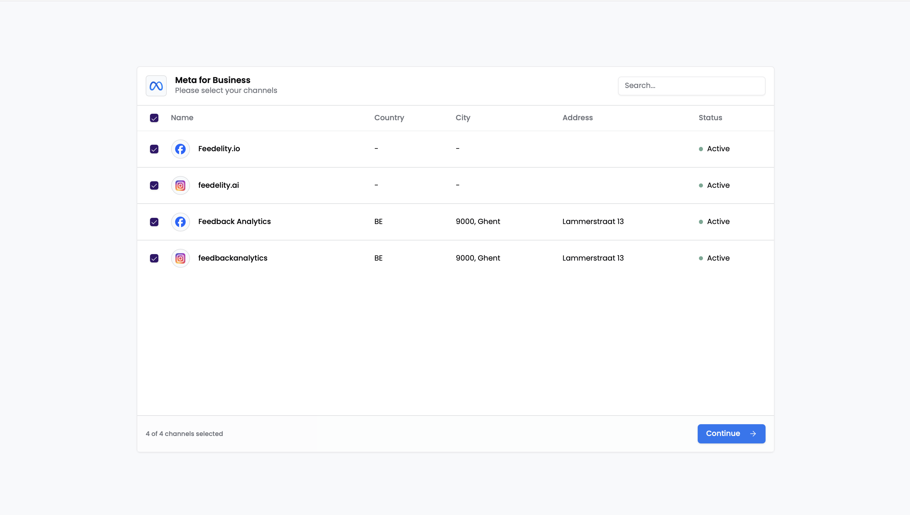
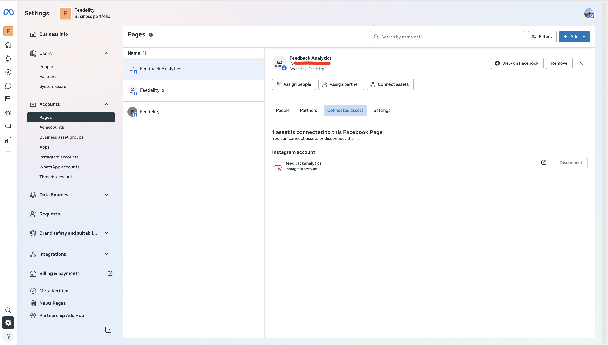

You can also bring Instagram and Facebook messages into Feedelity. Select the Meta integration and log in with your Facebook account when prompted.

From there, connect any pages linked to your account. Once you connect a page, Feedelity shows the associated Instagram and Facebook accounts, and you can integrate the ones you want.

<Note>
  Make sure you have access to the relevant Meta Business Portfolios. Check this in your [Meta Business Suite](https://business.facebook.com/): go to **Pages** and check **Connected assets** to see which pages you can access and link to Feedelity.
</Note>

