Feedelity connects to your Microsoft 365 tenant to read incoming feedback from designated shared mailboxes (for example, info@yourbrand.be). Each mailbox becomes a channel. Your team can then reply to that feedback by email, directly from Feedelity.

<Warning>
  A **Microsoft 365 administrator must start this integration**. This person needs rights to grant tenant-wide admin consent and to run Exchange Online PowerShell. A regular user account can't complete this setup.
</Warning>

Shared mailboxes have no signed-in user, so Microsoft doesn't support standard delegated permissions for this scenario. Instead, Feedelity runs as a background service with application permissions. By default, application permissions grant access to every mailbox in the tenant. This guide follows Microsoft's recommended approach to narrow that down: you scope access to a specific mail-enabled security group with an Application Access Policy. See Microsoft's reference: [Limiting application permissions to specific Exchange Online mailboxes](https://learn.microsoft.com/en-us/graph/auth-limit-mailbox-access#configure-applicationaccesspolicy).

## Set up the integration

<Steps>
  <Step title="Create a security group">
    Before you connect the app, define which mailboxes Feedelity may access by putting them in a group in Microsoft Exchange.

    1. Go to the **Exchange Admin Center** > **Recipients** > **Groups**.
    2. Click **Add a group** and select **Mail-enabled security**.
    3. Name the group, for example `Feedelity_Integration_Access`.
    4. Add owners, usually yourself.
    5. Add members: the shared mailboxes you want Feedelity to access, for example info@yourbrand.be.
    6. Assign an email address to the group itself, for example feedelity-access-group@yourbrand.com.
    7. Create the group.

    See the [appendix](#appendix-create-a-mail-enabled-security-group) for screenshots of each step.
  </Step>
  <Step title="Connect and grant consent">
    Next, install the Feedelity app in your tenant by granting consent.

    1. Log in to Feedelity as an administrator.
    2. Go to **Settings** > **Integrations** and click **Add integration**.
    3. Select **Outlook**.
    4. Grant consent: Microsoft opens. Click **Accept** to grant the required permissions.

    Feedelity then opens **Add a mailbox**. Don't add a mailbox yet: first restrict access in the next step. To come back later, click **Integrations** at the top to return to the list.

    <Note>
      At this moment, access is technically **tenant-wide**. You restrict it **immediately** in the next step.
    </Note>
  </Step>
  <Step title="Restrict access with a PowerShell policy">
    Now that the app is installed, use PowerShell to apply the restriction policy. See Microsoft's reference: [Limiting application permissions to specific Exchange Online mailboxes](https://learn.microsoft.com/en-us/graph/auth-limit-mailbox-access#configure-applicationaccesspolicy).

    You need the **Exchange Online PowerShell Module** installed.

    **1. Connect to Exchange Online**

    Open PowerShell as administrator and run:

    ```powershell
    Import-Module ExchangeOnlineManagement
    Connect-ExchangeOnline
    ```

    A login window pops up. Sign in with your Microsoft 365 administrator account.

    **2. Define your variables**

    Copy the block below into PowerShell. Replace the email address in quotes with the email of the security group you created in step 1.

    ```powershell
    # --- CONFIGURATION ---
    # 1. The Fixed Feedelity App ID (Do not change)
    $AppID = "f33297e7-2440-42f7-b370-ea69d9281623"

    # 2. YOUR Security Group Email (CHANGE THIS to your group email)
    $GroupEmail = "feedelity-access-group@yourbrand.com"

    # 3. Description for your reference
    $Desc = "Restrict Feedelity to specific shared mailboxes"
    ```

    **3. Create the policy**

    Paste this command to create the restriction with the variables you defined above:

    ```powershell
    New-ApplicationAccessPolicy -AppId $AppID -PolicyScopeGroupId $GroupEmail -AccessRight RestrictAccess -Description $Desc
    ```

    **4. Verify the policy (optional, recommended)**

    Run these tests to check that the restriction works.

    Test A, a mailbox in the group. The result should say "Granted":

    ```powershell
    Test-ApplicationAccessPolicy -Identity "info@yourbrand.be" -AppId $AppID
    ```

    Test B, a mailbox outside the group. The result should say "Denied":

    ```powershell
    Test-ApplicationAccessPolicy -Identity "ceo@yourbrand.be" -AppId $AppID
    ```

    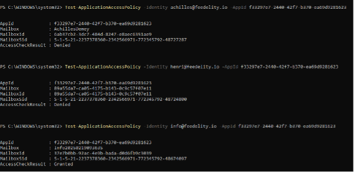
  </Step>
  <Step title="Finalize the configuration">
    Now that the connection is secure, tell Feedelity which mailbox to sync.

    1. Go to **Settings** > **Integrations** and click the Outlook account you just connected.
    2. Click **Add channel**.
    3. On **Add a mailbox**, type the email address of the shared mailbox in **Email**, for example info@yourbrand.be.
    4. Click **Continue**.

    <Warning>
      Make sure this mailbox is a member of the security group you created in step 1.
    </Warning>

    {/* SCREENSHOT: /integrations/accounts/{id}/channels/new — the "Add a mailbox" page for Outlook with an email address filled in */}
    <Frame>
      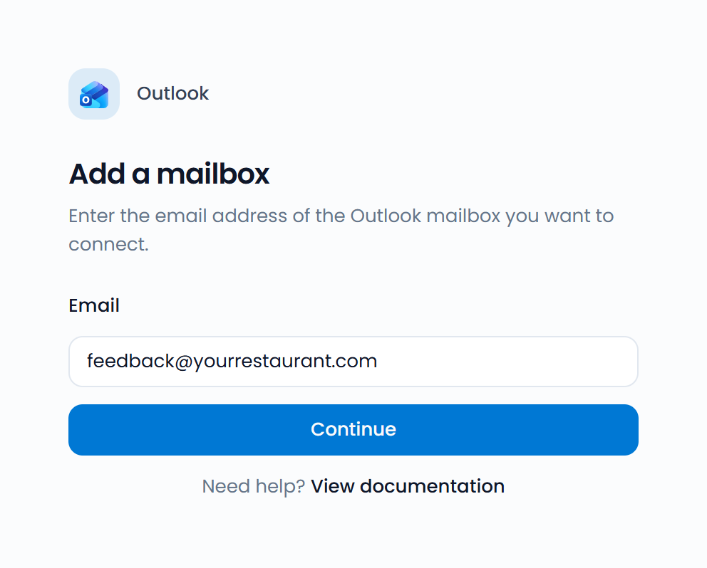
    </Frame>

    Mailboxes aren't linked to a location automatically. To link one, see [Link a channel to a location](/integrations/how-integrations-work#link-a-channel-to-a-location).
  </Step>
</Steps>

<Warning>
  **Timing:** access restrictions (Application Access Policies) can take up to 1 hour to propagate on the Microsoft Exchange servers.

  If you get an error when you add the mailbox right after running the PowerShell commands, wait 15–60 minutes and try again. This is a normal Microsoft delay, not an error with Feedelity.
</Warning>

## Technical reference: permissions and security

This section explains the technical details behind the permissions requested in step 2.

### Why Feedelity requires application permissions

Feedelity currently supports integration with shared mailboxes only.

A shared mailbox has no licensed user with a password to sign in. So Microsoft doesn't allow standard delegated permissions (acting on behalf of a signed-in user) for these mailboxes. Instead, Feedelity acts as a background service with application permissions.

- **Default behavior:** by default, Microsoft grants application permissions at the tenant level. The app technically has access to all mailboxes.
- **Safeguard:** the Application Access Policy you created in step 3 overrides this default. It strictly limits Feedelity's access to the security group you defined.

### Detailed permissions

**A. Application permissions (email integration)**

These let Feedelity access the shared mailboxes to process feedback without a user present.

| Permission | Type | Justification |
| --- | --- | --- |
| Mail.ReadWrite | Application | Lets Feedelity receive emails from the shared mailbox. |
| Mail.Send | Application | Lets your staff reply to complaints and feedback directly from Feedelity. |
| Organization.Read.All | Application | |

**B. Delegated permissions (user authentication)**

These let your team members log in to Feedelity with their Microsoft credentials.

| Permission | Type | Justification |
| --- | --- | --- |
| openid, email, profile | Delegated | Required for single sign-on (SSO). These let any user in your organization log in to Feedelity. Without them, users can't access the Feedelity application. |

### Manage permissions

You can review, manage, and edit these permissions at any time in the **Microsoft Entra Portal**, under **Enterprise Applications** > **Feedelity**.

<Warning>
  Changing or revoking these permissions manually in the Entra Portal may break the integration. Removing permissions stops emails from being processed or stops users from logging in.
</Warning>

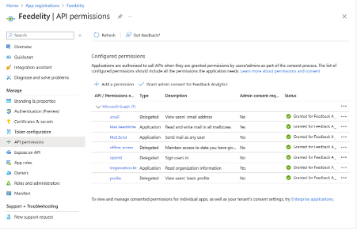

## Appendix: create a mail-enabled security group

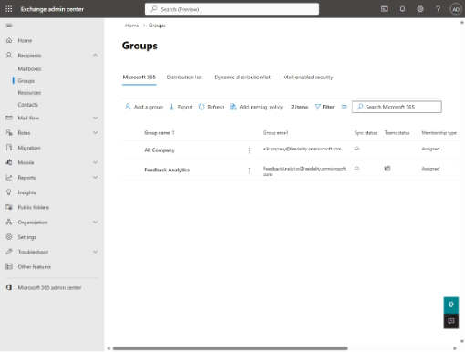

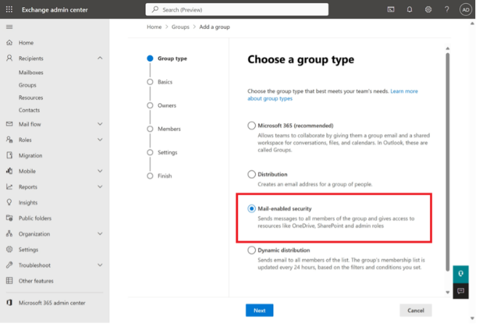

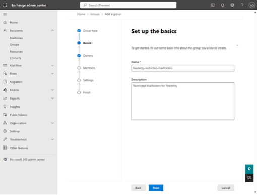

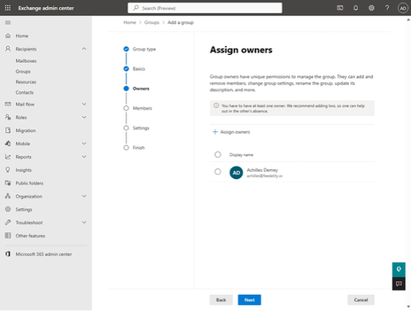

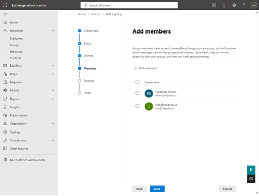

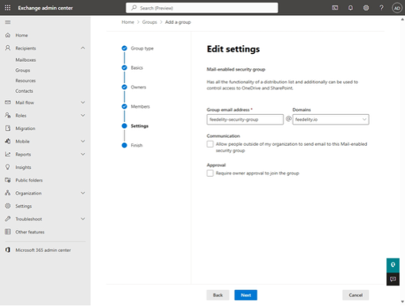

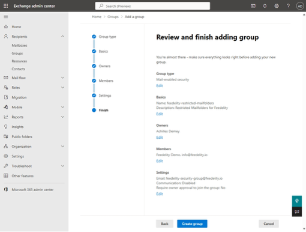

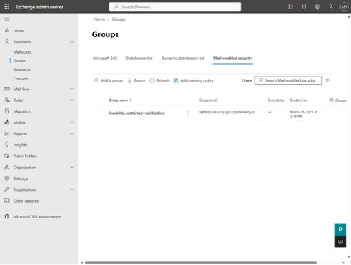
