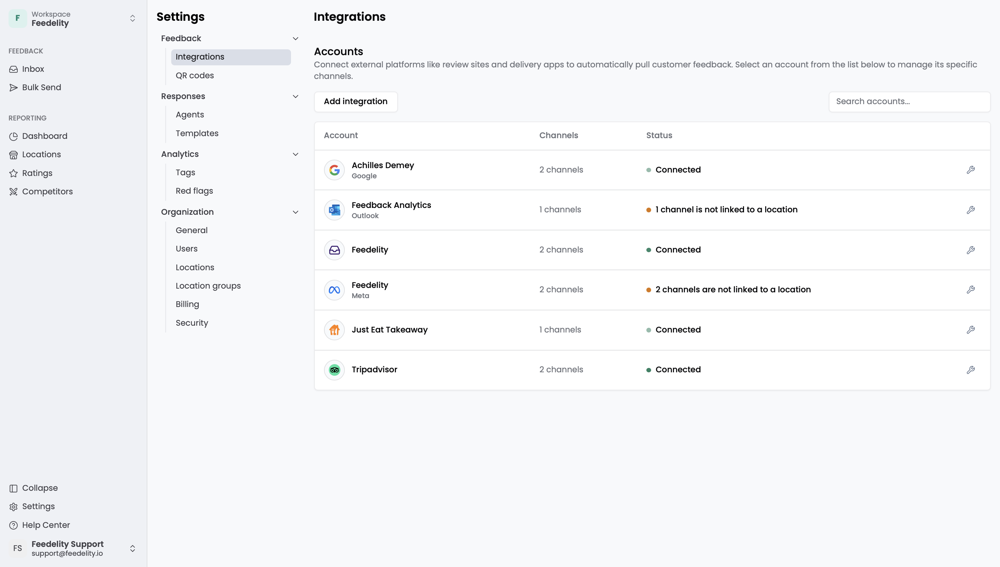
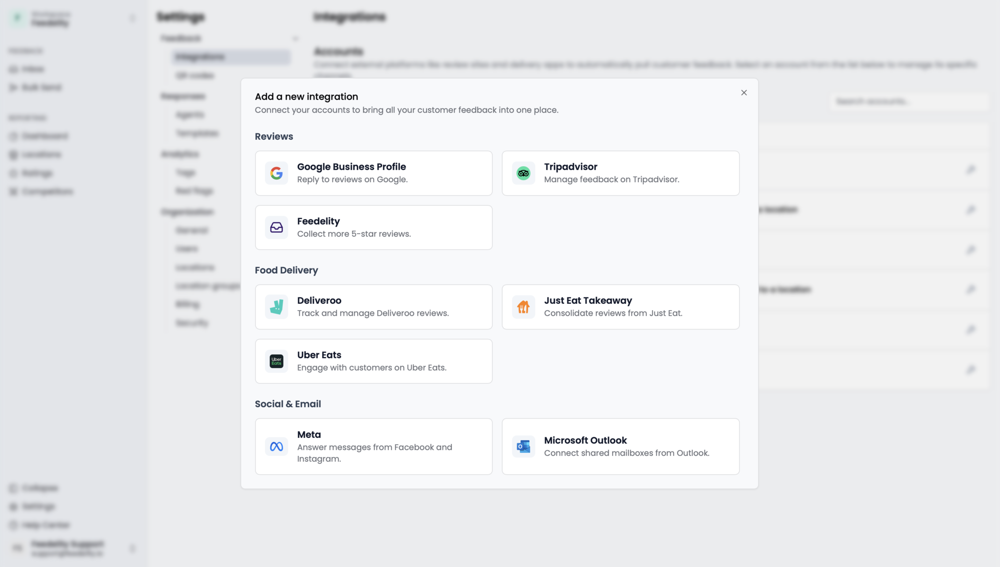
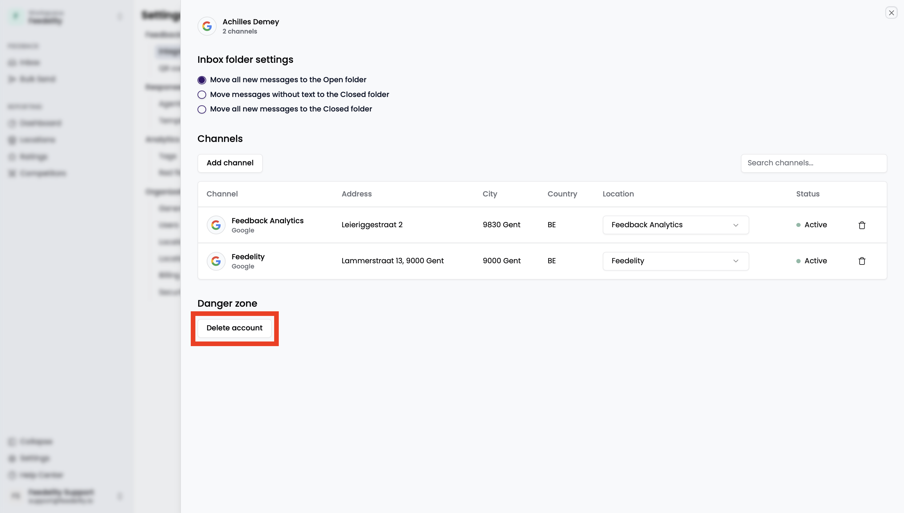
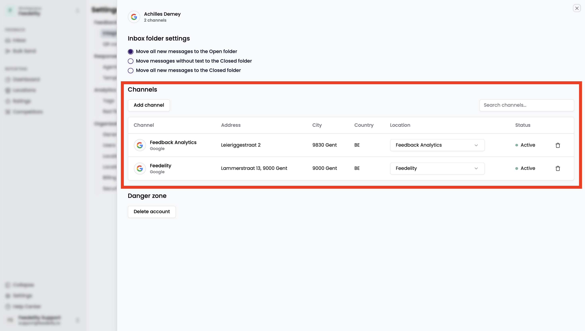
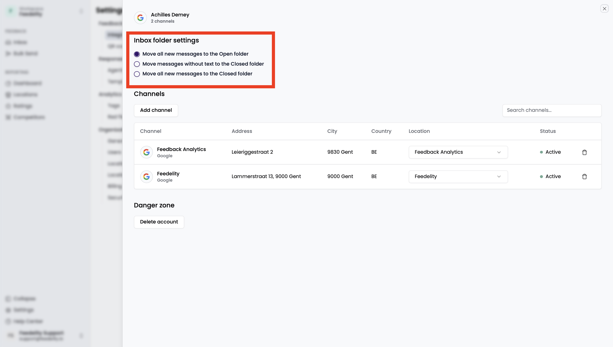
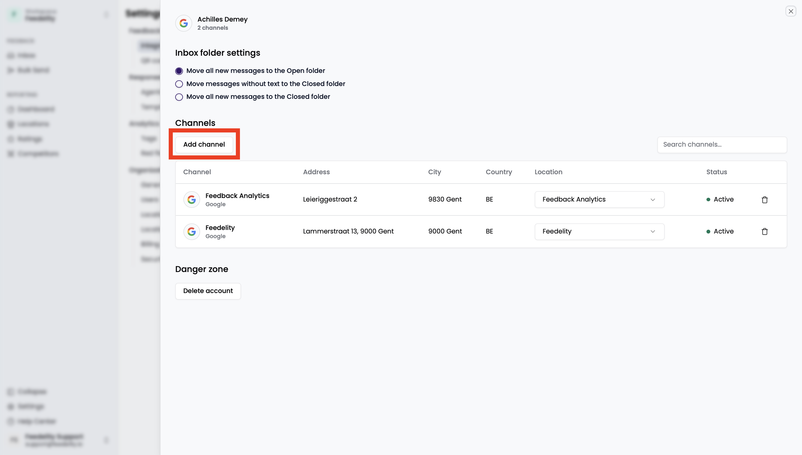
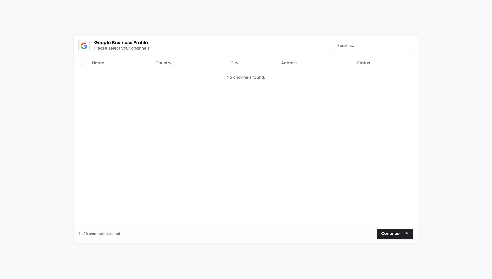
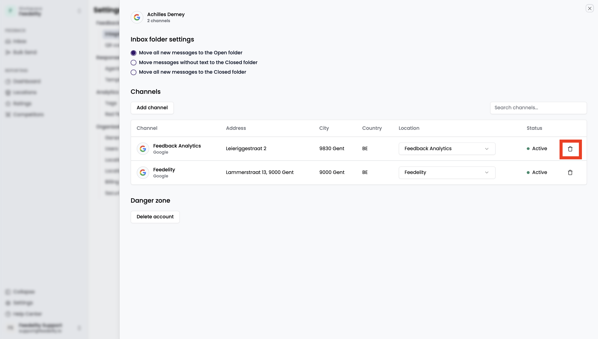

**Integrations** connect external platforms to Feedelity, so all your customer feedback flows directly into the Feedelity inbox.

Integrations are essential for gathering customer feedback. The more integrations you add, the more volume and variety of feedback you get, and the more complete your insights become.

## Manage integrations

### Add a new integration

<Steps>
  <Step title="Add an integration">
    Click **Add integration**.
  </Step>
  <Step title="Choose a platform">
    Select the platform you want to add.
  </Step>
  <Step title="Complete the setup">
    Follow the on-screen instructions. Each integration has its own setup flow, tailored to the external platform. Each platform has its own guide in the **Integrations** section.
  </Step>
</Steps>

### Delete an integration

<Steps>
  <Step title="Open the integration">
    Select the integration you want to remove.
  </Step>
  <Step title="Delete it">
    Click **Delete account**.
  </Step>
  <Step title="Confirm">
    A confirmation pop-up appears. Click **OK** to delete the integration.
  </Step>
</Steps>

## Link an integration channel to a location

Use the dropdown menu to link an integration channel to a location.

If you synced your Google locations when you first signed up, Feedelity created your locations automatically from your Google data. If you have no locations, create them manually under **Settings** > **Locations**.

Linking a channel to a location is optional. For example, you typically wouldn't link a shared mailbox, but you might link a dedicated location to feedback from a Facebook page.

## Integration-specific settings

Each integration has its own settings. Click an integration to open them. Use these settings to decide the status of each incoming case from that source.

## Manage channels

### Add a new channel

<Steps>
  <Step title="Open the integration">
    Select the integration where you want to add a channel.
  </Step>
  <Step title="Add a channel">
    Click **Add Channel**.
  </Step>
  <Step title="Select the channel">
    On the next screen, select the channel you want to add.
  </Step>
</Steps>

### Delete a channel

<Steps>
  <Step title="Click the trash can">
    Click the trash can icon of the channel you want to delete.
  </Step>
  <Step title="Confirm">
    A pop-up asks if you're sure. Click **OK** to remove the channel.
  </Step>
</Steps>

