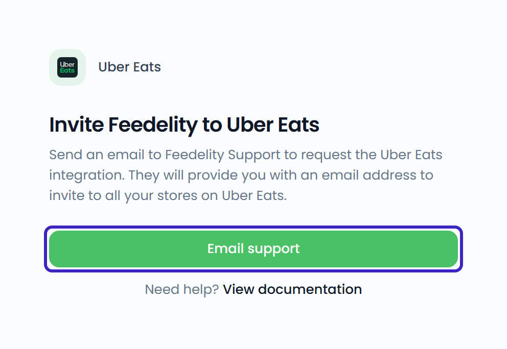
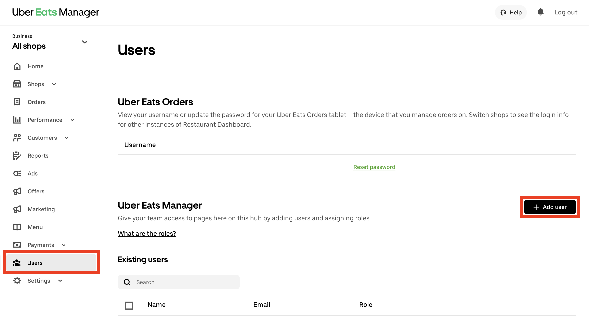
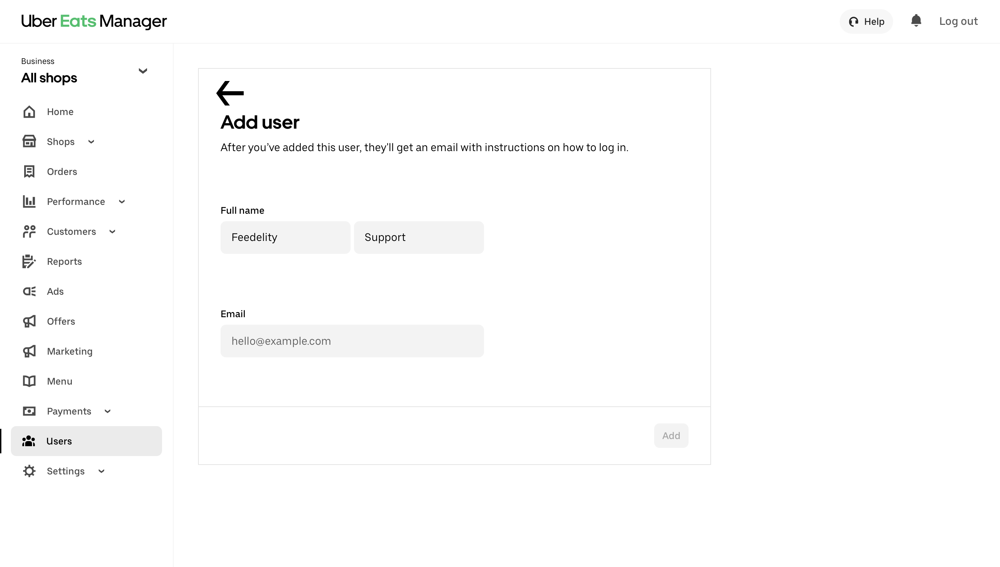

Connecting Uber Eats works a little differently from the other integrations. Our support team sets it up with you.

<Steps>
  <Step title="Email our support team">
    Go to **Settings** > **Integrations**, click **Add integration**, and choose **Uber Eats**. On **Invite Feedelity to Uber Eats**, click **Email support**. This opens a pre-filled email to [support@feedelity.io](mailto:support@feedelity.io).

    {/* SCREENSHOT: /integrations/accounts/new/6 — the "Invite Feedelity to Uber Eats" page with the Email support button */}
    <Frame>
      
    </Frame>
  </Step>
  <Step title="Get your Feedelity email address">
    Our support team sends you a dedicated Feedelity email address for your organization.
  </Step>
  <Step title="Add the email to your Uber Eats stores">
    Add the Feedelity email address as a user to all your stores in Uber Eats Manager. The type of user doesn't matter.

    - If you manage many stores, ask your Uber Eats account manager to add the email address to all of them for you.
    - Or add it to each store yourself.

    

    
  </Step>
  <Step title="Wait for activation">
    Accepting the invitation can take up to 24 hours. We let you know when it's done. The Uber Eats integration then appears under **Settings** > **Integrations**.
  </Step>
  <Step title="Select your restaurants">
    Open the Uber Eats integration and click **Add channel**. On **Select your restaurants**, select the restaurants you want and click **Continue**. If a restaurant has no location yet, link it on **Link your locations** and click **Finish**.

    {/* SCREENSHOT: /integrations/accounts/{id}/channels/new — "Select your restaurants" for Uber Eats with a few restaurants ticked */}
  </Step>
</Steps>

## Order details

Each Uber Eats review shows the order the customer placed: the order number, the total, and the items they ordered. See [Order details](/inbox/order-details).

## Replying to Uber Eats reviews

- You can reply to a review within 14 days after it's posted.
- A reply can be up to 600 characters.
- You can't edit a reply after you send it.
- You can add credit to your reply. See [Add credit to a reply](/inbox/credit).
- You can reply to many Uber Eats reviews at once with [Bulk Send](/inbox/bulk-actions).

Need help along the way? Contact our support team at [support@feedelity.io](mailto:support@feedelity.io).
