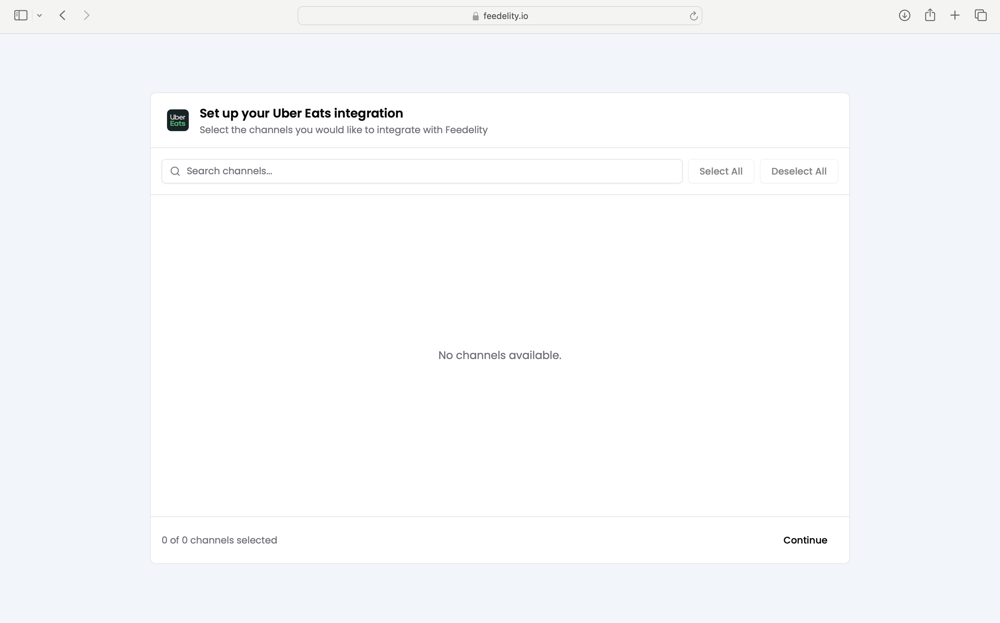

Connecting Uber Eats works a little differently from the other integrations. Follow the steps below to get started.

<Steps>
  <Step title="Email our support team">
    Send an email to [support@feedelity.io](mailto:support@feedelity.io) to request the Uber Eats integration.

    You can copy and paste this template:

    ```text
    Subject: Uber Eats Integration Request

    Hi Feedelity Support,
    I would like to request the Uber Eats integration for my organization [Your Organization Name]
    ```
  </Step>
  <Step title="We create a dedicated email address">
    Once we receive your request, we create a dedicated Feedelity email address for your organization.
  </Step>
  <Step title="Add the email to your Uber Eats locations">
    Add the dedicated Feedelity email as a user to your Uber Eats account. The type of user doesn't matter.

    - If you manage multiple restaurant locations, ask your Uber Eats account manager to add the email address to all locations for you.
    - Or add it to each location yourself.

    

    
  </Step>
  <Step title="Integration activation">
    Once the email is added to your Uber Eats locations, the integration activates automatically in Feedelity within 24 hours. You can then select which Uber Eats locations to add in Feedelity.

    
  </Step>
</Steps>

Need help along the way? Contact our support team at [support@feedelity.io](mailto:support@feedelity.io).
