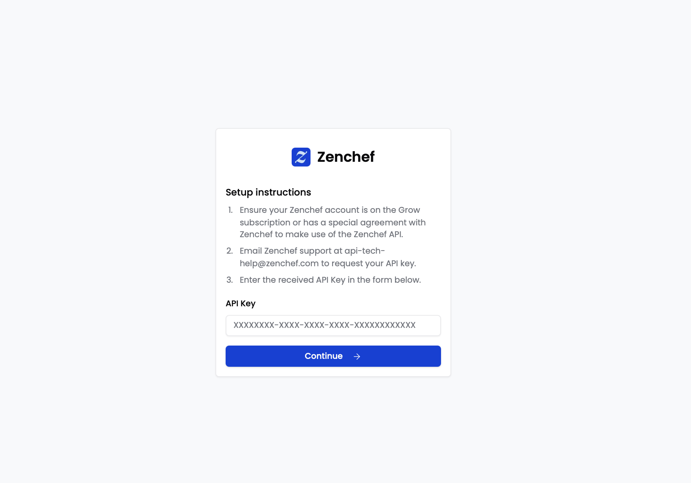
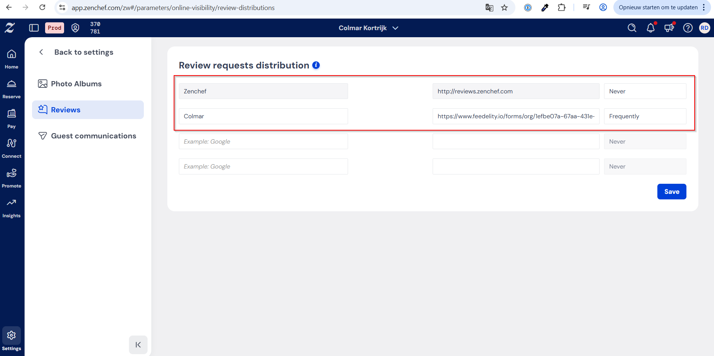

To connect Zenchef to Feedelity, you need your Zenchef API key. The API key is available to all Zenchef users on the Grow subscription plan, or with a special agreement with Zenchef to use the Zenchef API.

To get your API key, contact Zenchef Support at [api-tech-help@zenchef.com](mailto:api-tech-help@zenchef.com). Once you have it, paste it into the designated field in Feedelity.

## Ask for reviews with Feedelity's smart QR code URL

Whenever a guest books through Zenchef, they automatically receive a follow-up email after their visit asking about their experience. This is the perfect moment to request a review.

You have two options:

1. **Collect a Zenchef review** directly.
2. **Redirect guests to Feedelity's smart QR code URL**, which filters feedback intelligently. Happy guests go straight to Google to leave a public review. Unhappy guests are routed internally, so you can address their concerns privately.

To set this up, go to **Settings** > **Reviews** > **Review Distribution** in Zenchef ([open in Zenchef](https://app.zenchef.com/zw#/parameters/online-visibility/review-distributions)) and add your Feedelity URL.

<Tip>
  This is one of the fastest ways to collect a high volume of positive reviews. It isn't limited to Zenchef: most other reservation systems offer the same option, so you can add your Feedelity URL to their post-visit feedback flow too. See [Collect more five-star reviews through your reservation system](/collecting-feedback/reservation-system).
</Tip>
