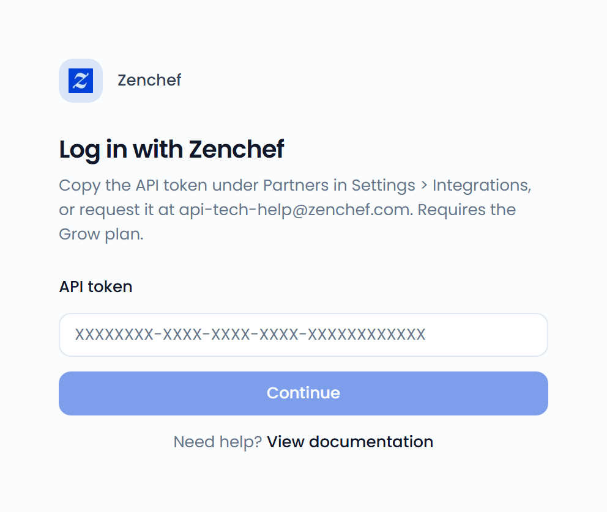

Connect Zenchef to bring your Zenchef reviews into the Feedelity inbox. This also covers reviews from Tablebooker, Formitable, and Resengo. You can reply to them from Feedelity.

## Connect Zenchef

To connect Zenchef, you need your Zenchef API token. It's available on the Zenchef Grow plan, or with a special agreement with Zenchef to use the Zenchef API.

<Steps>
  <Step title="Find your API token">
    In your Zenchef portal, go to **Settings** > **Integrations** and copy the API token under **Partners**. If you can't find it, ask Zenchef Support at [api-tech-help@zenchef.com](mailto:api-tech-help@zenchef.com).
  </Step>
  <Step title="Choose Zenchef">
    In Feedelity, go to **Settings** > **Integrations**, click **Add integration**, and choose **Zenchef**.
  </Step>
  <Step title="Enter your token">
    On **Log in with Zenchef**, paste the token into **API token** and click **Continue**.
  </Step>
  <Step title="Select your restaurants">
    On **Select your restaurants**, select the restaurants you want and click **Continue**. If a restaurant has no location yet, link it on **Link your locations** and click **Finish**.
  </Step>
</Steps>

{/* SCREENSHOT: /integrations/accounts/new/9 — the "Log in with Zenchef" form with the API token field */}
<Frame>
  
</Frame>

## Replying to Zenchef reviews

- A reply can be up to 2,000 characters.
- You can edit a reply after you send it.

## Ask for reviews with your Feedelity link

Whenever a guest books through Zenchef, they automatically receive a follow-up email after their visit asking about their experience. This is the perfect moment to request a review.

You have two options:

1. **Collect a Zenchef review** directly.
2. **Redirect guests to your Feedelity [QR code](/collecting-feedback/qr-codes) link**, which filters feedback intelligently. Happy guests go straight to Google to leave a public review. Unhappy guests are routed internally, so you can address their concerns privately.

To set this up, go to **Settings** > **Reviews** > **Review Distribution** in Zenchef ([open in Zenchef](https://app.zenchef.com/zw#/parameters/online-visibility/review-distributions)) and add your Feedelity URL.

<Tip>
  This is one of the fastest ways to collect a high volume of positive reviews. It isn't limited to Zenchef: most other reservation systems offer the same option, so you can add your Feedelity URL to their post-visit feedback flow too. See [Forms](/collecting-feedback/forms).
</Tip>
