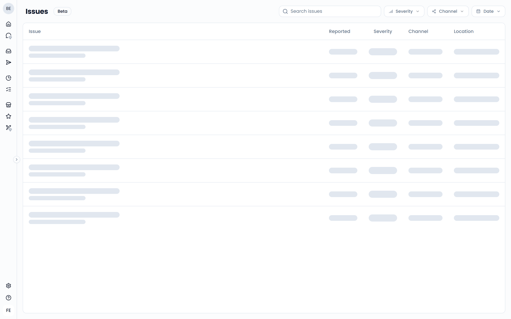

An issue is a specific problem a customer ran into that you can fix. Think of "Food served cold" or "Long wait for table". Feedelity finds issues in your feedback automatically and groups them into [tasks](/issues-and-tasks/tasks).

<Note>Issues is in beta.</Note>

## How Feedelity finds issues

When a new customer message with text arrives, Feedelity's AI reads it and pulls out every problem it mentions:

- One message can contain several issues, one, or none.
- Praise, questions, suggestions, and vague complaints without a clear cause are not issues.
- Automated emails, spam, and promotions are skipped.
- Ratings without text don't produce issues.

Each issue gets a short title and a neutral description of what happened. Titles and descriptions are always in English, whatever language the customer wrote in.

## Severity

Each issue gets a severity based on its real-world impact, not on how upset the customer sounds:

| Severity | Meaning |
| --- | --- |
| **Critical** | A risk to someone's safety, health, or security, or a legal risk for your business |
| **High** | The customer lost something, such as a wrong or missing order, an incorrect charge, or a failed booking |
| **Medium** | A service failure that affected the visit but caused no lasting loss, such as a long wait or unhelpful staff |
| **Low** | A minor comfort, preference, or quality problem |

## View your issues

To open the issues list, go to **Tasks** and click **View all issues** at the bottom of the list.

{/* SCREENSHOT: /issues — the issues list with the filters and the Issue, Reported, Severity, Channel, and Location columns */}

The list shows each issue with:

- **Issue**: the title and description
- **Reported**: when the customer sent the feedback. Hover over it to see the exact date and time.
- **Severity**
- **Channel**: where the feedback came from
- **Location**

Click **Load more** at the bottom to see more issues.

## Filter and search

Use the controls at the top to narrow the list:

- **Search issues**: search by text
- **Severity**
- **Location**: pick locations or location groups
- **Channel**
- **Date**: the period in which the feedback was sent

## Open the original feedback

Click an issue to open its case in the [Inbox](/inbox/overview), in a new tab. From there you can read the full message and reply to the customer.
