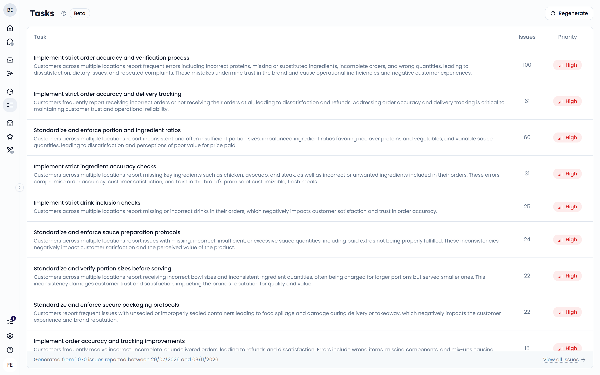
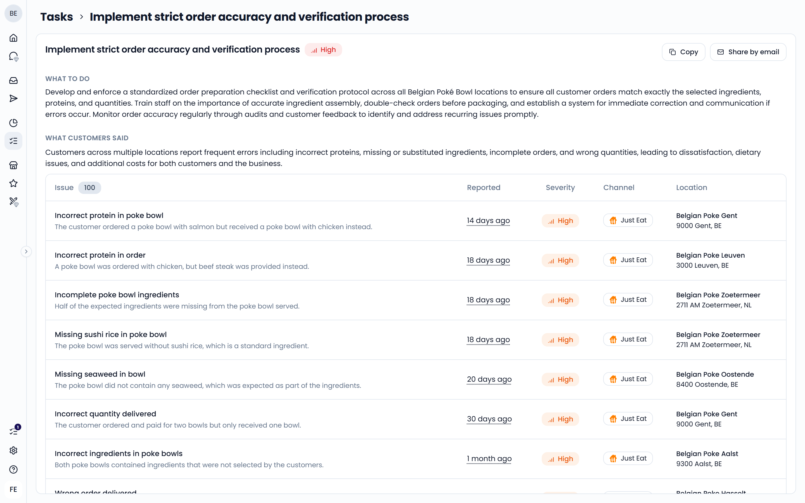

**Tasks** turns your feedback into a prioritized to-do list, so you know what to fix first. Each task is a concrete action, such as "Add checkout staffing at peak hours", based on problems your customers reported.

Open it from the sidebar under **Reporting** > **Tasks**.

<Note>Tasks is in beta.</Note>

{/* SCREENSHOT: /tasks — the task list with the Task, Issues, and Priority columns and the "Generated from … issues" footer */}

## How tasks are generated

Tasks are built from your [issues](/issues-and-tasks/issues):

1. Feedelity collects the issues reported in the selected period and locations.
2. It groups issues that describe the same underlying problem.
3. It turns each group into one task. The largest groups come first, up to 15 tasks.

Tasks are generated fresh each time you open the page. This takes a few seconds. Tasks are written in English.

By default, **Tasks** covers the last 30 days and all the locations you have access to.

## Priority

Each task gets a priority: **Critical**, **High**, **Medium**, or **Low**. The priority is the average [severity](/issues-and-tasks/issues#severity) of the issues behind the task.

The list is sorted by priority first. Tasks with the same priority are sorted by the number of issues behind them.

## The task list

Each row shows:

- **Task**: the title and why it matters
- **Issues**: how many issues the task is based on
- **Priority**

At the bottom, you see how many issues the tasks are based on and the period they were reported in. Click **View all issues** to see them in the [issues list](/issues-and-tasks/issues).

## Change the period or locations

<Steps>
  <Step title="Open the options">
    Click **Regenerate** in the top right.
  </Step>
  <Step title="Choose your selection">
    Pick the locations or location groups and the date range.
  </Step>
  <Step title="Regenerate">
    Click **Regenerate**. Feedelity builds a new list for your selection.
  </Step>
</Steps>

If no issues were reported for your selection, you see "No tasks right now".

## Open a task

Click a task to see its details:

- **What to do**: the concrete action to take
- **What customers said**: why it matters, and the list of issues behind the task. Click an issue to open its case in the [Inbox](/inbox/overview).

{/* SCREENSHOT: /tasks — an open task with the priority badge, Copy and Share by email buttons, What to do, and What customers said */}

## Share a task

Use the buttons at the top of an open task to pass it on to a manager or your team:

- **Copy**: copy the task's title, priority, action, and reason to your clipboard
- **Share by email**: open a new email with the task filled in

Feedelity doesn't track whether a task is done. Use your own to-do list or share the task with the person responsible.
