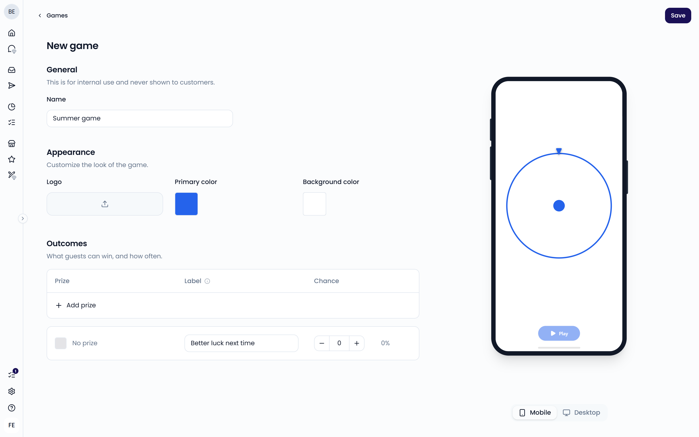
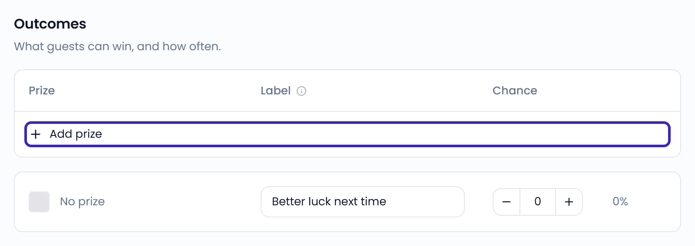

<iframe className="w-full aspect-video rounded-xl" src="https://www.youtube.com/embed/_lJ2T8LkYQQ" title="Spin-to-win game" frameBorder="0" allow="accelerometer; autoplay; clipboard-write; encrypted-media; gyroscope; picture-in-picture" allowFullScreen></iframe>

A game is a fun way to reward guests after they leave a review. Guests scan a QR code, leave a Google review, and spin a wheel. If they win, they get one of your [offers](/loyalty/offers) as a voucher by email.

Guests often only leave a review when something went wrong. A game gives your happy guests a reason to leave one too. The voucher then gives them a reason to come back.

{/* TODO: confirm marketing claims before re-adding them (old page said "12x more five-star reviews" and "about 1 in 20 guests redeem their voucher") */}

<Note>
  Loyalty (games, offers, and vouchers) is included in the trial and the Standard plan. On the Enterprise plan, it's an add-on. If your plan doesn't include it, **Games**, **Offers**, and **Vouchers** are grayed out in **Settings** with a lock and an **Add-on** label. Contact your account manager to add it.
</Note>

## What your guests see

[Watch this video](https://www.youtube.com/shorts/KpMaPBa3U5M) to see the game from a guest's point of view.

<Steps>
  <Step title="Scan and pick the location">
    The guest scans your QR code. If the game covers several locations, they pick the location they visited.
  </Step>
  <Step title="Leave a Google review">
    The guest taps **Write review** to open your Google listing in a new tab. A reminder asks them to come back to the game afterwards.
  </Step>
  <Step title="Enter an email">
    Back in the game, the guest enters an email address so the prize can reach them.
  </Step>
  <Step title="Spin the wheel">
    The guest taps **Play** to spin the wheel.
  </Step>
  <Step title="Win a voucher">
    If they win, they receive a [voucher](/loyalty/vouchers) by email with a unique code. If not, they see a thank-you message.
  </Step>
</Steps>

A guest can play the same game once every 24 hours with the same email address.

{/* SCREENSHOT: /play?game_id=<id> — the wheel on a phone, with the Play button */}

## Before you start

- Create at least one [offer](/loyalty/offers), or connect [Leat](/loyalty/leat) to use your Leat promotions. Offers are the prizes on your wheel.
- Connect [Google](/integrations/google) and link it to your locations. The game sends guests to the Google listing of their location. Without an active Google channel, guests see a message that the game isn't available.
- Add the rewards to your POS system and tell your team how guests redeem them.

## Create a game

<Steps>
  <Step title="Open Games">
    Go to **Settings** > **Games**, in the **Loyalty** section, and click **New game**.
  </Step>
  <Step title="Name the game">
    Under **General**, enter a **Name**. Guests never see it.
  </Step>
  <Step title="Style the game">
    Under **Appearance**, upload your **Logo** and set the **Primary color** and **Background color**. The preview shows how the game looks.
  </Step>
  <Step title="Add prizes">
    Under **Outcomes**, click **Add prize** and choose one of your offers. Use **Search offers** to find an offer by name. To create a new offer on the spot, choose **New prize**.
  </Step>
  <Step title="Save">
    Click **Save**.
  </Step>
</Steps>

{/* SCREENSHOT: /settings/games/<id> — the game editor with General, Appearance, Outcomes, and the preview */}

### Outcomes

Each outcome is a slice of the wheel. For each outcome, you set:

- **Prize**: the offer the guest wins, or **No prize**
- **Label**: optional text shown on the wheel. Leave it empty to show no text.
- **Color**: the color of the slice
- **Chance**: how often the outcome comes up. Use **Less often** and **More often** to adjust it. Feedelity shows the chance as a percentage.

The **No prize** outcome shows "Better luck next time" by default. Set its chance to 0% if every guest should win something.

A game needs at least one prize. **Add prize** only lists active offers. When you deactivate an offer that is already a prize, the game skips it when the wheel is spun. See [Activate or deactivate an offer](/loyalty/offers#activate-or-deactivate-an-offer).

Guests who win a prize receive the voucher email of that offer. You don't edit the email in the game. Go to **Settings** > **Offers**, open the offer, and click **Edit email**. The email is the same in every game that uses the offer. See [Customize the voucher email](/loyalty/offers#customize-the-voucher-email).

{/* SCREENSHOT: /settings/games/<id> — the Outcomes table, highlight the Chance column and Add prize */}
<Frame>
  
</Frame>

## Share your game

On the **Games** page, click **Share** next to a game. Choose how guests reach the game:

- **All locations**: one QR code for all your locations. Guests choose their location first. Use it on your website, social media, and print.
- **Specific location**: one QR code per location. Guests skip the choice and start right away.

Click **Download QR** to save the QR code, or **Copy link** to copy the game link.

{/* SCREENSHOT: /settings/games — the Share your game dialog with All locations and Specific location */}

We recommend printing the QR code on flyers in takeaway or delivery bags, and on plaques on your tables. Design a visual with:

- A picture of a prize wheel
- The QR code
- Your logo and brand colors
- An inviting message, such as "Love your experience? Let us know and spin to win!"
- A short explanation: "1. Scan the QR code 2. Leave a review 3. Come back to spin the wheel and win a reward"

## Choose good rewards

Good rewards are the cheaper items on your menu, such as a drink, a small dessert, or ice cream. You can also offer a discount, for example €2 off a minimum spend of €20.

State the conditions in the offer description, such as how long the voucher is valid. Feedelity doesn't track expiry dates or redemptions, so your team checks the conditions at the counter or in your POS.

<Warning>
  Before you launch a game, add the rewards to your POS system. This way, you and your staff can record redemptions properly.
</Warning>

## Delete a game

Open the game, click **⋯**, and choose **Delete game**. Your offers stay in place, and vouchers that guests already won remain valid.

## Is the game allowed under Google's policy?

Google's policy prohibits offering rewards *in exchange for a review*. In the game, the reward is tied to **spinning the wheel**, not to leaving a review or to the number of stars. Feedelity doesn't check whether a guest posted a review, or what rating they gave. Every guest who plays has the same chance at each prize.

{/* TODO: confirm with legal/product that this policy statement is still accurate */}
