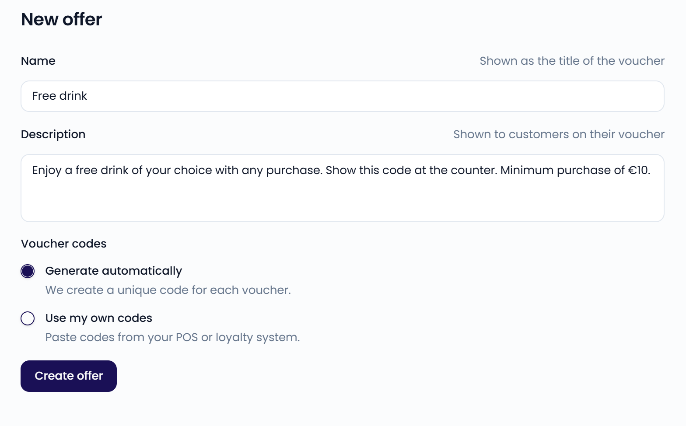

An offer is a reward you set up once, like a free coffee. Each guest who receives it gets a [voucher](/loyalty/vouchers) with a unique code to redeem with you. Offers are the prizes in your [games](/loyalty/games).

You create Feedelity offers in Feedelity. If you use a loyalty platform such as Leat, your promotions from that platform appear as offers too. See [Leat promotions](/loyalty/leat).

Go to **Settings** > **Offers**, in the **Loyalty** section, to manage your offers.

<Note>
  Loyalty (games, offers, and vouchers) is included in the trial and the Standard plan. On the Enterprise plan, it's an add-on. If your plan doesn't include it, **Games**, **Offers**, and **Vouchers** are grayed out in **Settings** with a lock and an **Add-on** label. Contact your account manager to add it.
</Note>

{/* SCREENSHOT: /settings/offers — the offers list, showing a Feedelity offer and a Leat promotion with their status */}

## The offers list

Each offer in the list shows:

- **Platform**: the icon of the platform the offer comes from, with **Feedelity offer** or **Leat promotion** under the name.
- **Status**: **Active** or **Inactive**. Guests can only receive vouchers for active offers. See [Activate or deactivate an offer](#activate-or-deactivate-an-offer).
- **Code warning**: for offers with your own codes, **Low on codes** when 10 or fewer codes are left, or **Out of codes** when none are left. The warning shows next to the status.

Use **Search offers** to find an offer by name. Click an offer to open it.

## Create an offer

<Steps>
  <Step title="Start a new offer">
    Go to **Settings** > **Offers** and click **New offer**. The **New Feedelity offer** page opens.
  </Step>
  <Step title="Name and describe the offer">
    Enter a **Name**, shown as the title of the voucher. Enter a **Description**, shown to guests on their voucher.
  </Step>
  <Step title="Choose where the codes come from">
    Under **Voucher codes**, choose **Generate automatically** or **Use my own codes**. See [Voucher codes](#voucher-codes).
  </Step>
  <Step title="Create the offer">
    Click **Create offer**.
  </Step>
</Steps>

Put everything the guest needs to know in the description: what they get, any minimum spend, how long the voucher is valid, and how to redeem it. For example: "Enjoy a free drink of your choice with any purchase. Show this code at the counter. Minimum purchase of €10."

New offers are active right away.

{/* SCREENSHOT: /settings/offers/new — the new offer form with both code options */}
<Frame>
  
</Frame>

## Voucher codes

Every voucher comes with a code the guest shows at checkout to redeem it. You choose where the codes come from:

- **Generate automatically**: Feedelity creates a unique code for every voucher. You find every code on the [Vouchers](/loyalty/vouchers) page.
- **Use my own codes**: paste codes from your POS or loyalty system, one per line. Feedelity takes the next available code for each voucher, so a code is never used twice.

On the offer page, the **Voucher codes** section shows which option the offer uses. For automatically generated codes, a banner confirms that Feedelity creates the codes. For your own codes, the section lists your codes.

### Switch how codes are made

You can change the option after you create the offer:

<Steps>
  <Step title="Edit the offer">
    Open the offer, click **⋯**, and choose **Edit offer**.
  </Step>
  <Step title="Choose the new option">
    Under **Voucher codes**, choose **Generate automatically** or **Use my own codes**.
  </Step>
  <Step title="Save">
    Click **Save changes**.
  </Step>
</Steps>

The switch only applies to new vouchers. Vouchers you already issued keep their code.

- **From your own codes to automatic**: your unused codes are kept. When you switch back, Feedelity uses them again.
- **From automatic to your own codes**: if you have no unused codes yet, the offer page shows **Add your own codes**. Guests can't receive vouchers for this offer until you add codes.

### Manage your own codes

For offers with your own codes, the **Voucher codes** section lists every code with its status: **Available** or **Issued**. Click an issued code to view its voucher. Under the list, you see how many codes are still available, for example "12 of 50 codes available".

- **Search codes**: find a code in the list.
- **Add codes**: paste more codes, one per line. You can add up to 5,000 codes at a time. Feedelity skips duplicates and codes the offer already has.
- **Export**: download the codes.

When an offer has no codes at all, the section shows **Add your own codes** with an **Add codes** button.

{/* TODO: confirm what a guest sees when they win an offer that has no codes left */}

{/* SCREENSHOT: /settings/offers/<id> — offer page with the Voucher codes section and the code list */}

## Warnings on the offer page

The offer page shows a banner at the top when guests can no longer receive vouchers, or soon won't. Every banner that applies is shown, with the inactive warning first:

- **Inactive**: "This offer is inactive and customers can no longer receive vouchers for this offer." Choose **Activate offer** in the **⋯** menu to make vouchers available again.
- **Out of codes**: all your own codes are used. Add more codes to make vouchers available again.
- **Almost out of codes**: 10 or fewer of your own codes are left. Add more codes so guests can keep receiving vouchers.

When an active offer is running low on codes or has none left, admins also see a reminder on the [Home](/home#loyalty) page.

## Activate or deactivate an offer

Deactivate an offer to stop giving it out, for example when a promotion ends. You can activate it again at any time.

<Steps>
  <Step title="Open the menu">
    Open the offer and click **⋯**.
  </Step>
  <Step title="Change the status">
    Choose **Deactivate offer** or **Activate offer**.
  </Step>
  <Step title="Confirm">
    Click **Deactivate** or **Activate** to confirm.
  </Step>
</Steps>

When an offer is inactive:

- Guests can no longer receive vouchers for it. Games skip it when the wheel is spun.
- You can't add it as a prize to a game.
- Vouchers already sent to guests remain valid.

## Customize the voucher email

Every guest who receives an offer gets an email with their personal code. Each offer has its own voucher email, so every game that uses the offer sends the same email. This also applies to [Leat promotions](/loyalty/leat).

You don't have to set anything up. Every new offer starts with a ready-made email: the subject is the name of the offer, and the body shows the name, the description, and the guest's code. The **Voucher email** section on the offer page shows a preview with an example code.

### Edit the email

<Steps>
  <Step title="Open the editor">
    Go to **Settings** > **Offers**, open the offer, and click **Edit email** in the **Voucher email** section.
  </Step>
  <Step title="Change the subject and body">
    Edit the **Subject** and the **Body**. The body is written in HTML. To keep the layout intact, change only the text between the tags.
  </Step>
  <Step title="Add placeholders">
    Click in the **Subject** or **Body** to show the placeholders, then click one to insert it where your cursor is. Hover over a placeholder to see **What it is** and **How to use it**.
  </Step>
  <Step title="Check and save">
    Click **Show preview** to see the result with an example code, then click **Save**.
  </Step>
</Steps>

These placeholders are filled in for every guest:

| Placeholder | What it is |
| --- | --- |
| **Name** | The name of your offer |
| **Description** | The description of your offer, with everything the guest gets. Use it in the body only. |
| **Code** | The guest's voucher code. In the body, you can also use it in a link. |
| **QR code** | The guest's voucher code as a QR code image. Use it in the body only. |

If a placeholder is written incorrectly, the editor shows a warning and **Save** stays disabled until you fix it. If you close the editor with unsaved changes, Feedelity asks **Discard changes?** first. Click **Keep editing** to go back to your changes.

{/* SCREENSHOT: /settings/offers/<id> — the Email template dialog with placeholders and preview */}

## Edit or delete an offer

The **Details** section of the offer page shows the **Name** and **Description**. To change them, open the offer, click **⋯**, and choose **Edit offer**. Change the details and click **Save changes**.

To delete the offer, click **⋯** and choose **Delete offer**. This permanently removes the offer and its codes. You can't delete an offer once vouchers have been issued for it. Deactivate it instead.
